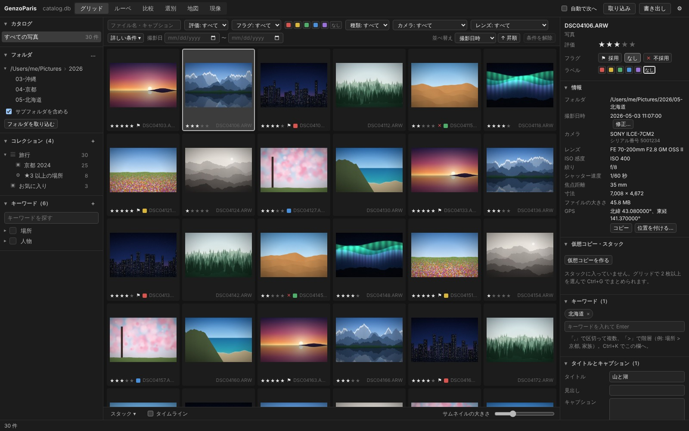
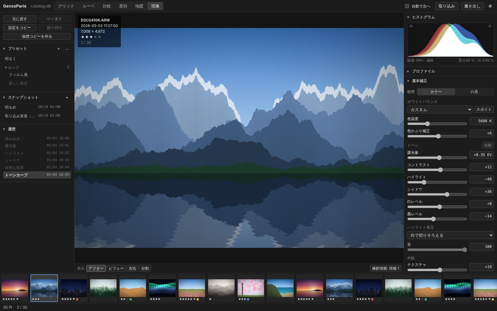
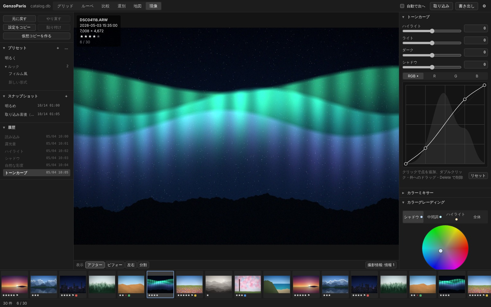
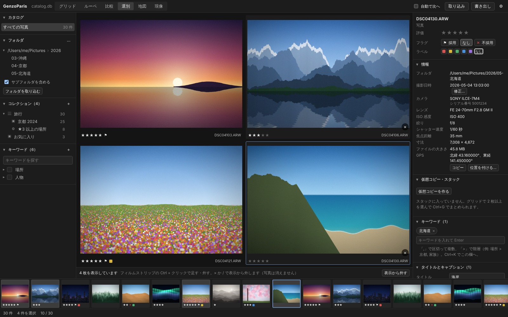
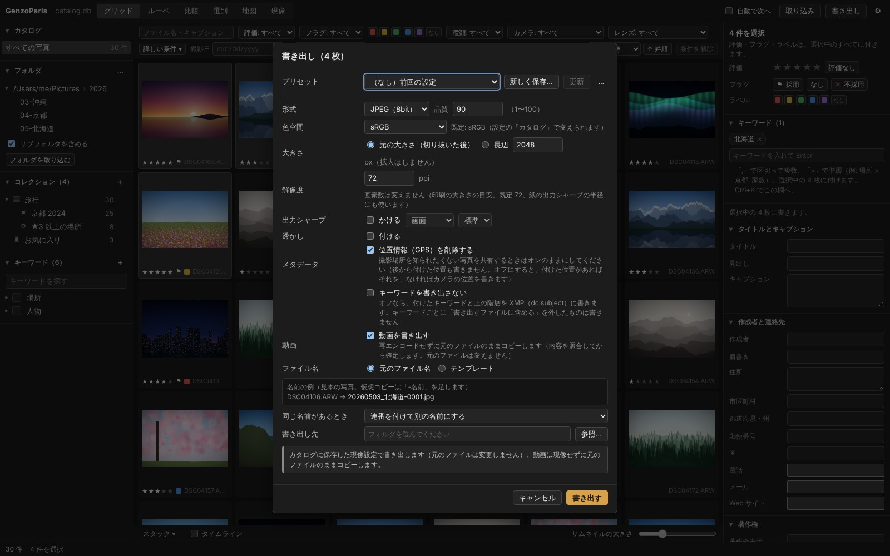
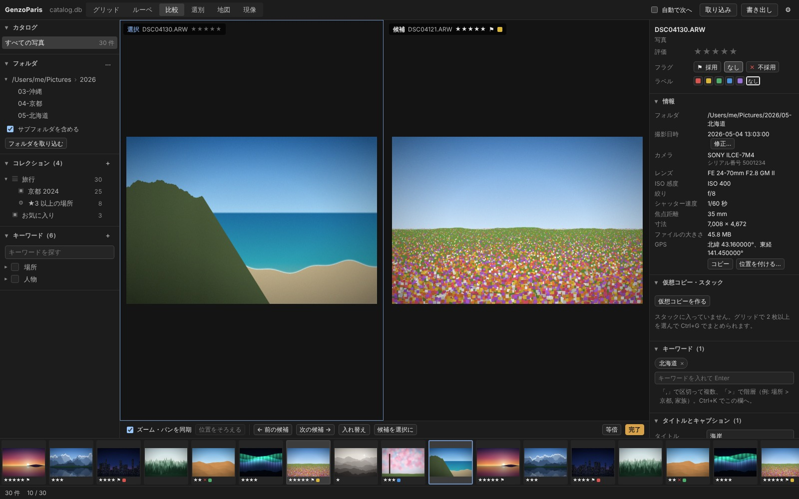
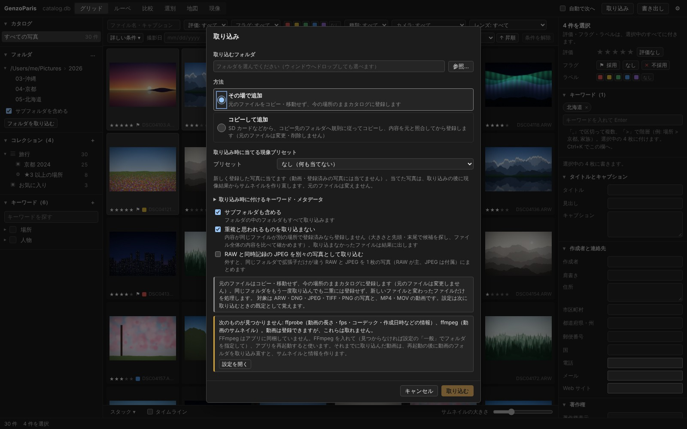
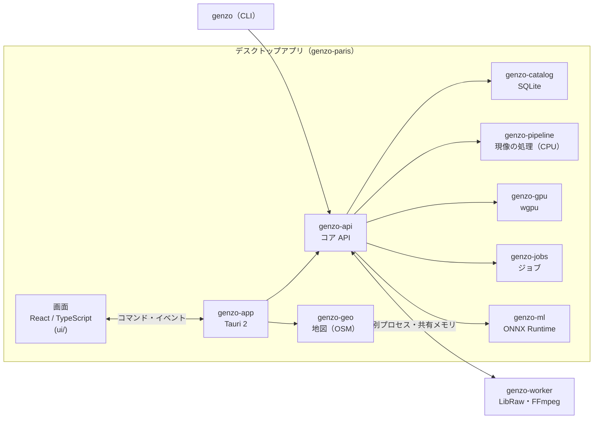

<p align="center">
  
</p>

<h1 align="center">GenzoParis</h1>

<p align="center">
  RAW 現像・非破壊編集と、写真・動画のカタログ管理をひとつにまとめた、Windows / macOS 向けのデスクトップアプリ
</p>

<p align="center">
  <a href="#主な機能">主な機能</a> ·
  <a href="#画面">画面</a> ·
  <a href="#はじめかた">はじめかた</a> ·
  <a href="#しくみ">しくみ</a> ·
  <a href="#ドキュメント">ドキュメント</a> ·
  <a href="#ライセンス">ライセンス</a>
</p>



Lightroom Classic のような「取り込み → 選別・整理 → 現像 → 書き出し」の流れを、1 人 1 つのカタログ（SQLite）で行います。元のファイルは変更せず、現像の設定はカタログに保存します（非破壊編集）。写真と動画を同じカタログで扱い、撮影日時の補正・位置情報の後付け・タイムラインなど、自作ならではの整理の機能も入れています。

> [!NOTE]
> **開発中です。** MVP（ロードマップの M5）と v1 の機能を実装し、Linux での E2E と GitHub Actions での配布物の作成までを確かめた段階です。**Windows / macOS の実機での確認と、性能・画質の計測（PoC）はこれから** で、実写での画質も未確認の項目があります。進捗と人の確認待ちの事項は [docs/implementation_status.md](docs/implementation_status.md) を見てください。

## 主な機能

### 取り込み

- **その場で追加** と、SD カードなどからの **コピー取り込み**（日付別フォルダなどの規則・リネームのテンプレート）
- 対象は ARW・DNG・JPEG・TIFF・PNG の写真と、MP4・MOV の動画。RAW は埋め込みの JPEG で、取り込んだ直後からサムネイルを表示
- **重複の検出**（ファイルの内容のハッシュ）、**RAW + JPEG の組** を 1 枚として扱う
- 取り込み時に **キーワード・メタデータ・現像プリセット** をまとめて付ける

### ライブラリ（閲覧・選別・整理）

- 仮想スクロールのグリッド、ルーペ（等倍表示・撮影情報の重ね表示）
- **比較表示**（2 枚の同期ズーム）と **選別表示**（複数枚を並べる）
- ★0〜5・採用 / 不採用・カラーラベルをキーボードで付け、自動で次の写真へ
- 評価・フラグ・ラベル・日付・カメラ・レンズ・種類・テキストでの **絞り込み** と並べ替え
- **階層キーワード**（「場所 > 京都」）、**コレクション** と **スマートコレクション**（条件で自動更新）
- **スタック**（連写などをまとめる）と **仮想コピー**（1 つの元ファイルに別の現像設定）
- タイトル・キャプション・作成者・著作権などの **メタデータの編集**
- 写真と動画の **統合タイムライン**（撮影日・イベントごとの見出し）、機材ごとの **撮影日時の一括修正**
- **位置情報の後付け**（座標の貼り付け、または OpenStreetMap の地図）と、写真を撮影地に並べる **地図表示**（オンラインの地図は既定で無効）

### 現像（非破壊）

| 分類 | できること |
|---|---|
| 基本補正 | ホワイトバランス（スポイト）、露光量・コントラスト、ハイライト・シャドウ・白レベル・黒レベル、**自動補正**、ハイライト復元 |
| トーン・色 | トーンカーブ（パラメトリック・ポイント・RGB 別）、自然な彩度・彩度、カラーミキサー（HSL）、カラーグレーディング、白黒 |
| 外観・ディテール | テクスチャ・明瞭度・かすみの除去、シャープ、ノイズ軽減、周辺光量補正（効果）・粒子 |
| 形・レンズ | 切り抜き・角度補正、変形（Upright 相当の自動・手動の遠近補正）、レンズ補正（RAW に埋め込まれた補正の情報と手動の補正。歪曲・周辺減光・色収差） |
| 部分補正 | マスク（ブラシ・線形・円形）、範囲マスク（色域・輝度）、**AI マスク**（被写体・空・人物。ONNX Runtime。配布物に同梱するのは被写体・人物のモデル）、スポット修正（修復・コピースタンプ） |
| プロファイル | カメラプロファイル（DCP）、ルック（3D LUT の `.cube`） |
| 作業 | ヒストグラムと白飛び・黒つぶれの表示、ビフォー / アフター（左右・分割）、履歴と取り消し / やり直し、スナップショット、現像プリセット、設定のコピー＆ペースト・一括適用 |
| 合成 | 比較明・比較暗合成（三脚で撮った複数枚を 1 枚に） |

プレビューは GPU（wgpu。Windows は Direct3D 12 / Vulkan、macOS は Metal）で描き、CPU 版（基準の実装）との一致をテストで確かめています。画面の表示はモニターの ICC プロファイルに合わせてカラーマネジメントします。

### 書き出し・ファイル管理・安全性

- JPEG・TIFF（16 bit）・PNG（8 / 16 bit）で書き出し。大きさ・品質・色空間（sRGB / Display P3 / Adobe RGB）・出力シャープ・**透かし**・ファイル名のテンプレート・**書き出しプリセット**
- **位置情報（GPS）の削除** など、書き出すメタデータを選べる。動画は再エンコードせず元のファイルのままコピー
- アプリの中でのフォルダ・ファイルの移動・名前の変更（カタログと整合させる）、外付けドライブの識別、**見つからない写真の検出と再リンク**
- カタログの自動バックアップと復元、起動時の整合性の確認、ログ・クラッシュレポート（外部には送信しない）
- カタログの構造は公開していて、外部のツールから SQL で読める（[docs/catalog_schema.md](docs/catalog_schema.md)）
- UI なしで登録・検索・現像・書き出し・計測などを行える検証用の CLI（`genzo`。[docs/cli.md](docs/cli.md)）

## 画面

<table>
  <tr>
    <td width="50%"></td>
    <td width="50%"></td>
  </tr>
  <tr>
    <td><b>現像</b> — ヒストグラム・基本補正。左はプリセット・スナップショット・履歴</td>
    <td><b>現像</b> — トーンカーブ（RGB 別）とカラーグレーディング</td>
  </tr>
  <tr>
    <td></td>
    <td></td>
  </tr>
  <tr>
    <td><b>選別表示</b> — 選んだ写真を並べて見比べる（<kbd>N</kbd>）</td>
    <td><b>書き出し</b> — 形式・色空間・大きさ・透かし・GPS の削除・プリセット</td>
  </tr>
  <tr>
    <td></td>
    <td></td>
  </tr>
  <tr>
    <td><b>比較表示</b> — 選択と候補の 2 枚を同期ズームで比べる（<kbd>C</kbd>）</td>
    <td><b>取り込み</b> — その場で追加 / コピーして追加、現像プリセット、重複の扱い</td>
  </tr>
</table>

> スクリーンショットは、画面のコードをモックのデータと **合成の画像**（実在の写真ではない）で描いたものです。写っている画像は現像の処理の結果ではありません。作り直す手順は [docs/development.md](docs/development.md#スクリーンショット) にあります。

### キーボード操作（抜粋）

| キー | 操作 | キー | 操作 |
|---|---|---|---|
| <kbd>G</kbd> / <kbd>E</kbd> / <kbd>D</kbd> | グリッド / ルーペ / 現像 | <kbd>0</kbd>〜<kbd>5</kbd> | 評価（★） |
| <kbd>C</kbd> / <kbd>N</kbd> | 比較表示 / 選別表示 | <kbd>P</kbd> / <kbd>X</kbd> / <kbd>U</kbd> | 採用 / 不採用 / フラグを外す |
| <kbd>Shift</kbd>+<kbd>M</kbd> | 地図 | <kbd>6</kbd>〜<kbd>9</kbd> | カラーラベル（赤・黄・緑・青） |
| <kbd>Z</kbd> | 等倍表示 | <kbd>R</kbd> / <kbd>W</kbd> / <kbd>Q</kbd> | 切り抜き / WB のスポイト / スポット修正 |
| <kbd>\\</kbd> / <kbd>Y</kbd> | ビフォー / アフター | <kbd>Ctrl</kbd>+<kbd>Shift</kbd>+<kbd>C</kbd> / <kbd>V</kbd> | 現像設定のコピー / 貼り付け |
| <kbd>Ctrl</kbd>+<kbd>Shift</kbd>+<kbd>I</kbd> | 取り込み | <kbd>Ctrl</kbd>+<kbd>Shift</kbd>+<kbd>E</kbd> | 書き出し |

macOS では <kbd>Ctrl</kbd> の代わりに <kbd>⌘</kbd> です。すべてのキーはアプリの中で <kbd>Shift</kbd>+<kbd>?</kbd>（ショートカットの一覧）で見られます。

## はじめかた

### 配布物（インストーラー）

Windows のインストーラーと macOS（macOS 26 以降）の `.dmg` は、GitHub Actions のワークフロー（`release.yml`。手動で実行）で作ります。作り方・入れ方・注意（FFmpeg は同梱しないこと、署名、ライセンス）は [docs/packaging.md](docs/packaging.md) を見てください。

### ソースから動かす

Rust（`rust-toolchain.toml` で 1.97.0 に固定）、Node 22、C のコンパイラ、[Tauri 2 の前提のパッケージ](https://v2.tauri.app/start/prerequisites/)、RAW を開くには LibRaw（0.21 以降）が要ります。

```sh
# LibRaw の例: Ubuntu は sudo apt install libraw-dev pkg-config、macOS は brew install libraw pkgconf
cargo build -p genzo-worker --features libraw   # RAW を展開するワーカー（本体は LibRaw に依存しない）
cd ui
npm ci
npm run app:dev                                 # デスクトップアプリを開発用に起動
```

動画の情報の読み取り・サムネイル・再生用のファイルの作成には FFmpeg（`ffmpeg`・`ffprobe`）が要ります（同梱しません。設定で場所を指定できます）。Windows での LibRaw の入手、テスト・E2E・CI などの詳しい手順は [docs/development.md](docs/development.md) にあります。

## しくみ



- **画面と処理を分ける**: 画面は Tauri 2 の WebView（React）で、現像・カタログ・ジョブは Rust のコア（`genzo-api`）が受け持ちます。CLI（`genzo`）も同じコアを使います。
- **信頼できない入力は別プロセスで**: 写真・動画の解析とデコード（LibRaw・FFmpeg）は `genzo-worker` で行います。壊れたファイルでワーカーが落ちても本体は止まらず、本体の実行ファイルは LibRaw に依存しません。
- **段階的なキャッシュ**: 展開 → センサーの処理 → 色・トーンの段階ごとに結果をキャッシュし、多くのスライダーの操作では後段だけを GPU で描き直します。
- **処理バージョン**: 現像の設定に処理のバージョンを記録し、アルゴリズムを変えても、以前に現像した写真の見た目を変えません。
- **ファイルの内容で写真を識別**: アプリの外でファイルを移動・改名しても、内容のハッシュ・大きさ・撮影日時で探して結び付け直せます。

crate の構成と依存の向き、各処理の設計は [docs/04_architecture.md](docs/04_architecture.md) にあります。

| crate | 役割 |
|---|---|
| `genzo-app` | デスクトップアプリ（Tauri 2）。画面とのコマンド・イベント、`genzo://` のサムネイル・プレビューの配信 |
| `genzo-api` | コア API（取り込み・検索・選別・現像のセッション・書き出し・ファイル操作など） |
| `genzo-pipeline` / `genzo-gpu` | 現像の処理（CPU の基準の実装と、wgpu の GPU 版） |
| `genzo-color` | 色空間・ICC（lcms2）・DCP・3D LUT |
| `genzo-raw` / `genzo-media` | LibRaw の FFI ／ 画像・動画の入出力、Exif・XMP、透かし |
| `genzo-catalog` / `genzo-jobs` | カタログ（SQLite）／ 優先度付きのジョブ |
| `genzo-worker` | RAW の展開・メタデータの読み取りを行うワーカープロセス |
| `genzo-ml` / `genzo-geo` | AI マスクの推論（ONNX Runtime）／ オンラインの地図の通信 |
| `genzo-model` / `genzo-testkit` | 共通の型・現像設定のスキーマ ／ 回帰テストと計測の基盤 |
| `genzo-cli` | 検証用の CLI（`genzo`） |

## ドキュメント

| 資料 | 内容 |
|---|---|
| [docs/development.md](docs/development.md) | **開発の手順**（ビルドとテスト、LibRaw、デスクトップアプリの起動、E2E、ライセンスの確認、CI、スクリーンショット） |
| [docs/cli.md](docs/cli.md) | **CLI（`genzo`）の使い方** |
| [docs/packaging.md](docs/packaging.md) | 配布物（インストーラー）の作り方・入れ方・注意 |
| [docs/implementation_status.md](docs/implementation_status.md) | 実装の進め方と進捗、人の判断・確認が必要な事項 |
| [docs/m5_acceptance.md](docs/m5_acceptance.md) | M5（MVP）の受け入れの確認の手順（Windows / macOS の実機で人が行う） |

<details>
<summary>設計資料・個別の機能の資料</summary>

| 資料 | 内容 |
|---|---|
| [prompts/premise_sheet.md](prompts/premise_sheet.md) | 前提条件 |
| [docs/01_feature_inventory.md](docs/01_feature_inventory.md) | 機能の棚卸しと MVP の範囲 |
| [docs/02_nonfunctional_requirements.md](docs/02_nonfunctional_requirements.md) | 非機能要件 |
| [docs/03_tech_selection.md](docs/03_tech_selection.md) | 技術選定 |
| [docs/04_architecture.md](docs/04_architecture.md) | アーキテクチャ設計 |
| [docs/05_poc_and_roadmap.md](docs/05_poc_and_roadmap.md) | PoC 計画とロードマップ |
| [docs/06_design_review.md](docs/06_design_review.md) | 設計レビュー |
| [docs/07_review_response.md](docs/07_review_response.md) | 設計レビューへの対応 |
| [docs/decision_log.md](docs/decision_log.md) | 決定事項ログ |
| [docs/third_party.md](docs/third_party.md) | 第三者のコード・データ・同梱物の台帳 |
| [docs/poc/README.md](docs/poc/README.md) | PoC の記録（計測と記録のルール、PoC-1〜7 の記録欄） |
| [docs/catalog_schema.md](docs/catalog_schema.md) | カタログ（SQLite）のスキーマと、外部のツールから SQL で読む方法（公開ビュー。ORG-07） |
| [docs/composite_design.md](docs/composite_design.md) | 比較明・比較暗合成（DEV-34）の設計 |
| [docs/ai_masks.md](docs/ai_masks.md) | AI マスク（DEV-20。被写体・空・人物の自動の選択）の仕組み、同梱したモデル（被写体・人物）と ONNX Runtime のライセンスと入手元、モデルの置き場と差し替え、確認の手順と制限 |
| [docs/retouch_design.md](docs/retouch_design.md) | スポット修正（DEV-21。修復・コピースタンプ）の設計 |
| [docs/geotag_brief.md](docs/geotag_brief.md) | 位置情報の後付け（LIB-21）の実装の依頼書（要望・決めたこと） |

</details>

## ライセンス

GenzoParis is free software: you can redistribute it and/or modify it under the terms of the GNU General Public License as published by the Free Software Foundation, either version 3 of the License, or (at your option) any later version.

This program is distributed in the hope that it will be useful, but WITHOUT ANY WARRANTY; without even the implied warranty of MERCHANTABILITY or FITNESS FOR A PARTICULAR PURPOSE. See the GNU General Public License for more details.

全文は [LICENSE](LICENSE) を参照してください。同梱する第三者のライブラリ・データのライセンスは [docs/third_party.md](docs/third_party.md) で管理しています（LibRaw のライセンスの選択など、公開・配布の前に人の確認が必要な事項があります）。

SPDX-License-Identifier: GPL-3.0-or-later
