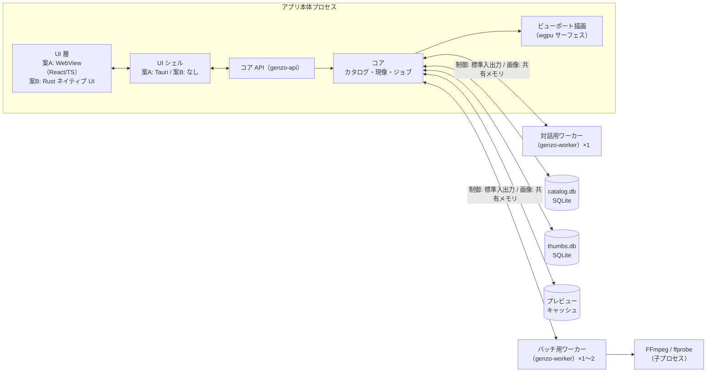
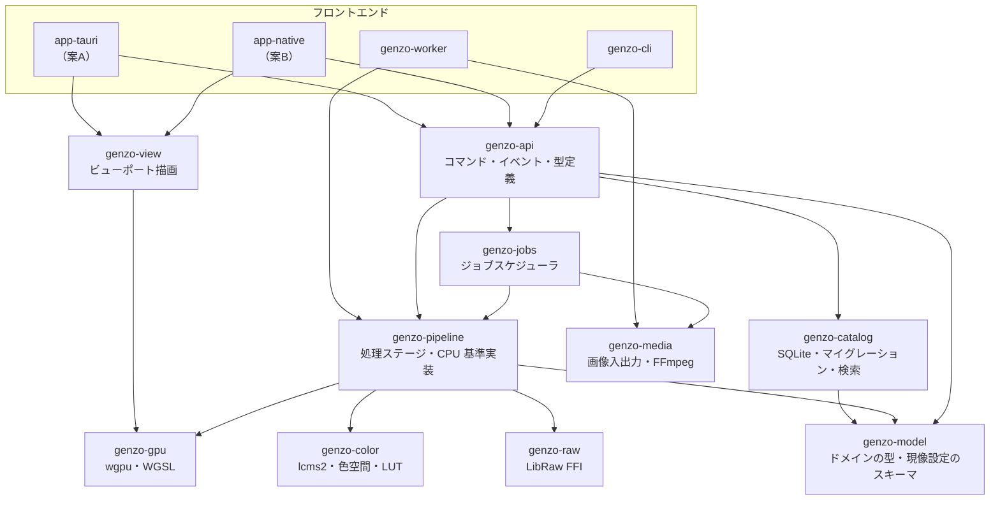
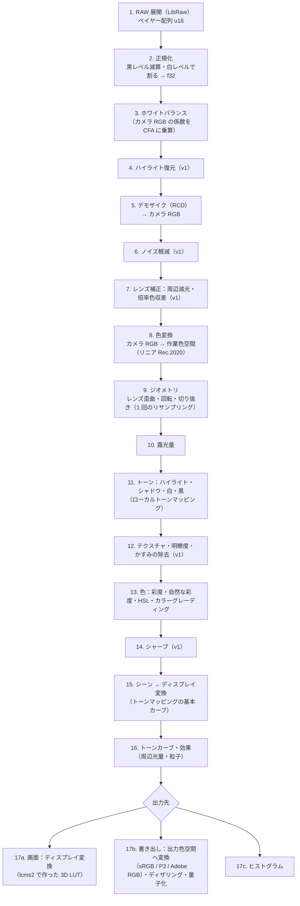
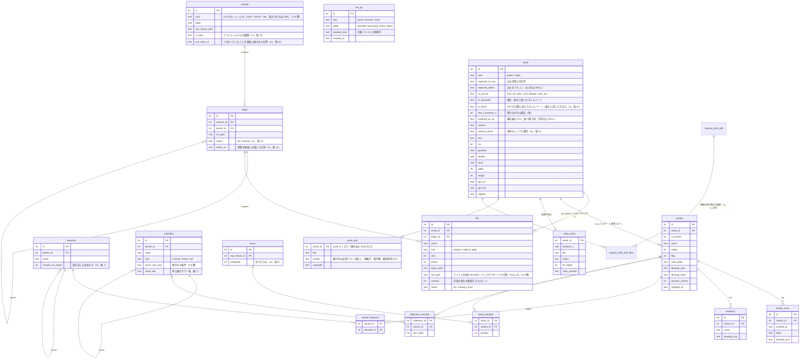
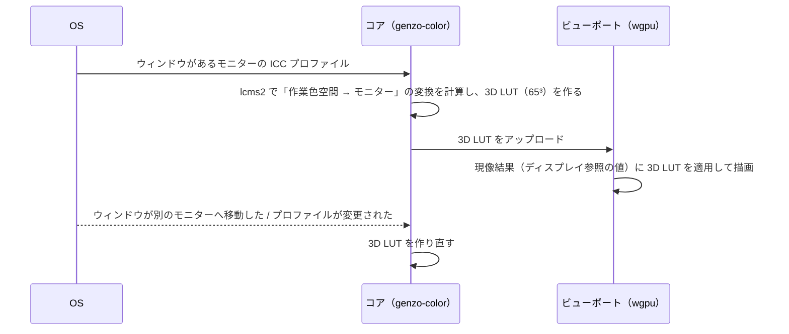
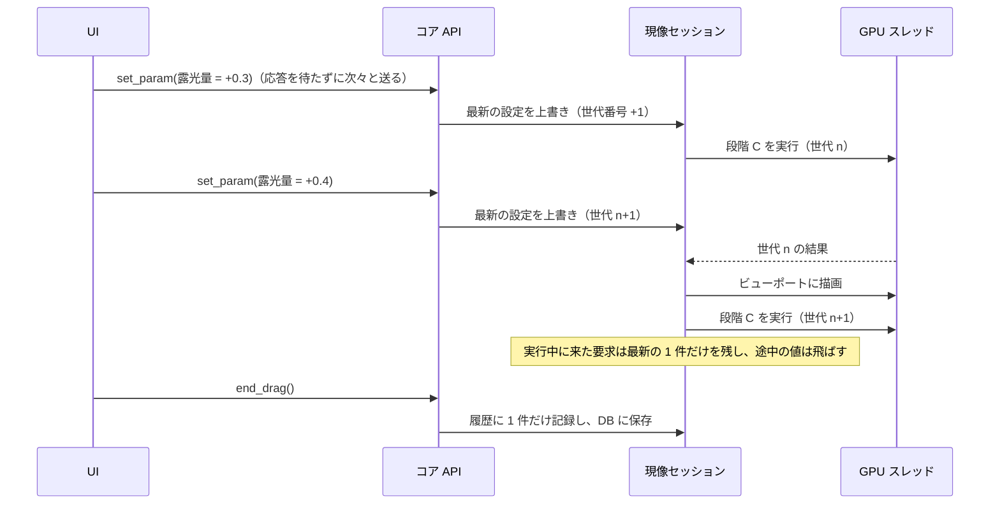
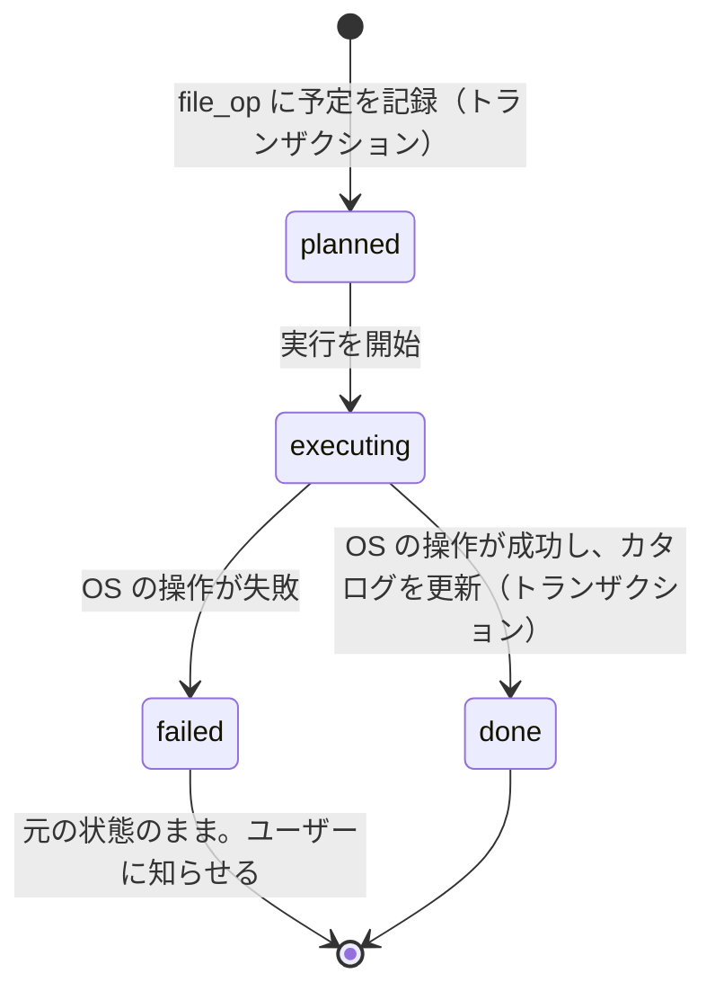

# [4] アーキテクチャ設計

- 入力: `docs/01`〜`docs/03`、`docs/decision_log.md`
- 前提とする技術スタック: **Rust コア ＋ wgpu ＋ SQLite ＋ LibRaw ＋ lcms2 ＋ FFmpeg（子プロセス）**。UI は案 A（Tauri 2 ＋ React / TypeScript）を第 1 候補とし、PoC-1 の結果で案 B（Rust ネイティブ UI）に切り替えられるようにする。
- 位置づけ: たたき台。コード例は設計を説明するためのもので、そのままではコンパイルできない箇所があります。

---

## 1. 全体構成

### 1.1 設計の基本方針

1. **コアは UI を知らない**: 現像エンジン・カタログ・ジョブ管理は、UI から独立した Rust のライブラリ群（crate）として作る。UI は「コア API」（コマンドとイベント）だけを通じてコアを使う。これにより、案 A と案 B を切り替えても、コアはそのまま使える（MAINT-01）。
2. **CPU 版が正、GPU 版は高速化**: すべての現像処理は CPU 版（Rust）を基準実装とし、GPU 版（WGSL）は CPU 版との差が許容誤差以内であることをテストで確認する（MAINT-02、IQ-07a。完全な一致は保証できない）。
3. **シーンリニアで処理し、最後にディスプレイ向けへ変換する**: 色の処理は、光の量に比例した値（シーンリニア）のまま浮動小数点で行い、トーンマッピングでディスプレイ向けの値に変換する（IQ-01、IQ-02）。
4. **信頼できない入力は隔離する**: 写真・動画の解析とデコードは、**対話的な処理も含めてすべて** 別プロセスのワーカーで実行する。壊れたファイルでデコーダが異常終了しても、アプリ本体は落ちない（SEC-05）。本体は、ワーカーから受け取って検証したバッファだけを扱う。（2026-10-13 追記: 動画の再生（VID-04）のデコードは WebView（OS の動画の機能）が行い、再生用のファイルへの変換は ffmpeg を本体の子プロセスとして動かす。どちらも本体のプロセスではデコードしない。4.2 節、決定事項ログ No.117）
5. **パラメータは解像度に依存させない**: 半径などの空間的なパラメータは「画像サイズに対する割合」で定義する。これにより、縮小プレビューと等倍表示・書き出しの見た目の差を小さくする（差は IQ-07b の許容差で管理する）。

### 1.2 プロセス構成



| プロセス | 役割 | 理由 |
|---|---|---|
| アプリ本体 | UI、コア API、**GPU を使う処理のすべて**（現像・ビューポート描画・書き出しの現像処理）、JPEG などのエンコード、カタログへの書き込み | GPU のキューとメモリを 1 か所で管理し、優先度を制御するため（レビュー R-10）。本体が扱うのは、ワーカーが展開して本体が検証したバッファだけにする |
| 対話用ワーカー（1 個） | ルーペ・現像パネルで開く写真の **RAW の展開とデコード**（優先度が最も高い処理専用で、常に待機させておく） | 対話的な処理でも、信頼できない入力のデコードは本体で行わない（SEC-05。レビュー R-05）。常駐させておくことで、プロセス起動の待ち時間をなくす |
| バッチ用ワーカー（1〜2 個） | 取り込み時のメタデータ読み取り、埋め込みサムネイル抽出、プレビュー生成と書き出しのための RAW の展開 | 大量の未知のファイルを扱う処理を隔離する |
| FFmpeg / ffprobe | 動画のメタデータ取得、サムネイル生成 | 動画デコーダの異常を隔離する。ライセンス上も扱いやすい |

ワーカーはカタログ DB に直接書き込まず、結果を本体に返します。DB に書き込むのは本体だけにして、書き込みの競合を避けます。

**ワーカーとのやり取り（レビュー R-05, R-10）**
- 制御（ジョブの依頼・結果・キャンセル）は、標準入出力で 1 行 1 メッセージの JSON をやり取りします。
- 画像のデータ（展開した CFA など。α7 IV で約 65MB）は **共有メモリ** で渡します。共有メモリは **本体が確保して所有** し、ワーカーは書き込むだけです。ワーカーが異常終了しても、本体が回収します。
- 本体は、受け取ったバッファの寸法・長さ・型・上限（画素数の上限など）を検証してから使います。
- ジョブごとにタイムアウトを設けます（ハングへの対策）。タイムアウトしたら、ワーカーを強制終了して再起動します。同じファイルで 2 回続けて失敗した場合は、そのファイルを以後スキップします。
- ワーカーごとにメモリの上限を設けます（OS の機能で設定できるかは PoC-2 で確認）。
- **2026-10-10 更新（決定事項ログ No.39）**: ワーカーと、ワーカーが起動した子プロセス（本体から見ると孫プロセス。ffmpeg・ffprobe など）は、まとめて終わらせます。Linux・macOS はプロセスグループ（本体がワーカーを新しいグループで起動し（`setpgid`）、`killpg` で終わらせる）、Windows はジョブオブジェクト（起動の直後、最初の依頼の前にワーカーを入れる。`JOB_OBJECT_LIMIT_KILL_ON_JOB_CLOSE` で、本体が異常終了してジョブのハンドルが閉じたときも終わる）です。タイムアウト・取り消し・異常終了・終了の依頼・本体の終了のすべての経路で使います（`genzo-worker` の `tree.rs`）。
  - メモリの上限の既定は **2 GiB（仮置き）** です。Linux はワーカーの `RLIMIT_DATA`、Windows はジョブオブジェクトの `JOB_OBJECT_LIMIT_PROCESS_MEMORY`（どちらも孫プロセスにもかかる）で、macOS は上限を設けません。根拠は、PoC-2 の参考の計測のワーカーのピーク（VmHWM 約 96〜104 MB）に、α7 IV のフルサイズと並行の余裕を見込んだことです。Windows・macOS は実機で未確認です。
  - 本体の異常終了で残った共有メモリの一時ディレクトリは、次の起動時に掃除します（持ち主のロックファイルで判断）。

**配布するアプリの実行ファイルの構成**（2026-10-10 追加。決定事項ログ No.32）
- 配布するアプリでは、ワーカーを **別の実行ファイル（`genzo-worker`）** にし、本体の実行ファイルは LibRaw に依存させません（本体は `libraw` の機能フラグなしでビルドし、ワーカーは別の cargo の実行でビルドする。`genzo-api` の `WorkerLaunch::Executable`。既定）。本体は RAW のデコーダの識別子を、ワーカーの最初の応答から受け取ります。
- 開発用の CLI（`genzo`）は、自分自身を `genzo __worker` で起動してワーカーを兼ねます（`WorkerLaunch::current_exe`）。そのため `libraw` を有効にした `genzo` は LibRaw の共有ライブラリに依存します（LibRaw の関数を呼ぶのは、ワーカーとして動くプロセスだけ）。
- LibRaw のライセンスは LGPL-2.1 を選ぶ方針ですが、**法的な事項のため、公開・配布の前に人（必要なら専門家）の確認が必要**です（[第三者の台帳](third_party.md) の 3.1 節）。

### 1.3 スレッド構成（アプリ本体）

**2026-10-10 更新（決定事項ログ No.36）**: コア API は、tokio の非同期ランタイムではなく、**同期の API ＋ 内部のスレッド ＋ イベントのチャネル** で作ります（`genzo-api` の `core` の doc）。当初の設計（tokio のコマンド処理・DB 書き込みスレッド・DB 読み取りプール・GPU スレッド）からの違いは表の「当初の設計との違い」の列のとおりです。

| スレッド | 役割 | 当初の設計との違い |
|---|---|---|
| UI スレッド | UI シェルのイベントループ（案 A では Tauri のメインスレッド） | — |
| コマンドを呼び出したスレッド | コア API の関数（`Core::execute` と型付きのメソッド）は、呼び出したスレッドで実行して結果を返す。写真を開く・同期の描画などでブロックしうるので、Tauri からは `spawn_blocking` で呼ぶ想定（未確認。PoC-1） | 当初は tokio の非同期ランタイムで受け付ける想定 |
| ジョブのスケジューラ（genzo-jobs） | 優先度付きのジョブキュー（6 章）。長い処理（取り込み・書き出し・プレビューの作り直し・詳細チェック）は P3 のスレッド（既定 2 本。仮置き）で実行し、ジョブの ID をすぐに返す。現像のプレビュー・表示範囲の描画（P0）は 1 本のスレッドで「最新の 1 件だけ」を処理する | — |
| 検索結果の作り直し（1 本） | 表示中の検索結果を、読み取り専用の接続でバックグラウンドで作り直す（3.7 節） | 当初の「DB 読み取りプール」の一部。ほかの読み取りはまだ同じ接続（PoC-6 で必要なら分ける） |
| （カタログの接続） | 書き込み用の接続を 1 つの `Mutex` で守り、書き込みを 1 つずつにする（SQLite の書き込みは 1 本しか進まないので、同じ効果） | 当初の「DB 書き込みスレッド（1 本）」の代わり |
| （GPU） | GPU を使う処理は、呼び出したスレッドで行う（`genzo-gpu` の `GpuRenderer` はスレッド間で共有できる）。P0 と P3 の GPU への投入の順序の制御（PERF-13）は、PoC-3 で GPU スレッドを置くかとあわせて決める | 当初の「GPU スレッド（1 本）」は置いていない |
| CPU ワーカープール（rayon） | CPU 版の現像処理、JPEG のエンコードなど（RAW の展開はワーカープロセスで行う）。並列度は、CPU のコア数と **メモリの予算**（6.1 節）の両方で制限する | — |
| （イベント） | ジョブの進捗・カタログの変更・プレビューの更新などは、`Core::subscribe` のチャネル（crossbeam-channel）で送る | — |

### 1.4 モジュール（crate）の構成



- 依存の方向は常に上から下です。`genzo-model` は他のどの crate にも依存しません。
- `genzo-gpu` は `genzo-pipeline` が定義する処理ステージの GPU 版です。GPU のない環境（CI）では、`genzo-pipeline` の CPU 版だけで動きます。ソフトウェアの GPU（Windows の WARP・Mesa の llvmpipe など）は、既定では使わずに CPU 版で処理します（2026-10-10、決定事項ログ No.46。環境変数 `GENZO_GPU_ALLOW_SOFTWARE=1` または `CoreConfig::gpu_allow_software` で使える。この開発環境のテストは許可して llvmpipe で GPU 版と CPU 版を比べる）。
- `genzo-cli` は、UI なしで登録・検索・現像・書き出しを行えます。自動テストと、AI による動作確認に使います（ORG-05）。
- ログ・クラッシュレポート（SYS-07。6.5 節）は `genzo-api` の `logging` が受け持ち、アプリ（`genzo-app`）と CLI が起動時に使います（2026-10-13 追加）。

### 1.5 UI とコアの間のインターフェース

| 種類 | 方向 | 内容 | 案 A での実現方法 | 案 B での実現方法 |
|---|---|---|---|---|
| コマンド | UI → コア | 「フィルターを適用」「レーティングを 3 にする」「露光量を +0.5 にする」など。要求と応答の組 | Tauri のコマンド（JSON） | 関数を直接呼ぶ |
| イベント | コア → UI | 「ジョブの進捗」「カタログが変更された」「プレビューが更新された」 | Tauri のイベント | チャネル |
| サムネイル | コア → UI | グリッドに表示する画像 | カスタム URI スキーム `genzo://thumb/{variant_id}?rev={hash}`（ブラウザのキャッシュが効く） | テクスチャを直接渡す |
| 動画（VID-04。2026-10-13 追加） | コア → UI | ルーペで再生する動画の元のファイル・再生用のファイル | カスタム URI スキーム `genzo://video/{variant_id}`・`genzo://video-proxy/{variant_id}`（Range の要求に応える。4.2 節） | OS の動画の再生の機能（未定） |
| 現像画像 | コア → 画面 | ルーペ・現像のプレビュー | **WebView を通さず、ビューポート（wgpu サーフェス）に直接描画** | 同左 |

- コマンドとイベントの型は Rust 側で定義し、TypeScript の型を自動生成します（ts-rs や specta など）。型の不一致をコンパイル時に検出でき、AI による変更の誤りを防げます。
- 現像のスライダー操作は、コマンドの応答を待たずに次の値を送れるようにします。コア側では、古い要求を捨てて最新の値だけを処理します（6.2 節）。
- **ビフォー / アフター**（DEV-31。2026-10-13 追加、決定事項ログ No.79）: 現像のセッションがビフォーの設定を持ちます（`Core::set_before`。出どころは variant を作ったときの設定（履歴の最初の 1 件。既定）・履歴の項目・スナップショット・今の設定の写し）。ビフォーで実際に描く設定は、出どころの設定の切り抜き・角度補正を今の設定（アフター）のものにしたもの（出力の格子をそろえ、位置を合わせて比べ、拡大・パンを同期するため）。描画はアフターと同じ P0 のスケジューラの別の「最新の 1 件だけ」の枠で、実際に描く設定のハッシュが変わったとき（切り抜き・角度・出どころ・画面のプロファイルの変更）だけ描き直します。結果は `Event::BeforeUpdated` で知らせ、`Core::before_frame` で取ります。等倍表示はアフターと別の枠の `Core::render_before_region`。ビフォーの画素はキャッシュ（L0・L1）に書きません（キーが variant の今の設定のため）。
- **表示範囲の描画**（ルーペの等倍表示 PRV-03・拡大とパン LIB-02。2026-10-10 追加、決定事項ログ No.58）: コア API の `Core::render_region`（コマンドは `RenderRegion`・`CancelRegion`）は、現像中の写真の表示範囲を C（出力の画素）か G（長辺を 1 とした値）の座標と倍率で受け、画面用の 8bit の画素（ステージ 17a の出力）を返します。縮小は B3 を面積平均で縮小してから 17a、拡大は等倍の結果の最近傍です。P0 の「最新の 1 件だけ」で処理し、古い要求は取り消し（`Cancelled`）で戻ります（UI は誤りとして表示しない）。画素は JSON の応答に入れず、`Core::region_frame` で取ります。今は CPU 版だけで、ビューポートへの直接の描画とあわせた形は PoC-1 で決めます。範囲・返す画素数の上限（16 Mi 画素）と倍率の上限（16 倍）は仮置きです。
- **比較表示の表示範囲の描画**（LIB-03。2026-10-13 追加、決定事項ログ No.114〜116）: 比較表示（選択と候補の 2 枚を並べ、拡大とパンを同期する）の等倍は、現像のセッション（1 枚）とは別に、コアの面（`pane`。2 つ。`MAX_VIEW_PANES`）ごとに任意の写真の表示範囲を描きます（`Core::render_view_region`。コマンドは `ViewOutputSize`・`RenderViewRegion`・`CancelViewRegions`・`ReleaseView`、画素は面ごとに `Core::view_region_frame`。`RegionInfo::pane` に面が入る）。描き方はルーペの等倍と同じで、現像中の写真ならセッションの今の設定、それ以外はカタログに保存した設定で描きます。展開した入力は 2 個まで持ち（`MAX_VIEW_SOURCES`。ファイルとリビジョンごと。仮想コピーは共有）、比較表示をやめたとき・カタログを閉じたときに捨てます。面ごとに P0 の「最新の 1 件だけ」で処理し、面どうしは取り消しません。L0 / L1 のキャッシュには書きません。全体表示と選別表示（選んだ写真を 12 枚まで並べる。`MAX_SURVEY_PHOTOS`）は L0 / L1 を使い、選別表示の枠が小さい（写真を出す長辺が 320 物理画素以下）ときは L0 だけを読みます。値はどれも仮置きです。

---

## 2. 現像パイプライン

### 2.1 処理ステージ



| 区間 | ステージ | 色空間 | 数値の範囲 | 精度 |
|---|---|---|---|---|
| センサー | 1〜4 | カメラ RGB（CFA） | 0〜1 を基本とし、WB 後は 1 を超えうる | u16 → f32 |
| シーンリニア（カメラ） | 5〜7 | カメラ RGB | 0〜（上限なし） | f32 |
| シーンリニア（作業） | 8〜14 | リニア Rec.2020 | 0〜（上限なし）。負の値は色域外として保持する | f32 |
| ディスプレイ参照 | 15〜16 | リニア Rec.2020（D65）。ディスプレイの白を 1 とする相対値。トーンカーブの計算のときだけ一時的に符号化する（2.6 節） | 輝度は 0〜1。色域外（負の値）は保持する | f32 |
| 出力 | 17 | ディスプレイ / 出力の色空間（色域圧縮と符号化をここで行う） | 0〜1 | 画面：16bit 浮動小数点または 10bit ／ 書き出し：8bit・16bit |

各境界の色空間・白色点・伝達関数・値の範囲の厳密な定義は、**2.6 節（色の契約）** を正とします。

**補足**
- **ステージ 3**: ホワイトバランスはデモザイクの前に CFA へ適用します。ユーザーが指定する色温度・色かぶりの値は、カメラ行列を使ってカメラ RGB の係数に変換します。
- **ステージ 4**（2026-10-13 追記。DEV-06、決定事項ログ No.126）: ハイライト復元は、WB を掛けた後の CFA（段階 A1）で、設定 `highlight_recovery`（方式と量）に従って行います。方式は「白で切りそろえる」（`clip`。既定。処理バージョン 1 と同じ）・「明るさだけ復元」（`neutral`）・「色を保って復元」（`reconstruct`）、量は 0〜100 です。CFA の 2 × 2 の組を単位に、飽和したチャンネルの値を本当の値の下限として扱い、明るさだけの復元では飽和したチャンネルを組の値の最大にします（マゼンタにならない）。色を保った復元では、近傍（チェビシェフ距離 4 組）の飽和していない組のチャンネルの比（最小二乗）から推定し、手がかりが少ないほど明るさだけの復元に寄せます。すべてのチャンネルが飽和した組は無彩色にします。**復元するときはステージ 3 では切りそろえず**、ステージ 4 が、ステージ 3 と同じ規則で切りそろえた値と復元した値を量で混ぜます。近傍の決まった範囲だけを使うので、タイルの分け方で結果は変わりません。RAW 以外の入力には使いません（設定していれば警告）。処理バージョン 2 から（2.5 節）。
- **ステージ 6**（2026-10-13 追記。DEV-13、決定事項ログ No.127）: ノイズ軽減は、デモザイクの後のカメラ RGB（段階 A1）で、ウェーブレットの係数の縮小で行います。各チャンネルの平方根（ショットノイズの分散の安定化）から輝度 Y = (R + 2G + B) / 4 と色 D1 = R − G・D2 = B − G を作り、面ごとに B3 スプラインの à trous（5 段）の細部を non-negative garrote で縮小して戻します。項目は輝度（量・ディテール・コントラスト）と色（量・ディテール）で、しきい値は段ごとに残る雑音の大きさ（独立な雑音をデモザイクして計測した値）に比例させます。段階 A1 は出力の格子（フル解像度、またはドラッグ中の 2 × 2 の簡易処理の格子）でかけるので、縮小のプレビューと書き出しで効き方がそろいます（簡易処理の格子では、その格子で計測した雑音の大きさを使う）。計算の余白はフル解像度で 62 画素です。RAW 以外の入力には使いません（設定していれば警告）。処理バージョン 2 から（2.5 節）。
- **ステージ 7**（2026-10-13 追記。DEV-14、決定事項ログ No.121〜123）: 周辺減光と倍率色収差の補正を、デモザイクの後のカメラ RGB（B1。段階 A1）で行います。周辺減光は中心からの距離 `r` の関数の利得を掛け、倍率色収差は R・B の面を中心からの倍率 `m(r)` の位置から取り直します（G はそのまま。双三次の補間）。補正の量は、RAW に埋め込まれた情報（Sony の ARW の VignettingCorrParams・ChromaticAberrationCorrParams、DNG の FixVignetteRadial・WarpRectilinear の面の比）と手動のスライダーから決めます。**lensfun などの外部のデータは使いません**（利用者の決定）。RAW 以外の入力にはこのステージを使いません（センサーのデータがないため。設定していれば警告）。処理バージョン 2 から（2.5 節）。
- **ステージ 9**: レンズの歪曲補正・回転・切り抜きは、座標の変換としてまとめ、リサンプリングを 1 回だけ行います。複数回行うと画質が落ちるためです。この段階より後の処理は、切り抜いた範囲だけを計算します。
  - 歪曲補正（2026-10-13 追記。DEV-14、決定事項ログ No.122・123）: 埋め込みの情報（Sony の DistortionCorrParams、DNG の WarpRectilinear）と手動のスライダーの半径方向の倍率 `k(r)` を、半径の 2 乗 `u = r² / R²` の 257 点の表（1D LUT）にして、出力の画素から入力の位置をたどる座標の変換に入れます（O → D。2.7 節）。歪曲を補正した画像の枠（D）は O と同じ大きさで、**枠の全体が元の画像の内側から取れる最大の範囲**になるように自動で拡大・縮小します（画像のない部分を作らない）。DNG の接線方向の係数は使いません（警告）。RAW 以外の入力にも手動の歪曲補正は使えます。GPU 版も同じ表と式で計算します（2.3 節）。
- **ステージ 11, 12**: ローカルトーンマッピングとかすみの除去は、画像全体の情報（低周波成分）を使います。そのため、**縮小した画像から「ガイド」（ぼかした輝度など）を先に計算し、タイル処理のときにはそれを拡大して参照** します。これにより、縮小プレビューとフル解像度の結果の差を小さくします（一致を保証するものではなく、IQ-07b の許容差で管理します）。ガイドの依存関係と座標系は 2.7 節で定義します。
- **ステージ 13**: 彩度や色相の調整は、リニアな値から知覚的に均等な色空間（OKLab など。どれを使うかは PoC で決定）に変換して行い、リニアに戻します。
- **ステージ 15**: シーンリニアの値（1 を超えうる）を、ディスプレイの表示範囲（0〜1）に滑らかに収める基本カーブです。白飛びを自然に丸めます。HDR 表示（CLR-03）に対応するときは、このステージを差し替えます。
- **ステージ 16**: トーンカーブは、ディスプレイ参照の値に対して適用します。カーブの横軸と縦軸は、輝度を **sRGB の伝達関数（IEC 61966-2-1）で符号化した値** とします（2.6 節）。ユーザーが見ている明るさとカーブの横軸が対応するため、操作が直感的になります。色相がずれないよう、輝度に対して適用し、RGB の比率を保ちます（RGB チャンネル別のカーブは例外）。
- **ローカル補正（マスク、v1）**: マスクごとに「露光量 +0.3、彩度 −10」のような調整値の差分を持ちます。ステージ 10〜14 の処理を、マスクの値で重み付けして適用します。Lightroom と同様の考え方です。

### 2.2 プレビューの計算方法と中間キャッシュ

スライダー操作に 33ms 以内で追従する（PERF-01）ため、処理をいくつかの段階に分け、段階の境目で結果をキャッシュします。

| 段階 | 含むステージ | 実行のタイミング | キャッシュ（α7 IV の場合） |
|---|---|---|---|
| **段階 A0：RAW の展開** | 1 | 写真を開いたとき（対話用ワーカーで実行） | 展開した CFA（u16、フル解像度）を、開いている写真について本体のメモリに保持する（有効画素だけで約 65MB。実際のバッファの寸法・余白を含めた量は PoC-2 で計測する） |
| **段階 A1：センサー処理** | 2〜8 | 写真を開いたとき、または WB・ハイライト復元（ステージ 4）・ノイズ軽減（ステージ 6）・レンズ補正（ステージ 7 の周辺減光・倍率色収差。歪曲はステージ 9 なので段階 B・C だけ）・カメラプロファイルを変更したとき | **プレビュー解像度（長辺 2560px）に縮小した作業色空間の画像** を GPU 上に保持する（2560 × 1707 ≒ 4.37M 画素 × 16 バイト ≒ 70MB） |
| **段階 B：ガイドの計算** | 11, 12 のガイド | 2.7 節の依存関係のとおり | 長辺 512px 程度の低解像度の画像 |
| **段階 C：仕上げ** | 9〜17 | スライダーを操作するたび | なし（毎回計算する） |

- 露光量やトーンカーブのような段階 C のパラメータを変更したときは、**段階 C だけを再計算** します（約 4.37M 画素の処理）。
- **WB を変更したとき**（レビュー R-04）: RAW の展開（A0）はやり直さず、保持している CFA から段階 A1 を実行します。
  - ドラッグ中は、デモザイクの代わりに **2 × 2 の画素をまとめる簡易処理**（ベイヤー配列の 4 画素から 1 画素の RGB を作る。α7 IV なら 3504 × 2336）で計算し、長辺 2560px に縮小します。デモザイクより大幅に軽く、表示に必要な解像度は満たします。
  - 指を離したら、デモザイク（RCD）で計算し直します（PERF-01b）。
  - 簡易処理と最終品質の見た目の差は IQ-07b の対象外とし、指を離した後の描画で置き換わることを前提にします。
- **ハイライト復元・ノイズ軽減のある A1**（2026-10-13 追記。決定事項ログ No.127・128）: プレビューの A1 は、フル解像度の格子で計算してから帯ごとに縮小します。ノイズ軽減の計算の余白（62 画素）が帯に比べて大きいので、帯の行を余白の 6 倍以上に広げます（`BAND_MARGIN_RATIO`。結果は変わらない）。ドラッグ中の簡易処理の A1 は GPU 版（ステージ 4・6 を含む）で、最終品質の A1・等倍・書き出しのセンサー処理は CPU 版です（RCD の GPU 版がないため）。
- **等倍表示・書き出し**: フル解像度を **タイル**（例：1024 × 1024 ＋ 周辺の余白）に分けて段階 A1〜C を実行します。段階 B のガイドは、プレビューと同じものを使います（2.7 節）。

各段階のキャッシュのキーは 4.1 節の共通の規則に従います。キーが一致すれば再計算を省略します。

### 2.3 CPU 版と GPU 版の一致を保証する方法

- 浮動小数点は 32bit で統一します。GPU でも「高速だが不正確な演算」の最適化は使いません。
- 合計や平均を求める処理（ヒストグラム、ガイドの計算など）は、計算の順序で結果が変わるため、CPU 版と GPU 版で同じ分割と同じ順序で計算します。
- 3D LUT の補間や、テクスチャのサンプリングは、GPU のハードウェア補間に頼らず、自前で補間します（ハードウェア補間は精度が GPU によって異なるため）。
- テスト（MAINT-03）：基準画像のセットで、CPU 版と GPU 版の両方で処理し、差が許容誤差（IQ-07a）以内であることを確認します。GPU のない CI では CPU 版の回帰テストだけを行い、GPU 版の比較は開発者の PC（RTX 3080 と M1）で定期的に実行し、**リリース前には必ず実行** します（レビュー R-08）。
- WGSL は浮動小数点の演算の結合や融合を許しているため、上の工夫をしても **完全な一致は保証できません**。ステージごとに許容誤差を定め、NaN・無限大・負の値・ゼロ付近の値の扱い（たとえば、対数を取る前に小さな値で下限を設ける）を CPU 版と GPU 版でそろえます。

### 2.4 書き出しの経路

- 書き出しは、**GPU 版を既定** とします（PERF-10 の 3 秒以内を満たすため）。GPU が使えない環境やエラーの場合は、CPU 版に切り替えます。
- 書き出しの GPU 処理は **本体の GPU スレッドで、優先度 P3 のタイルとして実行** します（6.1 節）。バッチ用ワーカーは RAW の展開だけを担当します。
- プレビュー（縮小してから処理）と書き出し（フル解像度で処理してから縮小）は、処理の順序が異なるため、結果は一般に一致しません。両者の差は IQ-07b の許容差で管理し、テストで確認します（レビュー R-02）。
  - 比較の基準（2026-10-10、決定事項ログ No.35）: フル解像度の結果を、プレビューの各画素が覆うフル解像度の範囲で平均したもの（回転・切り抜きがなければ、面積平均の縮小と同じ格子の対応）とします。回転・切り抜きでの位置のずれ（最大でプレビューの 0.5 画素＋フル解像度の 0.5 画素。2.7 節）を比較から除くためです。実機の 2 枚でも基準は未達です（PoC-5）。
- 書き出したファイルの安全性（原本を上書きしない、途中で失敗しても不完全なファイルを残さない）は 6.4 節で定義します。
- **書き出すメタデータ**（2026-10-13 追記。LIB-15、決定事項ログ No.78）: Exif（撮影情報・補正した撮影日時・GPS（`remove_gps` でなければ））に加えて、カタログで編集した説明のメタデータを XMP のパケット（`genzo-media` の `xmp_write`。JPEG は APP1、PNG は iTXt の `XML:com.adobe.xmp`、TIFF はタグ 700）に書きます。Exif の ASCII のタグは 7bit の文字しか書けないので、キャプション・作成者・著作権表示は ASCII で表せるときだけ ImageDescription・Artist・Copyright にも書きます（`?` に置き換えて書くことはしない）。JPEG の XMP は APP1 の 1 つのセグメント（約 64 KiB）に収まらなければ書き出しを失敗にします（拡張 XMP は書かない）。書き出しの設定で項目を選ぶ機能（Lightroom の「著作権のみ」など）はまだなく、すべての項目を書きます。
  - **キーワード**（2026-10-13 追記。LIB-09、決定事項ログ No.81）: 写真に付けたキーワードと、その親（含まれるキーワード）のうち「書き出すファイルに含める」（`keyword.include_on_export`）ものの名前を、同じ XMP の `dc:subject`（`rdf:Bag`。IPTC Core の Keywords）に書きます（`genzo-catalog` の `Catalog::export_keywords`）。階層（`lr:hierarchicalSubject`）と IPTC IIM（APP13）は書きません。書き出しの設定の `remove_keywords` で、すべてのキーワードを書かないようにできます（GPS の `remove_gps` と同じ。既定は書く）。

### 2.5 現像設定のスキーマとバージョン管理

```rust
/// 1 つのバリアント（仮想コピーを含む）の現像設定。
/// カタログには JSON で保存する。
#[derive(Serialize, Deserialize, Clone, PartialEq)]
pub struct DevelopSettings {
    /// スキーマの形（項目の追加・名前の変更）のバージョン。
    pub schema_version: u32,
    /// 処理アルゴリズムのバージョン。値が同じなら、アプリを更新しても結果は変わらない（IQ-08）。
    pub process_version: u32,
    pub white_balance: WhiteBalance,
    pub highlight_recovery: HighlightRecovery, // 方式・量（v1。処理バージョン 2）
    pub exposure_ev: f32,             // -5.0 〜 +5.0
    pub tone: ToneParams,             // ハイライト・シャドウ・白・黒（-100 〜 +100）
    pub tone_curve: ToneCurve,
    pub color: ColorParams,           // 彩度・自然な彩度・HSL・カラーグレーディング
    pub geometry: Geometry,           // 切り抜き・回転
    pub lens: LensCorrection,
    pub detail: DetailParams,         // シャープ・ノイズ軽減
    pub masks: Vec<LocalAdjustment>,  // v1
    /// 現像結果に影響する外部データの識別子と内容のハッシュ（レビュー R-08）。
    pub render_deps: RenderDeps,
}

/// 結果に影響する外部データ。値が変わったら、同じ設定でも結果が変わりうる。
pub struct RenderDeps {
    pub camera_profile: DataRef,         // カメラ行列・プロファイル
    pub lens_profile: Option<DataRef>,   // レンズ補正のデータ
    pub raw_decoder: String,             // 例: "libraw-0.21.x"（展開の設定を含む）
}
pub struct DataRef { pub id: String, pub sha256: String }

pub enum WhiteBalance {
    AsShot,
    Preset(WbPreset),
    Custom { temperature_k: f32, tint: f32 },
}
```

- **schema_version**: 設定の形が変わったときに上げます。古い形式の JSON を読み込んだときは、マイグレーション関数で順番に新しい形式へ変換します。
- **process_version**: アルゴリズムを変更し、同じ設定でも結果が変わる場合に上げます。既存の写真は古い `process_version` のまま、古いアルゴリズムで処理します。新しいアルゴリズムは、ユーザーが明示的に更新した写真にだけ適用します（DATA-09）。
  - 例外（2026-10-10、決定事項ログ No.28）: 配布の前なので、処理バージョン 1 のアルゴリズム（ステージ 15 の基本カーブ、RAW 以外の入力の扱い、色域の圧縮、画面用 LUT の格子、WB、コントラスト、飽和の切りそろえ）を、新しい版を作らずに書き換えました。配布を始めた後の変更は DATA-09 のとおり新しい版にします。
  - そのため、処理ステージのコードは、**処理バージョンごとにアルゴリズムを切り替えられる** ように作ります（ステージは `StageContext` から `process_version` を受け取る。7.1 節）。古いアルゴリズムのコードは削除せず、回帰テストの対象として残します。
- **render_deps**（レビュー R-08）: アルゴリズムを固定しても、カメラ行列・レンズのデータ・RAW デコーダが変われば結果は変わりえます。
  - カメラ行列などのデータは、LibRaw が内蔵する表に頼らず、**対象機種（α7 IV / α7C）の値をアプリ側にデータファイルとして持ち**、ID とハッシュで参照します。LibRaw を更新しても色が変わらないようにするためです。
  - 各 `process_version` が、どのデータと、どの RAW デコーダの設定を使うかを処理仕様として固定します。
  - 依存を更新したときは、旧設定の回帰画像を比較し、差が出た場合は新しい `process_version` として扱います。
  - **レンズのデータ**（2026-10-13 追記。DEV-14、決定事項ログ No.124）: `lens_profile` には、RAW に埋め込まれたレンズ補正の情報（genzo-raw の `LensCorrectionData`）を、ID `<出どころ>:<カメラ>|<レンズ>`（例: `sony_arw:SONY ILCE-7M4|FE 24-70mm F2.8 GM II`、`dng_opcode:...`）と、情報の内容（JSON）の SHA-256 で記録します。情報がなければ `None`。外部のデータ（lensfun など）は使いません。保存した値が `None`（レンズ補正の前に保存した写真）なら比べず、値が違えば警告します（ファイルの内容が変わったときなど）。
- **処理バージョン 2**（2026-10-13。決定事項ログ No.120）: v1 の機能のステージ（最初はレンズ補正。ステージ 7・9）を処理バージョン 2 から適用します。**版 1 のアルゴリズムと結果は変えません**。版 1 の写真に v1 の機能の項目の値があっても無視し、「処理バージョンを更新すると使えます」と知らせます。v1 の機能の項目が既定値なら、版 2 は版 1 とビット単位で同じ結果になる（テストで確認）ので、**新しく取り込む写真の既定を 2 にしました**（`CURRENT_PROCESS_VERSION` = 2）。既存の写真は版 1 のままで、利用者が「処理バージョンを更新」（`Core::upgrade_process_version`。履歴に「処理バージョンを 2 に更新」と残り、Undo で戻せる。CLI は `genzo develop upgrade <ID>`）したときにだけ版 2 にします。配布の前なので、後の v1 の機能のパッケージも新しい版を作らずに版 2 に足します（配布を始めた後の変更は新しい版にする）。
  - スキーマの版 2（同日）: レンズ補正の手動の項目（`lens.distortion`・`vignetting_amount`・`vignetting_midpoint`・`ca_red_cyan`・`ca_blue_yellow`）を加えました。版 1 の JSON にはない項目を既定値（何もしない値）で補うだけで、値は書き換えません。`process_version` のない JSON は、スキーマの版 1 なら 1、版 2 なら 2 で補います。項目が増えたので、既存の写真の設定のハッシュ（4.1 節のキャッシュのキー）も変わり、サムネイル・プレビューは作り直しになります（見え方は変わらない）。
  - ハイライト復元・ノイズ軽減（2026-10-13 追記。DEV-06・DEV-13、決定事項ログ No.126・127）: 同じスキーマの版 2 に、`highlight_recovery`（`method`・`amount`）と、ノイズ軽減の `detail.noise_reduction.luminance_detail`・`luminance_contrast`・`color_detail` を加えました（新しい版は作らない。配布の前のため）。既定は「切りそろえる」・量 0 で、処理バージョン 2 の既定の設定は版 1 とビット単位で同じなので、`CURRENT_PROCESS_VERSION` は 2 のままです。段階 A1 のハッシュに `highlight_recovery` とノイズ軽減のすべての項目を含めます。項目が増えたので、設定のハッシュ（4.1 節のキャッシュのキー）も変わります（レンズ補正の項目を加えたときと同じ。見え方は変わらない）。
  - 版の混在と設定の貼り付け（2026-10-13 追記。DEV-30・DATA-09、決定事項ログ No.130）: 既存の写真（版 1）と新しく取り込んだ写真（版 2）が同じカタログに混ざるのが普通になったので、**設定の貼り付け（一括適用）は貼り付け先の処理バージョンを変えません**（すべての項目を写す場合も。前は貼り付け元の版に置き換わっていた）。版 1 と 2 は、版 1 からある項目を同じ意味で使う（版 2 はステージを足しただけ）ので、版の違う写真の間でも選んだ項目だけを写せます（前は拒んでいた。genzo-pipeline の `ProcessVersion::shares_settings_with`。後の版で項目の意味を変えたら、そこで拒むか変換する）。版 1 の写真に写した v1 の機能の項目は保存しますが、更新するまで使われないので、結果の数（`PasteReport::needs_upgrade`）で知らせます。利用者が「処理バージョンが古い写真は更新する」を選んだとき（画面の貼り付けのダイアログ・CLI の `develop copy --upgrade-process-version`）だけ、貼り付け元より古い写真を貼り付け元の版に上げます（下げることはない。履歴の名前は「設定の貼り付け・処理バージョンを 2 に更新」）。選んだ写真をまとめて最新の版に更新する操作（`Core::upgrade_process_versions`。写真の右クリックのメニュー・CLI の `develop upgrade <ID>...`）も足しました。

### 2.6 色の契約（各境界の定義。レビュー R-01）

パイプラインの各境界で、画像の値が何を意味するかを次のとおり固定します。実装はこの表を正とし、他の節の記述と食い違う場合はこの表に合わせます。

**2026-10-10 更新**（決定事項ログ No.29〜31・40・41・59）: B0 の飽和の閾値、ステージ 15 の基本カーブと 1D LUT、RAW 以外の入力でのステージ 15、色域の圧縮の方式、トーンカーブの黒の持ち上げの式、ステージ 17a の最後に 0〜1 に収めること、画面用 3D LUT の格子（65³）を、実装に合わせて書きました。

| 境界 | 位置 | 原色 | 白色点 | 伝達関数 | 値の範囲 |
|---|---|---|---|---|---|
| B0：CFA | ステージ 2 の出力 | カメラのセンサー（チャンネルごと） | — | リニア | 黒レベルを 0、白レベルを 1 とする。飽和の閾値（白レベルと分けた値。genzo-raw の `RawImage::saturation_level`。仮置きの式は「黒 ＋（白 − 黒）× 0.995」）以上の画素には印を付けて 1 にする（実機の α7 IV では緑が白レベルより低い値に張り付いた。2026-10-10 変更） |
| B1：カメラ RGB | ステージ 3〜7 | カメラのセンサー | WB の係数で、被写体の中立色が (1, 1, 1) になるように正規化する | リニア | 0 以上、上限なし |
| B2：作業色空間 | ステージ 8〜14 | ITU-R BT.2020 | D65 | リニア | 上限なし。負の値（色域外）を保持する |
| B3：ディスプレイ参照 | ステージ 15 の出力〜16 | ITU-R BT.2020 | D65 | リニア（ディスプレイの白を 1 とする相対値） | 輝度は 0〜1。負の値（色域外）を保持する |
| B4a：画面への出力 | ステージ 17a | モニターの ICC プロファイル | モニターの ICC プロファイル | モニターの ICC プロファイル | 0〜1 |
| B4b：書き出し | ステージ 17b | sRGB / Display P3 / Adobe RGB (1998) | D65 | sRGB と Display P3 は IEC 61966-2-1 の伝達関数、Adobe RGB はガンマ 563/256（≒ 2.2） | 0〜1 を 8bit / 16bit に量子化する |
| B5：キャッシュ（L0 / L1） | 4 章 | Display P3 | D65 | IEC 61966-2-1 の伝達関数 | 0〜1 を 8bit JPEG で保存し、ICC プロファイルを埋め込む |

- アルファチャンネルは使いません。マスクは別の 1 チャンネルの画像として扱います。
- NaN・無限大は各ステージの出力で検出し、0 に置き換えます（デバッグ用のビルドでは件数を記録します）。

**3 つの圧縮・変換を分ける**
1. **トーンの圧縮**（ステージ 15）: 1 を超える輝度を、0〜1 に滑らかに収める。色域外の値には触れない。
   - 基本カーブ（RAW の入力。2026-10-10、決定事項ログ No.29）: 実機の ARW 2 枚（α7C・α7 IV）のカメラの JPEG に当てはめた Naka–Rushton 型のカーブ `Pc` を、輝度 Y（BT.2020 の係数）にかける。
     ```text
     Pc(Y) = P · Y^c / (Y^c + K)           K = k^c、c = 1.6
     Pc(Sm) = 0.18、Pc(1) = 1 から P と K を決める（Sm = 0.18 / 2^1.3 ≒ 0.0731。P ≒ 1.0757、k ≒ 0.1993）
     f(Y) = Pc(Y)                                          （0 ≤ Y ≤ Yj）
     f(Y) = 1 − (1 − fj) / (1 + sj · (Y − Yj) / (1 − fj))   （Y > Yj。fj = Pc(Yj)、sj = Pc'(Yj)、Yj = 0.95）
     ```
     - シーンの 0.0731 は表示の 0.18（sRGB の 8bit で約 118）、シーンの 0.18 は表示の約 0.494 になる。中間グレーの位置はこのカーブで持ち、カメラの BaselineExposure は使わない。既定の彩度は 0 のまま（カメラの JPEG の方が約 1.3 倍鮮やかだが、ルックの好みとして既定には入れない）。
     - `Pc` だけならシーンの 1.0（RAW の飽和）で表示の 1.0 に届くが、「1 を超える値（露光量を上げたとき）を 1 に向かってなめらかに収める」こととは両立しない。そこで、シーンの `Yj` = 0.95 より明るい部分を、`Pc` と値・傾きがつながり 1 に漸近する有理式に置き換える。単調・1 階微分まで連続・`f(0) = 0`・上限 1。シーンの 1.0 は表示の約 0.99710（sRGB の 8bit で 254.67 → 255）、2.0 は約 0.99974。
     - 評価: CPU で f64 の式から作る **対数の軸の 1D LUT**（`log2(Y)` の −16〜16 を 8192 点）を、CPU 版と GPU 版で同じ線形補間で引く（GPU の `pow` の精度に左右されないため。IQ-07a）。範囲より明るい輝度は表の最後の値（1）。`2^−16` より暗い輝度（0 以下を含む）は一定の比率（`f(2^−16) / 2^−16` ≒ 0.0183）を掛け、符号を保つ（色域外の値は今の契約どおり保持する）。
     - 色の扱い: RGB に `r = f(Y) / Y` を掛けて比率（色相）を保ち、最大のチャンネルが 1 を超える画素は、輝度を保ったまま無彩色に向かって彩度を下げて最大を 1 にする。
     - パラメータ（中間グレーの段数 1.3、指数 1.6、肩の始まり 0.95、LUT の点数）は 2 枚の実写だけに当てはめた **仮置き** で、ほかの場面は PoC-4 で確かめる（`genzo-pipeline` の `finish/scene_to_display.rs`）。
   - RAW 以外の入力（ディスプレイ参照の画像。2026-10-10、決定事項ログ No.30）: 既定で **恒等** にする。輝度 1 以下の画素は変えず、露光量などの調整で輝度が 1 を超えた画素だけ輝度を 1 にする（その画素は上の「色の扱い」で白に寄る）。入力の種類（`genzo-pipeline` の `InputKind`）で切り替える。
2. **色域の圧縮**（ステージ 17 の最初）: 出力先（モニター、または書き出しの色空間）の色域外の色を、色相を保ちながら色域内に収める。単純な切り捨ては使わない。方式（2026-10-10、決定事項ログ No.31）: 色域内の色は変えず、色域外の色だけを、輝度を保ったまま無彩色に向かって彩度を下げ、色域の境界に収める（`genzo-color` の `gamut.rs`。GPU 版も同じ式。f32 で計算）。
   ```text
   出力先の色空間のリニア RGB で、Y = その色空間の輝度、d = c − (Y, Y, Y)
   t = max_i( d_i / (1 − Y)（d_i > 0）, −d_i / Y（d_i < 0） )   （色域の境界までの相対的な距離）
   t ≤ 1（色域内）なら c' = c（変えない）。t > 1 なら c' = (Y, Y, Y) + d / t（境界の上の点）
   ```
   - 輝度が 0 以下の色は黒、1 以上の色は白にする（輝度を 0〜1 に収めるのはステージ 15 の役割）。NaN・無限大の成分は 0 とみなす。
   - 色域外の色は境界に重なる（彩度の違う色域外の色が、境界で同じ色になる）。以前の仮実装（膝 0.8・べき乗 1.2 のソフトな圧縮）は、境界に近い鮮やかな色（原色を含む）の彩度も下げていた。
3. **符号化**（ステージ 17 の最後）: 出力先の伝達関数で符号化する。

**トーンカーブ（ステージ 16）の計算方法**
- B3 の輝度 Y（BT.2020 の係数で計算）を、IEC 61966-2-1 の伝達関数で符号化する → カーブを適用する → リニアに戻す → RGB に「新しい Y ÷ 元の Y」の比率を掛ける（色相を保つ）。
- **黒を持ち上げるカーブの場合**（2026-10-10 に実装の式を反映。決定事項ログ No.41）: 上の比率をそのまま使うと、カーブが黒を持ち上げる（`curve(0) > 0`）とき `Y → 0` で比率が発散し、暗部の雑音の色の成分が数百倍になる（持ち上げた黒の上に鮮やかな点が出る）。そこで、持ち上げの分を無彩色として足し、色の成分にはカーブの残りの部分の倍率だけを掛ける（`genzo-pipeline` の `finish/tone_curve.rs`）。
  ```text
  e = srgb_encode(Y)、Y' = srgb_decode(curve(e))、Y0' = srgb_decode(curve(0))（黒の持ち上げ。持ち上げなければ 0）
  r = abs(Y' − Y0') / Y（Y ≥ 2^−16）、それより暗い（負を含む）画素は r = abs(Y'(2^−16) − Y0') / 2^−16（定数）
  RGB' = Y' + r · (RGB − Y)          （Y0' = 0 なら RGB' = (Y' / Y) · RGB で、上の式と同じ）
  ```
  - 輝度は常に `Y'` で、色相（無彩色からの向き）は保つ。絶対値は、単調でないカーブで色相を反転させないため。持ち上げた黒はフレアのように灰色になる。
  - カーブは 0〜1 の 1D LUT（線形補間。GPU 版にも同じ表を渡す）で評価し、0〜1 の外は傾き 1 で延長する。
- 同じ考え方（輝度と色の成分の倍率を分ける）を、コントラスト（ステージ 10 の後）の暗部にも使う: 中間グレーより暗い部分の色の成分の倍率を 4（仮置き）で止める（決定事項ログ No.44。`finish/exposure.rs` の `CONTRAST_CHROMA_GAIN_MAX`）。
- RGB チャンネル別のカーブは、各チャンネルを同じ伝達関数で符号化して適用する。
- ステージ 16 の出力は B3 のまま（リニア）です。「約 2.2」のような近似の符号化は使いません。

**画面への出力（ステージ 17a）**
1. B3 → モニターの色域へ色域圧縮する。
2. 3D LUT の入力として使うため、IEC 61966-2-1 の伝達関数で符号化する（リニアのまま LUT を引くと、暗部の精度が落ちるため）。
3. 3D LUT（**65³**。2026-10-10 に 33³ から変更、決定事項ログ No.40。四面体補間を自前で実装）を適用する。LUT は lcms2 で、変換元「BT.2020 の原色・D65・IEC 61966-2-1 の伝達関数」のプロファイル → 変換先「モニターの ICC プロファイル」、レンダリングインテントは相対的な色域を維持（色域圧縮は 1. で済んでいるため）として作る。lcms2 の直接変換との差（ΔE2000 の最大。このコンテナの計測）は、Adobe RGB で 0.65（色域外の入力を含めて 0.84）、sRGB で 0.18。
4. 結果を 0〜1 に収める（2026-10-10 に実装の手順を反映。決定事項ログ No.41）。LUT の格子点のうちモニターの色域の外の点は 0〜1 の外の値を持つため、1. で色域内に収めた色でも、四面体補間で結果がわずかに外れる（sRGB とみなしたモニターで最小 −0.016 程度）。色域外の色の処理（1.）とは別の、補間の誤差の吸収なので、単純な切り捨てには当たらない。GPU 版も同じ順序で収める（`genzo-pipeline` の `finish/output.rs`）。
- キャッシュ（B5）を表示するときは、変換元を Display P3 とした別の LUT を同じ仕組みで使います。

**RAW 以外の入力（JPEG / TIFF / PNG / HEIC）**
- 埋め込みの ICC プロファイル（なければ sRGB とみなす）から、lcms2 で B2 に変換し、ステージ 1〜8 を飛ばします。
- ステージ 15 は既定で恒等にします（上の「3 つの圧縮・変換」の 1。決定事項ログ No.30）。色域の圧縮は色域内の色を変えないので、既定の設定で書き出すと元の見た目に戻ります（sRGB の 8bit の画像で ±1 以内。テストで確認）。
- 例外（DCF のオプション色空間）: ICC プロファイルがない（または使えない）とき、Exif が Adobe RGB を示す（ColorSpace が 0xFFFF（Uncalibrated）で Interoperability IFD の InteropIndex が `R03`、または非標準の ColorSpace=2）なら、Adobe RGB (1998) とみなします。カメラで色空間を AdobeRGB にして撮った JPEG は、ICC を埋め込まず Exif だけで示すことがあるためです（2026-10-10 の指摘 F28。`genzo-media` の `decode.rs`・`exif_read.rs`）。対象機種（α7 IV / α7C）の AdobeRGB の JPEG に ICC が入るか、RAW の埋め込み JPEG がカメラの色空間の設定に従うかは、実機のファイルで**未確認**です（埋め込み JPEG は、今は JPEG 自体の Exif だけを見ます）。

**カメラ RGB から作業色空間への変換（ステージ 8）**
- 方針: 「XYZ（D65）→ カメラ RGB」の行列から、作業色空間（BT.2020）→ カメラ RGB の行列を作り、中立色 (1, 1, 1) が (1, 1, 1) に対応するよう行ごとに正規化してから、逆行列で カメラ RGB → BT.2020 の変換を得る。WB で中立色を正規化しているため、撮影時の光源の白は D65 の白に対応する（カメラ RGB の空間での簡易的な色順応）。
- 光源が D65 から離れるほど、この方式の誤差は大きくなります。光源ごとに補間する DCP 方式のプロファイル（DEV-17、v1）で改善します。
- LibRaw には複数の行列（`cam_xyz`、`rgb_cam` など）があり、意味が異なります。どれを使うか、また行列の基準の光源は、**PoC-2 で実際の API と α7 IV / α7C のデータで確認** します。使う行列はアプリ側のデータファイルに固定します（2.5 節の render_deps）。

### 2.7 ガイドの依存関係と座標系（レビュー R-03）

**2026-10-10 更新（決定事項ログ No.59）**: RAW の既定の切り抜き（A-2）を座標系に加え、**G の「画像全体」（切り抜く前の全体）は、RAW では既定の切り抜きの範囲** にしました（RAW 以外の入力と既定の切り抜きのない RAW では、これまでどおり画像の全体）。

**座標系**

| 名前 | 内容 |
|---|---|
| S：センサー座標 | CFA の画素の座標（フル解像度。RAW の有効画素の全体）。センサー処理（ステージ 2〜8）とデモザイクはこの全体で行う |
| 既定の切り抜き | S の中の矩形。RAW に記録された既定の切り抜き（DNG の DefaultCropOrigin / DefaultCropSize、Sony の ARW の同じタグ。LibRaw の `raw_inset_crops[0]`）で、カメラの JPEG と同じ範囲。ない場合（RAW 以外の入力を含む）は S の全体。genzo-raw の `RawImage::default_crop` |
| O：向きを反映した座標 | 既定の切り抜きの範囲に、RAW の向き（Orientation）を反映した座標（画素の並べ替えと平行移動だけ） |
| D：歪曲補正後の座標（2026-10-13 追加。DEV-14） | O にレンズの歪曲補正を適用した画像。枠は O と同じ大きさで、枠の全体が O の内側から取れる最大の範囲になるように自動で拡大・縮小する（画像のない部分がない）。歪曲補正がなければ O と同じ。中心は既定の切り抜きの中心（DNG の WarpRectilinear では opcode の光学中心）、半径の基準は既定の切り抜きの対角線の半分（DNG では中心から S の最も遠い隅まで） |
| G：ジオメトリ補正後の全体 | D に回転を適用した、**切り抜く前** の画像全体（＝既定の切り抜きの範囲が基準の枠）。座標は、G の外接矩形の長辺を 1 とした値で表す |
| C：出力座標 | 切り抜いた後の画像。出力の画素は C → G（切り抜きの位置と倍率）→ D（回転の逆変換）→ O（歪曲補正の逆変換。表を引く）→ S（向きと既定の切り抜きの位置）の順にたどる。リサンプリングは C → S の 1 回だけ |

**既定の切り抜き**（2026-10-10 追加。実機の α7 IV の ARW の不具合 A-2。決定事項ログ No.59）
- α7 IV の APS-C クロップの ARW では、LibRaw の有効画素（4736 × 3132）の右端 40 列が詰め物（2 列左の値の繰り返し）で、下から 3 行目の B が異常な値になっている。どちらも既定の切り抜き（左 44・上 30 から 4608 × 3072）の外にある。既定の切り抜きを使わない現像では、出力の端に筋の帯と青紫の線が出た。
- そのため、S（センサー処理の範囲）は有効画素の全体のまま、**O・G の基準の枠を既定の切り抜きの範囲にする**。利用者の切り抜き（`CropRect` の割合）・回転の中心・空間的なパラメータの基準の長さ・ガイドの範囲・書き出しの「元の寸法」は、既定の切り抜きを基準にする。撮影情報の寸法と API の `SourceInfo` の寸法も、既定の切り抜きの寸法にする（例: α7C は 6000 × 4000）。GPU 版も同じ値を使う。
- 未決の点（implementation_status の表 No.54）: A1（プレビュー）は有効画素の全体から作るため、既定の切り抜きの分だけプレビューの長辺が短くなる（例: 長辺 2560 を要求すると、α7 IV の APS-C で 1661 × 2491、α7C で 2550 × 1700）。
- 既定の切り抜きのすぐ外の画素（デモザイクとリサンプリングの近傍）は、S の実際の画素を使う（鏡映で拡張するのは S の外だけ）。
- 歪曲補正（D）があるとき（2026-10-13 追記）: 切り抜きの制限（`constrain_crop`）・WB のスポイトの位置・ガイドの格子は、G → D → O の変換をたどる（D には画像のない部分がないので、切り抜きの制限は回転だけを考える）。フル解像度のタイルの入力の範囲（`input_roi`）は、出力のタイルの辺の上の点（各辺 128 点）を O まで写した範囲に、補間の近傍と余白 2 画素を足して求める。
- LibRaw の値の原点: DNG は余白（ActiveArea）を足した RAW のバッファの座標（genzo-raw が余白を引く。原点が奇数のときは LibRaw が偶数にそろえる）、Sony の ARW はタグの値そのもの（対象の 2 機種は余白が 0 なので有効画素の座標と同じ。余白のある Sony の機種では使わない）。DNG と Sony 以外のメーカーの値は、意味が未確認のため使わない。

**ガイドの定義**
- 入力: ステージ 8 の出力（B2、**露光量を適用する前**）の輝度 Y を、G の座標で長辺 512px に縮小したもの。**切り抜く前の画像全体**（G。既定の切り抜きの範囲）を使う。
- 値: log2(max(Y, 2⁻¹⁶)) をぼかしたもの。
- 露光量は値を定数倍する処理なので、対数の領域では定数を足すだけになります。そのため、**露光量を変えてもガイドを作り直す必要はなく**、使うときに露光量（EV）を足します。

**ガイドが依存するもの（キャッシュのキーに含めるもの）**

| 含める | 含めない |
|---|---|
| 段階 A1 のキー（WB、ハイライト復元（ステージ 4）、レンズ補正（周辺減光・色収差）、カメラプロファイル、ノイズ軽減）、回転、歪曲補正、ガイドのアルゴリズムのパラメータ、process_version | 露光量（上記のとおり対数の領域で足す）、切り抜き、ハイライト・シャドウなどのスライダー（ステージ 11 のトーンの項目。ガイドを使う側のパラメータ） |

**決めごと**
- **切り抜きによって補正の結果は変わらない**: ガイドとかすみの除去（v1）に使う全体の統計は、切り抜く前の画像全体（G）から計算します。
- **空間的なパラメータ**（ぼかしの半径など）は、G の長辺に対する割合で定義します。出力の解像度や切り抜きには依存しません。

**タイル処理**
- 各タイルの周辺の余白は、ステージごとの `input_roi`（7.1 節）を出力側から順にたどって計算します。近傍の画素を使う処理の半径、リサンプリングのフィルタの範囲、デモザイクに必要な余白を含みます。
- 画像の端の外側は、**鏡映（反射）で拡張** します。CPU 版と GPU 版で同じ方法を使います。
- 確認方法: タイルの大きさを 256 / 512 / 1024 と変え、タイルに分けない処理の結果と比べ、IQ-07a の許容差以内であることを自動でテストします。露光量だけを変えたときにガイドが再計算されないこと、切り抜きを変えても切り抜いた範囲内の結果が変わらないこともテストします。

---

## 3. カタログ

### 3.1 ER 図



**設計上の判断**
- **asset（実体）と variant（現像のバリエーション）を分ける**: 1 つの元ファイルから複数の仕上がり（仮想コピー）を作れるようにするためです。グリッドに表示する単位は variant とし、レーティング・フラグ・キーワード・コレクションも variant に付けます（Lightroom の仮想コピーと同じ扱い）。
- **写真と動画を同じ asset テーブルで扱う**: `kind` で区別します。動画に固有の情報は `video_meta` に分けます。これにより、写真と動画を混ぜた一覧・検索（ORG-01）が自然に実現できます。
- **現像設定は JSON で 1 列に保存する**: 項目が多く、バージョンによって変わるためです。検索に使う一部の値（`process_version` など）だけを列として持ちます。
- **撮影日時は、元の値と推定に使った情報を分けて持つ**（レビュー R-18）: 元の日時の文字列、元のオフセットの有無、推定に使ったタイムゾーンとその出どころ、時計のずれの補正値、補正後の UTC を別々に保存します。後から時計のずれやタイムゾーンを修正（LIB-16）したり、修正を取り消したりできるようにするためです。
  - オフセットの情報がない写真・動画は、ユーザーが設定した既定のタイムゾーンで UTC を推定し、`tz_source = user_default` と記録します。
  - **UTC の印（`Z`）だけが記録された値**（ffprobe の動画の `creation_time` など）は、UTC をその値のまま使い、`tz_source = utc_only`、元のオフセット（`captured_offset`）を `"Z"` と記録します。撮影した地点のオフセットは分からないため、表示のオフセット（`tz_assumed`）には既定のタイムゾーンを使います（既定のタイムゾーンを変えると表示のオフセットだけが変わり、UTC は変わらない）。`+00:00` と書かれた値は、オフセットが記録されたもの（`exif`）として扱います。利用者がタイムゾーンを指定しても UTC は変えません（カメラが現地時刻を UTC として書いていた場合は、時計のずれの補正で直す前提。DJI の実データは PoC-7 で確認）。書き出しの Exif には、表示のオフセットとその現地時刻を書きます（2026-10-10 追加。決定事項ログ No.54）。
  - 撮影日時がないファイルは、現在時刻などで置き換えず `captured_at_utc = NULL` とし、撮影日時順の並べ替えでは **最後に並べます**。
- **全文検索**: ファイル名・キャプションを対象にします。日本語の検索の仕様は 3.6 節で定義します。
- **説明のメタデータ**（LIB-15。2026-10-13 追加、スキーマの版 6、決定事項ログ No.78）: タイトル・見出し・作成者と連絡先・著作権（表示・状態・使用条件・URL）・撮影場所・クレジット・提供元・指示（IPTC Core の主要な項目。genzo-model の `MetadataField`）を、**元のファイルには書かず**カタログに保存します。キャプションは MVP からの `asset.caption`、そのほかは `asset_iptc`（asset と 1 対 1。どれかの項目に値がある asset だけが行を持ち、すべての値を消すと行を消す）。キャプションと同じく asset に付け、仮想コピーも同じ値です。値は前後の空白・制御文字を除いて整え（1 行の項目は改行を空白に）、1 つの値は 2,000 文字まで（仮置き）。複数の写真への一括編集は 1 つのトランザクションで行います（`Core::set_metadata`。画面のまとめは `Core::metadata_summary`）。書き出したファイルには XMP（UTF-8。すべての項目）と、ASCII で表せる値だけを Exif の ImageDescription・Artist・Copyright に書きます（2.4 節）。
- 2026-10-13 更新（LIB-16。3.13 節、決定事項ログ No.102・103）: 利用者のタイムゾーンの指定には 2 つの読み方があり、撮影した瞬間を変えずに表示だけを変える指定と、UTC の印だけの値を現地時刻として読む指定のために、UTC の計算に使ったオフセット `tz_basis`（表示のオフセット `tz_assumed` と違うときだけ）を足しました（スキーマの版 11）。表示する撮影日時は常に `captured_at_utc` を `tz_assumed` で表したものです。
- 2026-10-10 更新（決定事項ログ No.54）: `tz_source` の値に `utc_only` を加えました（カタログのスキーマの版 4。CHECK 制約を変えるため、SQLite の「12 の手順」で asset の表を作り直し、削除した id を再利用しないための連番も引き継ぐ。移行の前に自動でバックアップする（3.4 節））。版 3 までに `exif`・`+00:00` で記録した `Z` だけの値は `utc_only` に変えます（利用者がタイムゾーンを指定した行は変えない）。

### 3.2 主要なクエリとインデックス

| 用途 | クエリの概要 | インデックス |
|---|---|---|
| グリッドの一覧（撮影日時順） | フィルター条件に合う variant の id を、撮影日時順に **すべて** 取得する。同じ日時のものは `variant.id` の順に並べる（レビュー R-12） | `asset(captured_at_utc)`、`variant(asset_id)` |
| 評価での絞り込み | `rating >= ?` と期間 | `variant(rating)` と `asset(captured_at_utc)`。PoC-6 で実行計画を確認する |
| フォルダの表示 | フォルダ内の variant | `file(folder_id)` |
| キーワードでの検索 | 子のキーワードを含めて検索する（再帰 CTE） | `variant_keyword(keyword_id, variant_id)` |
| コレクション・スマートコレクションでの検索（LIB-10・LIB-11。3.9 節） | 手動はメンバーの副問い合わせ、スマートは条件を SQL の式にしたもの、セットは中のいずれか | `collection_member` の主キー（`collection_id, variant_id`）と、条件の各列の索引 |
| テキスト検索 | 3.6 節 | FTS5（trigram）と、正規化した文字列の列 |
| カメラ・レンズでの絞り込み | — | `asset(camera)`、`asset(lens)` |
| 同じ名前のファイルを探す（書き出しの原本の照合で、上書きの設定のとき。6.4 節） | すべてのフォルダから、比較用の名前（`name_key`）が同じファイル | `file(name_key)`（2026-10-10 に追加。スキーマの版 3、決定事項ログ No.38。それまでは全件を走査していた） |
| 重複の候補（取り込み。IMP-04。3.11 節） | クイックハッシュ（大きさを含む）が同じファイル | `file(quick_hash)`（2026-10-13 に追加。スキーマの版 10） |
| 内容でファイルを探す・重複の組（ORG-03。3.11 節） | 全体のハッシュが同じファイル、同じ値の組 | `file(full_hash) WHERE full_hash IS NOT NULL`（部分索引。版 10） |
| スタックでまとめる（LIB-12。3.10 節） | 検索した id の並びを、スタックの所属（`stack_member` の全件。スタックに入っている写真の数に比例）でまとめる。スタックがなければ表を読まない | `stack_member` の主キー（`stack_id, variant_id`）と `variant_id` の `UNIQUE` |
| 動画の長さ・fps・コーデック、寸法での絞り込み（VID-03） | `video_meta` の副問い合わせ（動画の条件を指定すると写真は除く）。寸法は長辺（`max(width, height)`）で比べる | なし（動画の件数が少ないうちは不要とみる。PoC-6 の実行計画で判断する） |

**グリッドの仮想スクロールの方式**: フィルターを適用したとき、条件に合う variant の id を順番どおりに **すべて**（50 万件でも約 4MB）取得して、コアのメモリに保持します。UI は「表示範囲の何番目から何番目」を要求し、コアはその範囲の詳細（評価、ファイル名など）だけを返します。これにより、スクロール位置に関係なく一定の速さで表示できます。

### 3.3 ファイルの移動・リネーム・欠落への対応

- ファイルの場所は「ボリューム ＋ ボリューム内の相対パス」で管理します。ドライブ文字やマウント先が変わっても追跡できます（FILE-03）。
- **クイックハッシュ**（ファイルサイズ ＋ 先頭と末尾の 64KB のハッシュ）は、**候補を絞り込むためだけ** に使います。ファイルの中間だけが変わった場合を見分けられないためです（レビュー R-09）。
- 同一性を確定する必要がある場面（再リンクの確定、コピー取り込みの検証、取り込みの重複の確認）では、**ファイル全体のハッシュ**（BLAKE3）で確認し、`file.full_hash` に保存します。2026-10-13 から（ORG-03。3.11 節）、アプリはカタログを開いている間に、全体のハッシュのないファイルをバックグラウンドで順に計算して記録します（内容による同一性の追跡。FILE-04 の再リンクの基盤）。
- ファイルの変化（サイズ・更新日時・クイックハッシュのいずれかの変化）を検知したら `file.revision` を 1 増やし、キャッシュを無効にします（4.1 節）。
- 起動時にすべてのファイルの存在を確認すると時間がかかるため、**表示したときに確認** し、加えてバックグラウンドで少しずつ確認します。見つからないファイルは `status = missing` にし、グリッドに印を付けます。2026-10-13 から（FILE-04。3.14 節）、アプリはカタログを開いたときと、つないだドライブを見つけたときに、内容のハッシュの計算と同じスレッドで、フォルダごとにファイルとフォルダの有無を確かめます（つながっていないドライブは確かめない）。
- 再リンク（FILE-04）では、ユーザーが指定したフォルダからクイックハッシュが一致するファイルを候補として探し、全体のハッシュで確認してから結び付け直します。2026-10-13 の実装（3.14 節）では、名前と撮影日時だけが同じ（内容が変わっている）ファイルも、確からしさの低い候補として挙げ、利用者が選んだときだけ結び付けて読み直します。
- アプリ内での移動・リネーム（FILE-02）とゴミ箱への移動は、`file_op` テーブルを使った状態遷移で行います（6.4 節・3.14 節）。

### 3.4 データ保全

- **カタログ（catalog.db）**: WAL モード、`synchronous = FULL` を出発点にします。macOS では `fullfsync` も有効にします（macOS の通常の fsync は、ストレージ装置のキャッシュまで書き込まない場合があるため）。保存の待ち時間を PoC-6 で計測し、問題がなければこのまま採用します（DATA-03b。レビュー R-07）。
  - `synchronous = NORMAL` を採用する場合は、電源断で失ってよい操作の範囲とその根拠を決定事項ログに記録します。
  - スライダー操作の保存はまとめて行う（6.2 節）ので、FULL による書き込みの回数の増加は限られる見込みです。
- **サムネイル DB（thumbs.db）**: 失っても作り直せるため、`synchronous = NORMAL` とします。
- **SQLite 以外のファイルの同期**（2026-10-10 の指摘 F19。`genzo-model` の `fs_sync`）: 書き出し・カタログのバックアップは、macOS では `F_FULLFSYNC` を使い、失敗したら（SMB の NAS など対応しないファイルシステム）通常の fsync に戻します（SQLite と同じ。Rust の std の `File::sync_all` は戻さないため使いません）。作り直せる L1 のプレビューは、macOS でも通常の fsync にします（thumbs.db の `NORMAL` と釣り合わせる）。macOS の SMB・exFAT での動きと、`F_FULLFSYNC` と fsync の時間の差は PoC-6 で確認します。
- すべての接続で `PRAGMA foreign_keys = ON` を設定します（SQLite の既定では外部キーの制約が無効なため）。
- バックアップは SQLite のオンラインバックアップ API（または `VACUUM INTO`）で、アプリを使いながら一貫性のあるコピーを作ります（DATA-04）。
  - バックアップのファイル名には、カタログのファイル名とカタログの ID（`app_state` の `catalog_id`。バックアップ・復元では変わらない）の先頭 16 文字を入れ、一覧・世代の管理・自動バックアップの経過時間の判定は同じカタログのものに限ります（同じファイル名の別のカタログが保存先を共有しても、互いのバックアップを消さないため）。今作ったバックアップは、時計が既存のバックアップより前に戻っていても世代の管理で消しません。
  - バックアップと復元の先は上書きしません（2026-10-10 追記。PR #1 の Codex の指摘）。存在の確認は、シンボリックリンクをたどらずにその名前の項目を見ます（リンク先のない壊れたリンクも「ある」として断ります）。一時ファイルに書いて `fsync` した後の公開は、「上書きしない」名前の変更（Linux・macOS は `renameat2` の `RENAME_NOREPLACE`、なければハードリンクと削除、Windows は上書きしない `MoveFileExW`。tempfile の `persist_noclobber`）で行うため、確認の後に別のプロセスが作ったファイルも置き換えません。この種類の名前の変更ができないファイルシステム（NAS など）では、空きを確かめてから通常の名前の変更をするので、確認から変更までの間の競合は防げません（`genzo-media` の書き出しと同じ制限）。復元の差し替え（`apply_restore`）の退避先の確認も、壊れたリンクを「ある」として扱います。
- スキーマの変更は、番号付きのマイグレーションで行い、適用前に自動でバックアップします（DATA-08）。2026-10-10 の時点のカタログのスキーマは版 4（版 3 は名前の索引、版 4 は `tz_source` の `utc_only`）。2026-10-13 に版 5（外部から読むための公開ビュー。3.8 節）、版 6（説明のメタデータ `asset_iptc` と、`photos_v1` の列 `title`・`creator`・`copyright`。3.1 節）、版 7（キーワードの書き出しの印 `keyword.include_on_export`、コレクションの名前の比較用のキー `collection.name_key` と重複の禁止、公開ビュー `photo_collections_v1`。3.9 節）、版 8（`folder`・`keyword`・`collection` を `AUTOINCREMENT` で作り直し、削除した ID を使い回さない。3.9 節）、版 9（`stack` を `AUTOINCREMENT` で作り直して折りたたみの状態 `collapsed` を足し、写真が抜けた後に一番上の写真を付け替えて 1 枚以下のスタックを消すトリガー `stack_member_after_delete` と、公開ビュー `photo_stacks_v1` を足した。3.10 節）、版 10（クイックハッシュ・全体のハッシュの索引 `file_quick_hash`・`file_full_hash` と、公開ビュー `photo_files_v1`。既存のファイルの全体のハッシュは移行では計算せず、アプリがバックグラウンドで計算する。3.11 節）、版 11（`asset.camera_serial`・`asset.tz_basis`、撮影日時の修正の履歴 `capture_time_edit`・`capture_time_edit_item`、`photos_v1` の列 `camera_serial`。既存の行の 2 つの列は NULL で、撮影日時は変わらない。3.13 節）、版 12（`volume.fs_type`・`volume.last_seen_at`、`folder.status`・`folder.status_at`、状態が `ok` でないファイルの部分索引 `file_not_ok`。既存のフォルダは `ok`。パスから作ったボリュームの OS のボリューム ID への移し替えは SQL では行わず、カタログを開いたときにアプリが行う。3.14 節）。
- **`app_state` の `capture_time_reresolve`**（2026-10-10 追加。決定事項ログ No.54）: 撮影日時の推定し直し（既定のタイムゾーンによる表示のオフセット）が済んでいない印です。版 4 の移行（`utc_only` にした asset があるとき、移行と同じトランザクション）と、既定のタイムゾーンを変えたとき・初めて保存したとき（設定を保存する前）に付けます。起動時に印があれば推定し直しのジョブを動かし（asset がなければ印を外す）、ジョブは、一覧を作ったときからすべてのチャンクで同じオフセットを使い、それがカタログに保存された今の値と同じときだけ印を外します（カタログのロックの中で判定。取り消し・失敗のときは外さない）。途中でアプリが終わっても、次に開いたときに推定し直すためです（独立レビューの指摘で追加）。印のある間は起動のたびにジョブが動き、50 万件での時間は未計測です。

### 3.5 カタログの制約（レビュー R-12）

ER 図に加えて、MVP の時点で次の制約を DDL に定義します。v1 以降のテーブルは、必要になったときにマイグレーションで追加します。

| 対象 | 制約 | 理由 |
|---|---|---|
| `folder` | `UNIQUE(volume_id, rel_path_key)` | 同じフォルダの二重登録を防ぐ |
| `file` | `UNIQUE(folder_id, name_key)` | 同じファイルの二重登録を防ぐ（**登録の繰り返しは冪等** にする） |
| `variant` | `asset_id` ごとに `is_master = 1` は 1 件だけ（部分インデックスによる UNIQUE） | マスターが 2 つになるのを防ぐ |
| `variant` | `rating` は 0〜5、`flag` は -1 / 0 / 1（CHECK） | 不正な値を防ぐ |
| 外部キー | asset を削除したら、file・variant・履歴・キーワードの関連を削除する（ON DELETE CASCADE）。キーワードやコレクション自体は残す | 参照の整合性 |

- **パスの比較用のキー**（`rel_path_key`、`name_key`）は、Unicode の正規化（NFC）を行い、Windows と macOS の既定のファイルシステムでは大文字・小文字を区別しない形にしたものです。表示には元のパスを使います。
  - 大文字・小文字や正規化を区別するボリューム（大文字・小文字を区別する APFS、Windows のフォルダごとの設定、NTFS 上の NFC と NFD の名前など）では、キーが同じでバイト列の違う名前が同じフォルダに並びえます。MVP では、そのような名前のファイル・フォルダは**どれも登録せずに報告**します（1 つのレコードにまとめないため）。ボリュームごとに区別するかを判定してキーを切り替える対応は、FILE-03（v1。2026-10-13）では**しませんでした**（OS ごとの判定（macOS の `pathconf` の `_PC_CASE_SENSITIVE`、Windows のフォルダごとの設定、Linux の ext4 の casefold のフォルダごとの設定）がフォルダの単位でも変わりうること、キーを切り替えると `UNIQUE(volume_id, rel_path_key)` の意味が変わり既存の行の移行が要ること、Windows・macOS の既定では起きないことから。implementation_status の人の判断の表 No.43）。
  - 配下のフォルダの行は、親の部分を登録したときの綴りのまま持ちます（`ensure_folder_tx` は階層ごとに渡された綴りを保存する）。フォルダの付け替え（名前の変更・移動・場所の指定し直し）は、配下の相対パスを親の相対パスのバイト長ではなく、部分（`/` 区切り）の数で切って付け替えます（`genzo-catalog` の `rel_path_below`。2026-10-13 の files の検証のラウンド 1）。区別するボリュームで、配下のフォルダが綴りだけの違う別のフォルダとしてディスクにある場合は、ディスクの上では一緒に動かないので、フォルダの名前の変更・移動をしません（`genzo-api` の `fileops.rs` の `check_subfolders_inside`）。
- フォルダを走査するとき、**シンボリックリンクやジャンクションの先のフォルダはたどりません**（循環と二重登録を防ぐため）。
- 高度な重複検出（IMP-04、v1。別の場所にある同じ内容のファイル。3.11 節）とは別に、MVP でも「同じファイルを登録し直しても件数が増えない」ことを保証します。

### 3.6 テキスト検索の仕様（レビュー R-11）

| 項目 | MVP の仕様 |
|---|---|
| 対象 | ファイル名、キャプション。2026-10-13 から説明のメタデータのうちタイトル・見出し・作成者・著作権表示・撮影場所（場所・市区町村・都道府県・国）・クレジット・提供元（LIB-15。連絡先・URL・著作権の状態・使用条件・指示は対象にしない。genzo-model の `MetadataField::searchable`） |
| 一致の方式 | **部分一致**（「京都」で「京都旅行」も見つかる） |
| 正規化 | 検索する側とされる側の両方を、Unicode の NFKC 正規化と小文字化で正規化する（全角・半角の英数字、英字の大文字・小文字を区別しない）。濁点の有無は区別する |
| 3 文字以上の検索語 | FTS5 の **trigram トークナイザー** で検索する |
| 1〜2 文字の検索語 | trigram では検索できないため、正規化した文字列の列に対する部分一致（LIKE）で検索する。50 万件での速度を PoC-6 で計測する |
| キーワード | 全文検索ではなく、キーワードのテーブル（3.2 節）で完全一致・前方一致を検索する。入力欄の補完は部分一致（前方一致のものを先に。キーワードの数は少ないので索引のない LIKE。2026-10-13 追記、3.9 節） |
| 入力の扱い | ユーザーの入力を FTS5 の検索式としてそのまま実行しない。検索語を引用符で囲むなどしてエスケープし、検索式を組み立てる |

- 形態素解析による単語単位の検索は、trigram で不足が出た場合に v1 以降で検討します。
- 使う SQLite のビルドで trigram トークナイザーが使えることと、索引のサイズを PoC-6 で確認します。

### 3.7 検索結果の世代と、検索中の更新（レビュー R-12）

- フィルターを適用するたびに、検索結果に **世代番号** を付けます。UI が範囲を要求するときは世代番号を添え、古い世代への要求には「結果が更新された」と応答します。
- 評価の変更などで、表示中の検索結果の条件や並び順が変わる場合は、バックグラウンドで結果を作り直し、新しい世代として UI に知らせます。
  - 実装（2026-10-10、決定事項ログ No.38）: 専用のスレッドが読み取り専用の接続（WAL なので書き込みと並行して読める）で作り直し、カタログを変える操作は作り直しを待ちません。続けて来た要求はまとめて 1 回で作り直します。作り直している間に条件を適用し直したら、古い条件の結果は捨てます。作り直すまでは今の世代のまま範囲の要求に答えます。
  - 作り直した後も、**選択中の variant は id で追跡して選択を保ちます**。
  - 「★3 以上」で表示中に評価を 2 に下げた写真は、すぐに一覧から消すと操作しにくいため、次にフィルターを適用し直すまで残します（Lightroom と同様の挙動。UI の詳細は M4 で決める）。

### 3.8 公開されたスキーマ（ORG-07。2026-10-13 追加、決定事項ログ No.77）

カタログは普通の SQLite のファイルで、外部のツールから SQL で読めます。構造・読み方・例は [catalog_schema.md](catalog_schema.md) に書きます。

- **文書と実際のスキーマを食い違わせない**: 新しく作ったカタログ・サムネイル DB の `sqlite_master`・`PRAGMA table_list`・`PRAGMA table_info` から、すべての表・ビューの列と宣言した型、索引・トリガー、スキーマの版を集め、文書に載っているか（逆に、文書の表・列が実際にあるか）をテストで確かめます（`genzo-catalog` の `src/tests/schema_doc.rs`）。スキーマを変えるマイグレーションは、文書も同時に更新します。
- **公開ビュー**（スキーマの版 5 から。`schema.rs` の `PUBLIC_VIEWS`）: 外部から読む安定した入口として、次の 5 つを置きます。名前の末尾の版（`_v1`）の間は、列の名前・意味・値の形を変えず、列を減らしません（変えるときは `_v2` を足す。列を足すことはある）。
  - `photos_v1`（版 5。版 6 で末尾にタイトル・作成者・著作権表示の列を足した）: 写真・動画の一覧。1 行 = 1 つの variant。撮影日時の UTC と現地時刻、撮影情報、元ファイル（主なファイル）の場所と状態、評価・フラグ・ラベル、現像設定の JSON など。
  - `photo_keywords_v1`（版 5）: 写真に付いたキーワード。階層は「 > 」でつなぐ。
  - `photo_collections_v1`（版 7。3.9 節）: 手動のコレクションに入れた写真（1 行 = 1 つの variant と 1 つのコレクション。コレクションの階層は「 > 」でつなぐ）。
  - `photo_stacks_v1`（版 9。3.10 節）: スタックに入っている写真（1 行 = 1 つの variant。スタックの中の順・一番上か・写真の数）。
  - `photo_files_v1`（版 10。3.11 節）: 元ファイルの一覧（1 行 = 1 つのファイル。RAW と同時記録の JPEG は別の行で同じ asset・マスターの variant を持つ。役割・場所・状態・全体のハッシュ）。
  - 列の一覧と例の SQL は [catalog_schema.md](catalog_schema.md) の 3 章です。
- **マイグレーションとビュー**: SQLite の「12 の手順」で表を作り直すと、その表を参照するビューがあれば `ALTER TABLE ... RENAME` が「error in view ...: no such table」で失敗します（SQLite 3.26 以降）。そこで、マイグレーションの各版の SQL の前にすべてのビューを外し（定義を覚えておく）、SQL の後に、マイグレーションが作り直さなかったものを同じ定義で作り直し、すべてのビューが使えることを確かめてからコミットします（`schema.rs` の `apply_migrations`）。作り直せない（ビューが参照する列を消した・名前を変えた）場合は、その版の移行は失敗して戻ります。ビューの定義を変えるマイグレーションは、`DROP VIEW IF EXISTS` してから新しい定義で作ります。
- 構造は、コア API の `Core::catalog_schema`（`Command::CatalogSchema`）、CLI の `genzo catalog schema [--sql]`、画面の設定の「カタログ」の「カタログの構造」でも見られます。
- 外部からは**読み取り専用で開き、書き込まない**ことを案内します（アプリはファイルの状態・検索の索引・現像設定のハッシュ・ファイル操作の記録の整合を保ちながら書くため）。WAL のため、`catalog.db` だけをコピーすると最近の変更が欠けることがあります（文書の 2.2 節）。

### 3.9 階層キーワード・コレクション・スマートコレクション（LIB-09〜11。2026-10-13 追加、決定事項ログ No.81〜83）

表（`keyword`・`variant_keyword`・`collection`・`collection_member`）は版 1 からあり、版 7 で書き出しの印と名前の比較用のキーを足しました（3.4 節）。版 8 で `keyword`・`collection`（と `folder`）の ID を `AUTOINCREMENT` にし、削除した ID を使い回しません（スマートコレクションの条件・ターゲットコレクションは ID で参照するので、使い回すと、削除したものを参照する条件が後から作ったものに付け替わるため。移行では、条件が参照する削除済みの ID も連番に含める）。操作は `genzo-catalog` の `keyword.rs`・`collection.rs`、SQL への変換は `smart_sql.rs`、コア API は `genzo-api` の `organize.rs`（`Core::keyword_tree`・`add_keywords`・`collections`・`add_to_collection`・`set_smart_rule` など。コマンドは `Command::KeywordTree` など）です。

- **階層キーワード**（LIB-09）: 同じ親の下で同じ名前（NFKC ＋ 小文字化で比較）は 1 つだけで、名前の変更・移動で重なるときはエラーにします（まとめない）。自分・子孫の下へは移せません。付与は variant 単位（仮想コピーは別に付けられる）。親のキーワードでの絞り込みは子を含めます（`SearchFilter::keywords`。再帰 CTE。3.2 節）。一覧の数は、そのキーワードが直接付いている写真の数です（子の分は数えない。Lightroom と同じ）。画面の入力欄は「場所 > 京都, 家族」の形（「,」「、」で複数、「>」で階層。なければ作る）。書き出しは 2.4 節。
- **コレクション**（LIB-10）: 種類は手動（`manual`。variant を入れる）・スマート（`smart`。条件で決まる）・セット（`set`。コレクションを入れる入れ物）の 3 つ。入れ子はセットの中だけで、同じ親の下で同じ名前（種類によらない）は 1 つだけ（`collection_unique_name`）。メンバーは variant 単位で、`sort_order` は入れた順。写真・コレクションの削除でメンバーの記録も消えます（写真は消えない）。絞り込みは `SearchFilter::collection_id`（手動はメンバー、スマートは条件、セットは中のコレクションのいずれか）。画面では、フォルダとコレクションは「どこを見るか」の 1 つ（片方を選ぶともう片方を外す）。写真の追加は、ドラッグ＆ドロップ（ポインターのイベントで自作。Tauri のネイティブのドロップ（フォルダの取り込み）を有効にしたままでは Windows の WebView2 で HTML5 のドラッグ＆ドロップが届かないため）・メニュー・ターゲットコレクション（B キーで入れる・外す）。手動のコレクションを表示している間の Delete は、カタログから除かずにコレクションから外します（決定事項ログ No.82）。
- **スマートコレクション**（LIB-11）: 条件は版付きの JSON（`genzo-model` の `SmartRule`。`{"version": 1, "match": "all" | "any", "rules": [...]}`。条件の種類は `rating`・`flag`・`color_label`・`keyword`・`capture_time`・`camera`・`lens`・`kind`・`text`・`folder`・`collection` と、入れ子の `group`）で `collection.smart_rule_json` に保存し、**検索のたびに SQL の 1 つの式にします**（`smart_sql.rs`。値はすべてバインドする）。保存した条件は検索結果の作り直し（3.7 節）でそのまま評価されるので、評価・キーワードなどが変われば結果も変わります（選別の操作の「次に条件を適用し直すまで残す」はしない）。
  - 否定（含まれない・含まない）は `NOT coalesce((式), 0)` にして、値の分からない列（NULL）を「一致しない」とみなしてから否定します。「等しくない」は `IS NOT` で、値の分からないものも一致させます（カメラが「X ではない」に、カメラの分からない写真も入る）。
  - 撮影日の範囲は UTC の時刻で保存します（画面はカタログの既定のタイムゾーンの日付を UTC にする。絞り込みの `captured_from`・`captured_until` と同じ）。「直近 N 日」は検索した時刻から N × 24 時間前まで。
  - コレクションの参照（`collection`）は、セットの中・ほかのスマートコレクションの条件をたどります。たどって自分に戻る（循環する）条件・移動は保存しません（`check_smart_cycles`）。外部のツールで循環を作られた場合、削除された参照・アプリより新しい版の条件は、検索で「どれにも一致しない」とみなします（一覧では読めない理由を出す）。
  - 上限（仮置き）: 入れ子 8 段、条件 200 個、テキストの値 200 文字、直近 3 万 6,500 日。
  - 性能（PERF-07）: 既存の索引（`variant(rating)`・`asset(captured_at_utc)`・`asset(camera)`・`variant_keyword(keyword_id, variant_id)`・`collection_member` の主キー・FTS5）を使い、新しい索引は足していません。50 万件のダミーのカタログ（PoC-6 の `populate_dummy`。`genzo-catalog` の `tests/dummy.rs`）での参考値（2026-10-13、このコンテナ（4 コア）の release ビルド、撮影日時順、2 回目の実行。ミリ秒の小数点以下を四捨五入）: キーワード「場所」（子を含む）290 ms、手動のコレクション（1 万件）90 ms、スマート（★3 以上かつキーワード）213 ms、スマート（いずれかのグループ ＋ 期間 ＋ テキストを含まない）378 ms、セット（手動 ＋ スマート）328 ms。同じ計測で既存の「全件・撮影日時順」は 409 ms、「★3 以上」は 537 ms で、0.2 秒の目標（M1 Mac）との比較は PoC-6 の実機の計測で行います。スマートコレクション・セットの写真の数と、条件の編集中の件数は、読み取り専用の接続で数えます（書き込みを待たせない）。

### 3.10 スタック・仮想コピー（LIB-12・LIB-13。2026-10-13 追加、決定事項ログ No.86〜89）

表（`stack`・`stack_member`）は版 1 からあり、版 9 で使い始めました（3.4 節）。操作は `genzo-catalog` の `stack.rs`（スタック）・`develop.rs`（仮想コピー）、検索結果のまとめ方は `stack.rs` の `StackLayout::group`、コア API は `genzo-api` の `stacks.rs`（`Core::create_stack`・`set_stacks_collapsed`・`auto_stack`・`rename_virtual_copy`・`set_as_master` など。コマンドは `Command::CreateStack` など）と `search.rs`（まとめた結果の保持）です。

- **スタックの規則**（LIB-12）: 1 つの variant は高々 1 つのスタックに入り（`stack_member.variant_id` の `UNIQUE`）、スタックは 2 枚以上です。写真が抜けて 1 枚以下になったスタックは、トリガー `stack_member_after_delete` が消します（写真の削除・仮想コピーの削除の `ON DELETE CASCADE` でも動くので、どの削除の経路でも 1 枚のスタックを残さない）。スタックの中の順は `(position, variant_id)` で、一番上の写真（`stack.top_variant_id`）は常に最初です（一番上の写真が抜けたら、トリガーが残りの最初の写真を一番上にする）。
  - **まとめる**（Ctrl / ⌘ + G）: 選んだ写真（2 枚以上）を 1 つのスタックにします。既にスタックに入っている写真が含まれていれば、そのスタックの写真もまとめます（前のスタックは消える）。順は撮影日時の順（分からないものは最後、同じなら variant の ID の順）で、一番上は表示中の写真（指定がなければ最も早いもの）。作ったスタックは折りたたみます。
  - 写真の追加（最後に、撮影日時の順。ほかのスタックの写真は移す。一番上と折りたたみの状態は変えない。画面は右クリック・ツールバーの「スタック ▾」の「選んだ写真をスタックに足す」と右のパネルの「選んだ n 枚を足す」で、足す先は表示中の写真のスタック、なければ選んだ写真が入っているただ 1 つのスタック）・除外（写真は消えない）・解除（Ctrl / ⌘ + Shift + G）・一番上にする（Shift + S。ほかの写真の順は変えない）・折りたたみの切り替え（S・印のクリック。すべてのスタックをまとめて変えることもできる）。折りたたみの状態はカタログに保存します。
- **検索結果のまとめ方**（グリッド・フィルムストリップ。3.2 節の仮想スクロールの id の並び）: 条件に一致した写真のうち、同じスタックのものを 1 か所にまとめます。置く位置は、一番上の写真が一致していればその位置、していなければ最初に一致した写真の位置です。折りたたんだスタックはその 1 枚（代表）だけを出し、展開したスタックは一致した写真をスタックの中の順に並べます。一致しない写真は出さず、代表は一致した写真から選ぶので、絞り込みで写真が消えることはありません。件数（`SearchResult::count`）は表示する写真の数で、折りたたんだスタックの中に隠した写真の数は `SearchResult::hidden`（画面の下の帯に出す）。`SearchFilter::expand_stacks` なら、保存した状態によらずすべて展開して並べます。条件に合う写真の数（`Core::count`。スマートコレクションの数など）はまとめる前の数です。
  - 作り直し（3.7 節）では、選別の操作で残す写真を加えてからまとめます。
  - 性能: まとめるのは検索の後の O(n) の処理で、スタックの所属（スタックに入っている写真の数だけ）を使います（スタックがなければ表を読まない）。**所属は接続ごとに覚えておき、カタログが変わっていなければ読み直しません**（`stack.rs` の `StackLayoutCache`。変わったかは、ほかの接続の書き込みで変わる `PRAGMA data_version` と、その接続で変えた行の数の累計 `sqlite3_total_changes` で判定し、どの表への書き込みでも読み直す）。書き込みのない間の検索（絞り込み・並べ替え・フォルダを変えた検索）は読み直さず、評価などを変えた後の作り直しは読み直します。50 万件の参考値は 3.10 節の末尾。
- **選択とスタック**: グリッドで選べるのは表示している写真（折りたたんだスタックは代表の 1 枚）だけで、評価・フラグ・ラベル・キーワード・コレクション・書き出し・現像設定の貼り付けは表示している写真だけに付きます（隠れた写真には付かない）。削除のダイアログでは、折りたたんだスタックの中に隠れている写真も含めるかを選べます（既定は含めない。仮想コピーだけの削除では選べない）。
  - 画面は、検索し直すたびに（折りたたみ・自動スタック・まとめる・絞り込みのどれでも。作り直しの `search_updated` でも）、**複数選択を今の結果に出ている写真だけにします**（コマンド `shown_variants`。結果を 1 回たどる。1 枚だけを選んでいれば位置だけを求める）。**表示中の写真が折りたたんだスタックに隠れたら、そのスタックの代表（結果に出ている 1 枚。ふつうは一番上の写真）を選び**、ほかの選択のうち結果に出ているものは残します（`ui/src/state/app.ts` の `relocateSelection`）。
- **撮影時刻の間隔による自動スタック**（`Core::auto_stack`）: 条件（画面は表示中のフォルダ・コレクション・絞り込みの条件）に合う写真・動画のうち、スタックに入っていない、撮影日時の分かるものを撮影日時の順に並べ、前の写真との間隔が指定の時間（0〜3,600 秒。既定 2 秒は仮置き）以下のものを続けて 1 つのスタックにします（2 枚以上のものだけ。一番上は最も早いもの、折りたたむ）。作る前に数の見込み（`dry_run`）を出します。すべて 1 つのトランザクションで作ります。
- **仮想コピー**（LIB-13）: 写真の実体（asset）と現像のバリエーション（variant）を分けるデータモデル（3.1 節）のうえで、variant を足します。評価・フラグ・ラベル・キーワード・コレクション・現像設定・履歴・スナップショットは variant ごと、キャプションと説明のメタデータは asset ごと（仮想コピーも同じ値）です。
  - 作る（Ctrl / ⌘ + '）: 元の variant の今の現像設定を写します（履歴の最初は「仮想コピーの作成」）。作った仮想コピーは元の variant と同じスタックに入れます（元の variant がスタックに入っていればそのすぐ後ろ、入っていなければ元の variant を一番上にした新しいスタック。どちらも展開する。Lightroom Classic と同じと AI は理解している。要確認）。手動のコレクションを表示していれば、画面がそのコレクションにも入れます。名前は省くと「コピー n」（同じ写真の仮想コピーの名前と重ならない最小の n）。名前は 200 文字までで制御文字は使えず、同じ名前は許します。
  - 元の写真にする（マスターの入れ替え）: 仮想コピーをマスターにし、前のマスターは仮想コピーになって、マスターにした仮想コピーの名前を受け継ぎます（もう一度入れ替えると元に戻る）。現像設定・履歴・評価・キーワード・コレクション・スタックの位置は、それぞれの variant のまま変えません。
  - 削除の規則（6.4 節）: 仮想コピーの削除はマスターを消せません。マスターの「カタログから除去」「ゴミ箱へ移動」は asset ごとなので、仮想コピーもまとめて消えます（確認の一覧に挙がる）。マスターだけを消して仮想コピーを残したいときは、先に仮想コピーを元の写真にしてから、前のマスター（仮想コピーになったもの）を仮想コピーとして削除します。Delete・Backspace で開く削除のダイアログは、対象がすべて仮想コピーなら「仮想コピーだけを削除」を既定にします。
  - 書き出しのファイル名は「元のファイル名-仮想コピーの名前」です（マスターは元のファイル名。同じ名前は連番。2.4 節）。

性能（PERF-07）: 50 万件のダミーのカタログ（PoC-6 の `populate_dummy`。variant 550,155 件）で、連写（同じ撮影日時）を間隔 1 秒で自動スタックにして計測しました（このコンテナの release ビルドの参考値。実機の値ではありません）。最初の計測（2026-10-13。所属を検索のたびに読み直していた版）は 3 回のうち 3 回目の値で、同じ計測を 3 回したとき、まとめない検索は 399・449・430 ms、所属の読み込みは 86・124・109 ms とばらつきました。所属を覚えておく版（同じ日の検証の後）は 1 回の計測です（`genzo-catalog` の `tests/dummy.rs` の `poc6_scale_measurement`。所属の読み込みは読み取り専用の接続で計測し、まとめた検索は 2 回目（所属を覚えた後）を計測）。

| 計測 | 最初の計測 | 所属を覚えておく版 |
|---|---|---|
| 自動スタックの見込み（`dry_run`） | 85,097 個・185,034 枚（対象 544,607 枚、撮影日時なし 5,548 枚）、700 ms | 同じ数、684 ms |
| 自動スタックを作る | 2.08 s | 1.73 s |
| スタックの所属を読む（185,034 枚） | 109 ms | 93 ms（読み直すとき） |
| スタックの所属（覚えたものを使う） | — | 26 µs |
| まとめない検索（全件・撮影日時順） | 550,155 件、430 ms | 550,155 件、408 ms |
| スタックでまとめた検索（折りたたみ） | 450,218 件（隠した写真 99,937 枚）、544 ms | 同じ件数、437 ms |
| スタックでまとめた検索（すべて展開） | 550,155 件、534 ms | 550,155 件、430 ms |

最初の計測で、まとめた検索とまとめない検索の差（約 0.1 秒）の多くは、検索のたびにスタックの所属を読み直す時間でした。所属を覚えておく版では、書き込みのない間の検索の差は 22〜29 ms（まとめる処理と、まとめた結果の大きさ。1 回の計測）です。カタログが変わった後の最初の検索（評価などを変えた後の作り直し）は、今も所属を読み直します（約 0.1 秒）。まとめる処理（`StackLayout::group`）は、最初の版（標準のハッシュ表を写真ごとに 2 回引き、スタックごとに配列を作る）では、同じ規模の合成データ（写真 550,155 件・スタック 85,401 個）で 0.23〜0.46 秒かかったため、ID 専用の速いハッシュで写真ごとに 1 回だけ引き、展開するスタックの写真を数えて振り分ける形に直しました（同じ合成データで 30〜47 ms）。まとめない検索そのものが PERF-07 の 0.2 秒を超えているのは MVP からの課題です（implementation_status の人の判断の表の No.85・91）。

### 3.11 内容による同一性・重複の検出・RAW と JPEG のペア（ORG-03・IMP-04・IMP-06。2026-10-13 追加、決定事項ログ No.90〜93）

列（`file.quick_hash`・`file.full_hash`・`file.role`）は版 1 からあり、版 10 で索引と公開ビュー `photo_files_v1` を足しました（3.4 節）。操作は `genzo-catalog` の `identity.rs`（`files_with_quick_hash`・`set_full_hash_if_current`・`files_without_full_hash`・`duplicate_groups`・`companion_files`）・`register.rs`（`RegisterOptions`）、コア API は `genzo-api` の `identity.rs`（`Core::compute_content_hashes`・`content_hash_status`・`duplicate_groups`・`identify_file`、取り込みの重複の確認）と `import.rs`（`Core::import_folder_with`・`ImportOptions`）です。

- **内容のハッシュ**（ORG-03）: クイックハッシュ（大きさ ＋ 先頭と末尾の 64KB）は候補を絞るだけに使い、同じ内容かはファイル全体の BLAKE3 で確かめます（3.3 節）。全体のハッシュは、記録の内容（リビジョン・大きさ・更新日時・クイックハッシュ）が計算した時と同じで、まだ記録していないときだけ記録します（計算の間にファイルが変わった・登録し直された場合に、古い内容の値を記録しない）。記録した値は、ゴミ箱へ移す前の「登録したものと同じファイルか」の確認（6.4 節）に使うので、別の値で上書きしません（内容の変化を検知して登録し直すと消える）。読む前と後でファイルの大きさ・更新日時・クイックハッシュが記録と同じことを確かめます。
  - **バックグラウンドの計算**（ジョブの種類 `hash_files`）: 全体のハッシュがなく、見つからない状態でないファイルを id の順に 256 件ずつ読み、記録します。専用の 1 本のスレッド（書き出し・プレビューの作り直しの P3 のスレッドを占めない。6.1 節）で、取り消せます（読んでいる途中のファイルも 1 MiB ごとに確かめる）。現像のプレビューなどの対話の処理（P0）が動いている間は、ファイルごとに最大 2 秒（`INTERACTIVE_MAX_WAIT`。仮置き）待ってから読みます。フォルダが見えない（ドライブが外れている）・ファイルが見つからないものは飛ばし（失敗に数えない）、読めないものは結果に挙げます。1 つのジョブで同じファイルは 1 回だけ試します。
  - **ネットワークのボリューム**（SMB・NFS など）のファイルは、設定（`hash_network_volumes`。既定は読まない）で許したときだけ読みます。判定はフォルダごとで、Windows は UNC のパスと `GetDriveTypeW` の `DRIVE_REMOTE`、macOS は `statfs` の `MNT_LOCAL` がないもの、Linux は `statfs` の `f_type` が NFS・SMB・CIFS・SMB2・AFS・Ceph・Coda・NCP・9P のもの（FUSE はローカルのドライブにも使われるため区別しない。分からなければローカルとみなす）。Windows・macOS の判定は実機で未確認です。ネットワークのため飛ばしたファイルは「試した」ことにせず、計算の実行中にネットワークのボリュームも含めるよう頼まれたら（設定の変更・「今すぐ計算する」）、探し直しで計算します（`identity.rs` の `HashVisits`。2026-10-13 の検証の指摘）。
  - **いつ動かすか**: アプリ（`genzo-app`）は、起動の設定（`CoreConfig::background_hashing`）で許し、カタログの設定（`hash_in_background`。既定は有効）が有効なときに、カタログを開いたとき（版 10 より前から移行したカタログの既存のファイルを含む）と取り込みの後に動かします（実行中に頼まれたら、終わる前にもう一度対象を探す）。設定を止めると実行中の計算を取り消します。CLI・テストは自動では動かさず（短い間だけ開くため）、`genzo hash compute`・`Core::compute_content_hashes` で明示的に計算します。
  - 状況（計算済み・対象・重複の組の数）は `Core::content_hash_status`、内容が同じファイルの組は `Core::duplicate_groups`（記録したファイルの中で）、ファイルの内容で登録済みの写真を探すのは `Core::identify_file`（場所・名前によらない。アプリの外で移された写真の再リンク（FILE-04）の基盤）です。画面は設定の「カタログ」の「内容による同一性（重複の検出）」。
- **取り込みでの重複の検出**（IMP-04）: 新しく登録するファイル（同じフォルダ・名前の登録がないもの）について、クイックハッシュが同じで見つからない状態でない登録済みのファイルを候補にし、候補があれば新しいファイルと候補の全体のハッシュ（候補に記録がなければ読んで求め、記録する）を比べます。同じ取り込みの中で先に登録した（する）ファイルとも比べます（2 つ目からを重複とする）。候補がなければファイル全体を読みません。
  - 「重複と思われるものを取り込まない」（`ImportOptions::skip_duplicates`。既定はカタログの設定 `import_skip_duplicates` で、その既定は有効）なら、メタデータを読まずに飛ばします。結果（`ImportReport::duplicates`）に、取り込まなかったもの・設定により別の写真として登録したものと、同じ内容の登録済みのファイル・写真を挙げます。比べるために求めた全体のハッシュは記録します。
  - 見つからない（`missing`）ファイルは候補にしません（アプリの外で移されたファイルの再リンク（FILE-04）の対象のため。同じ内容のファイルを別の場所から取り込むと、別の写真として登録する）。新しいファイル・候補を読めない・途中で変わった場合は、同じとはみなしません（取り込む）。
  - 費用: 重複の候補があるファイル（同じ SD カードを別の場所から取り込み直すなど）は、新しいファイルと候補（記録がなければ）の全体を読むので、取り込みが遅くなります（バックグラウンドの計算で候補の記録が済んでいれば、新しいファイルだけを読む）。
- **RAW と JPEG のペア**（IMP-06）: 同じフォルダで、拡張子を除いた名前が同じ（比較は NFC ＋ 小文字化）RAW（genzo-catalog の `RAW_EXTENSIONS`）と JPEG（`.jpg`・`.jpeg`）を 1 つの asset（1 枚の写真）にまとめ、RAW を主（`role = 'primary'`）、JPEG を付属（`sidecar_jpeg`）にします（MVP からの登録の規則。JPEG を先に登録していれば、RAW を登録したときに JPEG だけの asset に RAW を加え、評価などは残す）。1 つの RAW にまとめる JPEG は 1 つだけです。
  - 別々に取り込む設定（`ImportOptions::separate_raw_jpeg`。既定はカタログの設定 `import_separate_raw_jpeg` で、その既定はまとめる）では、新しく登録するファイルをまとめません。登録済みの写真は分けない・まとめません。
  - 表示: グリッドに「RAW+JPEG」の印（セル・フィルムストリップの説明にも）、右のパネルのファイルの一覧に主のファイル・同時記録の JPEG を並べます。現像・書き出しは RAW（主のファイル）から行います。
  - 削除: カタログからの除去・ゴミ箱へ移動は asset ごとなので、RAW と JPEG の両方が対象で、確認の一覧に両方を挙げます（6.4 節）。JPEG だけを消す操作はありません。
  - 移動・リネーム（FILE-02。後のパッケージ）: 同じ asset のほかのファイルを `Catalog::companion_files` でたどれるので、一緒に移す。
- 公開ビュー `photo_files_v1`（1 行 = 1 つのファイル。役割・場所・状態・全体のハッシュ）で、外部のツールからもペアと内容のハッシュを読めます（3.8 節・catalog_schema.md）。

性能（PERF-07・SCL-02）: 50 万件での索引の大きさ・バックグラウンドの計算の時間（ファイルの読み込みの速さで決まる）は未計測です（implementation_status の人の判断の表の No.96）。

### 3.12 コピー取り込み・リネーム規則・取り込み時のメタデータ（IMP-02・IMP-03・IMP-05。2026-10-13 追加、決定事項ログ No.94〜98）

カタログのスキーマは変えていません（版 10 のまま）。コア API は `genzo-api` の `copy_import.rs`（コピー取り込みのジョブ）・`naming.rs`（名前の規則）・`import.rs`（`ImportOptions::copy`・`metadata`・`dry_run`）、カタログは `genzo-catalog` の `register.rs`（`ImportTags`・`Catalog::register_batch_tagged`）です。

- **コピー取り込み**（IMP-02。`ImportOptions::copy` = `CopySettings`）: 取り込むフォルダ（SD カードなど）の写真・動画を、コピー先のフォルダ（あるフォルダ）へコピーしてから、**コピー先のファイルを登録**します。元のファイルは読み取り専用で開くだけで、移動・削除・変更しません（DATA-01。元を消す機能はない）。
  1. 準備（並列）: 走査（取り込みと同じ規則。コピー先が取り込むフォルダの中にあれば、コピー先は走査しない）、登録済みの写真との重複の確認（3.11 節。取り込まない設定ならコピーしない）、メタデータの読み取り（ワーカー）。
  2. 組と順序: 同じフォルダで拡張子を除いた名前（比較キー）が同じ RAW と JPEG を 1 つの組にし、同じ名前で一緒にコピーします（別々に取り込む設定でも、名前はそろえる）。組を撮影日時（現地の時刻）の順に並べます。撮影日時が分からないファイルは、ファイルの更新日時を既定のタイムゾーンで読んだ時刻を使います（組の中に撮影日時の分かるファイルがあれば、それを使う）。
  3. 名前: フォルダの規則（`FolderRule`: `2026/2026-10-13`（既定）・`2026/10/13`・`2026/2026-10`・`2026-10-13`・`20261013`・1 つのフォルダ・元のフォルダの構成のまま）とリネームの規則で、コピー先の相対パスを決めます。**使えない名前**（この取り込みで決めた名前、カタログに登録済みのそのフォルダ・名前、コピー先にある名前（大文字・小文字と Unicode の正規化だけが違う名前を含む））なら、組のすべてのファイルに同じ `-1`・`-2` …を付けます（`-9999` まで）。組に RAW・JPEG があれば、**拡張子を除いた名前が、ほかの写真の RAW・JPEG**（同じ 3 つのうち、組の名前そのものでないもの。拡張子の違う RAW 同士・JPEG 同士も含む）**と同じ名前も使いません**（同じフォルダで拡張子だけが違う RAW と JPEG は、登録で 1 枚の写真にまとめられ（3.11 節）、削除で両方が対象になるため。別のフォルダの同じ名前の RAW と JPEG を 1 つのフォルダへコピーするとき・登録済みの RAW の隣へ別の写真の JPEG をコピーするときに起きる。別々に取り込む設定でも同じ。2026-10-13 の検証の指摘）。ただし、コピー先に**同じ名前・同じ内容**（大きさと全体の BLAKE3）の登録していないファイルがあれば、コピーせずにそれを登録します（前の取り込みが公開の後・登録の前に終わった場合の続き）。
  4. コピー（1 ファイルずつ）: コピー先と同じフォルダの一時ファイル（`.genzo-import-*.tmp`。Unix では隠しファイル）に、元を 1 MiB ずつ読みながら BLAKE3 を求めて書き（取り消しを確かめる）、更新日時を元にそろえ、ディスクに確定（`fsync`、macOS は `F_FULLFSYNC`。2026-10-10 の指摘 F19 と同じ）します。**元のファイルがコピーの間に変わっていないこと**（大きさ・更新日時・クイックハッシュ）と、**一時ファイルを先頭から読み直した BLAKE3 が元と同じこと**を確かめてから、**上書きしない名前の変更**（`persist_noclobber`。6.4 節の書き出しと同じ。使えないファイルシステムでは、空きを確かめてから通常の名前の変更）で公開します。読み直しは OS のキャッシュから読まれうるので、媒体そのものの読み直しは保証しません。
  5. 登録: 64 件（`IMPORT_BATCH_FILES`）ごとに 1 つのトランザクションで登録し（組は分けないので 65 件になることがある）、コピーで求めた全体のハッシュを記録します。続けてサムネイル（L0）を作ります（取り込みと同じ）。
  - **失敗・取り消し**: このジョブが作ったものだけを片付けます。一時ファイルは失敗・取り消し・パニックで消えます。組の途中で失敗したら、その組で公開したファイルを消します（消す前に、公開した直後の大きさ・更新日時・クイックハッシュと同じことを確かめ、違えば消さない）。カタログへの登録が失敗したら（コミットの前。何も登録されていない）、そのバッチで公開したファイルを同じように消してからジョブを失敗にします（前のバッチは登録済みで、カタログとファイルは食い違わない。警告 `import_copy_rolled_back`）。**登録をコミットした後の失敗**（結果の集計・サムネイルの記録の読み取りなど）では、そのバッチのコピーは消さずにジョブを失敗にし、全体のハッシュを記録できないときは警告だけにします（後でバックグラウンドの計算が求める。消すと、カタログに行が残り、ファイルがない状態になるため。2026-10-13 の検証の指摘）。取り消されたら、登録の済んでいない完全な組を登録してから止めます。最後に、このジョブが作ったフォルダのうち空のものを消します。コピー先の空きが足りない（`StorageFull`）ときは、残りのファイルをコピーしません。
  - **強制終了・電源断のとき**: 一時ファイルが残ることがあり、次のコピー取り込みが同じフォルダに書くときに 1 時間（`STALE_TEMP_AGE`。仮置き）より古いものを消します。公開した後・登録の前に止まったファイル（完全なコピー）は残り、同じフォルダを取り込み直すと 3. の規則で登録します。コピーの途中の状態は `file_op` に記録しません（6.4 節の状態遷移は登録済みのファイルの移動・リネーム・ゴミ箱のためのもの。決定事項ログ No.98）。
  - **名前を決めるだけの確認**（`dry_run`）: 1〜3. だけを行い、結果（`CopyReport::copied`）に予定を入れます。ファイルもカタログも変えません。
  - 結果（`ImportReport::copy` = `CopyReport`）: コピーしたファイル（元 → コピー先。既にあったものの印）、コピーしたバイト数、ファイルの更新日時で日付を決めた数、次の連番（`next_sequence`。複数のフォルダを続けて取り込むとき、画面は次のフォルダの開始番号にする）。
- **リネーム規則**（IMP-03。`RenameRule`）: テンプレートの項目は `{date}`・`{time}`・`{year}`・`{month}`・`{day}`・`{hour}`・`{minute}`・`{second}`・`{seq}`（連番。開始番号・桁数（1〜9）。RAW と JPEG の組は 1 つに数え、撮影日時の順）・`{name}`（元の名前）・`{camera}`（機種）・`{text}`（任意の文字）。`{{`・`}}` は波かっこそのものです。拡張子は元のファイルのもの（大文字・小文字もそのまま）。テンプレートに直接書いた文字・任意の文字に、ファイル名に使えない文字（`< > : " / \ | ? *` と制御文字）があればエラーにします（黙って変えない）。値（元の名前・カメラ）の中の使えない文字は `_` に置き換えます。作る名前は、コピー先のドライブを別の OS で使うことがあるため、**どの OS でも Windows の規則に合わせ**、Windows の予約名（`CON`・`PRN`・`AUX`・`NUL`・`COM0`〜`COM9`・`LPT0`〜`LPT9`・上付きの数字・`CONIN$`・`CONOUT$`。最初の `.` の前の部分で比べる）に `_` を足し、先頭の `.`（隠しファイルにしない。取り込みの走査も飛ばす）と前後の空白・末尾の `.` を除き、Unicode を NFC にし、拡張子を除いて UTF-8 で 200 バイト（`MAX_STEM_BYTES`）までにします。結果が空なら元の名前にします。名前の例は `Core::import_name_preview`（決まった見本の写真。カタログ・ファイルは使わない）。
- **取り込み時のキーワード・説明のメタデータ**（IMP-05。`ImportOptions::metadata` = `ImportMetadata`）: キーワードの階層のパス（3.9 節。なければ作る）と説明のメタデータ（3.1 節の `asset_iptc`・キャプション）を、**このバッチで新しく作った写真**（`RegisterStatus::Added` で、組として既存の写真に入れたもの（`paired`）でないファイルの写真。RAW と JPEG の組は 1 枚）に、**登録と同じトランザクション**で付けます（登録済みの RAW の隣に新しい JPEG が現れた・登録済みの JPEG に RAW が足された場合、ファイルは新しいが写真は前からあるので付けない。2026-10-13 の検証の指摘）（`Catalog::register_batch_tagged`。どれかが失敗すれば登録もキーワードの作成も残さない）。その場で登録する取り込み（IMP-01）でも使えます。取り込み直しで変化のない・内容の変わった写真には付けません。値のある項目だけを書き、ほかの項目は変えません。キーワードの名前・値の規則は取り込みを始める前に確かめます（作らずに確かめる `check_keyword_path`・`ImportTags::validate`）。
- **取り込みの設定の保存**: 方法（その場で・コピー）・コピー先・フォルダの規則・リネームの規則・付けるもの・サブフォルダは、アプリの設定（`genzo-app` の `settings.json` の `import`。カタログによらない）に、取り込みを始めたときに保存します。重複・RAW と JPEG の扱いは、これまでどおりカタログの設定です（決定事項ログ No.97）。

### 3.13 撮影日時の一括修正・写真と動画の統合タイムライン（LIB-16・ORG-01。2026-10-13 追加、決定事項ログ No.102〜105）

カタログのスキーマの版 11 で `asset.camera_serial`・`asset.tz_basis` と修正の履歴の表を足しました（3.1 節・3.4 節）。モデルは `genzo-model` の `capture_time.rs`（`CaptureTime::with_zone`・`ZoneMode`・`without_user_changes`・`with_user_changes_of`・`basis`）、カタログは `genzo-catalog` の `capture.rs`（機材・修正・履歴・取り消し・タイムラインの撮影日時）、コア API は `genzo-api` の `capture_time.rs`（`Core::capture_devices`・`plan_capture_time_edit`・`edit_capture_times`・`capture_time_edits`・`undo_capture_time_edit`）と `timeline.rs`（`Core::timeline`）、CLI は `genzo time`・`genzo timeline` です。

- **非破壊**: 修正は、時計のずれの補正（`time_correction_s`）とタイムゾーンの指定（`tz_source = user_set`・`tz_assumed`・`tz_basis`）だけを変え、元の値（`captured_at_raw`・`captured_offset`）と元のファイルは変えません。表示・並べ替え（`captured_at_utc`）・期間の絞り込み・スマートコレクション・自動スタック・タイムライン・書き出したファイルの Exif / XMP（表示の現地時刻とオフセット。2.4 節）には修正後の値を使います。内容の変わったファイルを読み直したときは、修正（指定とその読み方・補正）を新しい値に移します（MVP からの規則を `with_user_changes_of` に広げた）。
- **機材**（`DeviceKey`）: カメラの表示名（`asset.camera`）・本体のシリアル番号（`asset.camera_serial`。Exif の BodySerialNumber、RAW は LibRaw の `shootinginfo.BodySerial`）・写真か動画か の組です。シリアル番号を記録しないカメラは同じ機種をまとめて 1 つの機材とみなし、動画の機材はコンテナのタグ（`com.apple.quicktime.make`・`model`、`make`・`model`）の表示名です（エンコーダーの名前は使わない）。機材のタグのない動画（DJI・Sony の動画のタグは実データで未確認。PoC-7）は「機材の情報のない動画」にまとまります。書き出したファイルにシリアル番号は書きません。版 11 より前に取り込んだ写真のシリアル番号は、ファイルを読み直すまで NULL です。
- **修正の種類**（`CaptureAdjustment`）:
  - **ずらす**（`shift`）: 補正値に秒を足します（±36,525 日まで。`MAX_CAPTURE_SHIFT_SECONDS`。仮置き）。
  - **基準の写真に合わせる**（`sync`）: 基準の写真の正しい現地時刻（オフセットは入力・指定、なければ基準の写真の表示のオフセット）から、基準の写真の今の UTC との差（秒の単位。基準の写真の秒の端数は残す）を求めて、対象のすべてをずらします。同じ時刻でもう一度合わせると差は 0 です。
  - **タイムゾーンの指定**（`set_zone`。`ZoneMode`）: `keep_local`（記録の時刻をそのタイムゾーンの時刻として読む。カメラの時計がその地域の時刻だった。撮影した瞬間が変わる。UTC の印（`Z`）だけの値も現地時刻として読むので、DJI などで現地時刻が UTC として書かれていた動画を直せる）と、`keep_instant`（撮影した瞬間はそのままで、そのタイムゾーンの時刻で表示する）。`keep_instant` で、UTC の計算に使うオフセットが表示と違うとき、その値を `tz_basis` に残します。どちらも、同じ指定を繰り返しても変わりません（補正値に足し込まない）。
  - **指定の取り消し**（`clear_zone`）: ファイルの記録（なければ既定のタイムゾーン）に戻します。補正値は保ちます。
  - **ファイルの値に戻す**（`reset`）: 補正値と指定をすべて取り消します。
  - 撮影日時の分からない写真は変えません。結果が表せる範囲（0〜9999 年）を超える写真が 1 枚でもあれば、すべて変えずにエラーにします。
- **1 つのトランザクション**で、変えた asset ごとに変える前の修正の状態（`tz_source`・`tz_assumed`・`tz_basis`・`time_correction_s`）を `capture_time_edit_item` に記録してから書きます。変わったものがなければ履歴を残しません。履歴は新しい順に 20 回分（`MAX_CAPTURE_TIME_EDITS`。仮置き）です。
- **元に戻す**: 最後の修正から順に取り消します。変える前の値をそのまま書くのではなく、今の撮影日時をファイルの値に戻してから、変える前の修正の状態を当て直します（修正の後に既定のタイムゾーンを変えた・ファイルを読み直した場合も、その結果を保つため）。修正の後に削除した写真は飛ばします。
- **タイムゾーン情報のないデータの扱い**: 見込み（`plan_capture_time_edit`）に、対象の撮影日時の記録の内訳（オフセットの記録あり・記録なし（既定のタイムゾーンで推定）・UTC の印だけ（動画など）・指定済み）を返し、画面と CLI が示します。推定の規則は 3.1 節のまま（記録のない値は既定のタイムゾーン、UTC の印だけの値は UTC のまま既定のタイムゾーンで表示）です。
- 変えたら `catalog_changed`（`capture_time`・すべて）を知らせ、表示中の検索結果を作り直します（3.7 節）。

**写真と動画の統合タイムライン**（ORG-01）:

- 表示中の検索結果（撮影日時の順のときだけ。写真と動画が混ざる。折りたたんだスタックは代表の 1 枚）を、**撮影日**（写真ごとの表示のオフセットの現地の日付）と、その日の中の**イベント**（前の写真との撮影の間隔（UTC の差の絶対値）が設定の間隔を超えたら区切る）のまとまりに分けます（`Core::timeline`。間隔は 0〜1 日。0 はイベントで分けない）。イベントは日付をまたぎません。撮影日時の分からない写真は最後の 1 つのまとまり（日付なし）です。タイムゾーンをまたぐ旅行では、撮影の順（UTC）と日付が前後することがあり、同じ日付の見出しが 2 回出ます。
- まとまりは検索結果の中の連続した範囲（先頭の位置と数・日付・最初と最後の現地時刻・写真と動画の数）だけで、写真ごとの情報は画面に送りません。まとまりが 50,000（`MAX_TIMELINE_GROUPS`。仮置き）を超えるときは、イベントで分けずに日付だけでまとめます。撮影日時は読み取り専用の接続で読みます（カタログを変える操作を待たせない）。結果の写真が 2 万件以上でカタログの 1/4 以上なら asset と variant の表を 1 回ずつ順に読み、少なければ写真ごとに引きます（`Catalog::timeline_keys`）。
- 画面（グリッドの「タイムライン」・T）は、まとまりから見出しの行（日付・イベント。同じ日にまとまりが 2 つ以上あるときだけイベントの見出し）を含む行の表を作り（`ui/src/library/gridMath.ts` の `withTimeline`。行の数に比例する手間）、位置 → 行はまとまりの二分探索、スクロールの位置 → 行は行の上端の二分探索で求めます。50 万件で内容の高さがブラウザの上限を超える場合の物理と仮想の位置の対応（LIB-01）はそのまま使います。世代が変わったとき・撮影日時が変わったとき・間隔を変えたときに読み直し、届くまでは前のまとまりで出します（件数が違えば整える）。見出しのクリックでその日・イベントの写真を選び、下の帯で区切りの間隔と年・月への移動を選べます。スクロールして日付の見出しが隠れたら、上端に今の日付を出します。

性能（参考値。このコンテナ（4 コア）の release ビルド、PoC-6 の 50 万件のダミーのカタログ（variant 550,155 件）。`genzo-catalog` のテスト `capture_scale_measurement`）: タイムラインの撮影日時の読み取り（全件）約 0.41 秒（写真ごとに引くと約 0.90 秒）、機材の一覧 約 0.92 秒、118,874 件の機材の写真の修正（117,629 件が変わる）の見込み 約 0.39 秒・修正 約 3.0 秒・取り消し 約 3.3 秒。まとまりを作る処理は、55 万件（3,667 日）で約 0.09 秒（debug ビルド。`genzo-api` のテスト `timeline_scale_measurement`）。実機（M1 Mac）では未計測です（implementation_status の人の判断の表の No.110）。

### 3.14 外付けドライブの識別・アプリの中でのファイル操作・見つからない写真と再リンク（FILE-02〜04。2026-10-13 追加、決定事項ログ No.106〜113）

カタログのスキーマの版 12 で、ボリュームのファイルシステムの種類・最後につながった日時と、フォルダの状態（`ok` / `missing`）を足しました（3.1 節・3.4 節。`catalog_0012_volumes_and_missing.sql`）。実装は `genzo-api` の `volumes.rs`（`volumes/os.rs` は OS ごと）・`fileops.rs`・`relink.rs`、`genzo-catalog` の `folders.rs`・`files.rs`、`genzo-media` の `rename.rs` です。

**ボリュームの識別**（FILE-03。決定事項ログ No.106・107）:

- ID は OS のボリューム ID です。Linux は `/proc/self/mountinfo` と `/dev/disk/by-uuid` から `uuid:<ファイルシステムの UUID>`（bind マウント・btrfs のサブボリュームはマウントの根を足して `uuid:<UUID>:<根>`）、macOS は `getattrlist` の `ATTR_VOL_UUID` から `uuid:<UUID>`（APFS のデータのボリューム `/System/Volumes/Data` はマウント先を `/` とし、`/`（読み取り専用のシステムのボリューム）とその中のパスもデータのボリュームとして扱う。起動ディスクを 1 つのボリュームにする）、Windows は `GetVolumeInformationW` のシリアル番号とファイルシステムの名前から `winvol:<ファイルシステム>:<XXXX-XXXX>`、ネットワークのファイルシステム（Linux・macOS）は `net:<マウント元>` です。取れない場合（コンテナの中・tmpfs・Windows の UNC の共有と割り当てたネットワークドライブなど）は、MVP と同じくパスのマウント先から作る `path:` の ID にします。**Windows・macOS の取り方は実機で未確認です。**
- フォルダはボリュームの中の相対パスで持つので、ドライブ文字・マウント先が変わっても、同じ ID のボリュームが見つかればそのマウント先で同じファイルを指します（`last_mount_path` を新しいマウント先にする）。
- **つながっていないボリューム**: 記録したマウント先にも、つながっているボリュームの中にも同じ ID がなければ、つながっていないとし、カタログの場所の問い合わせでマウント先を `None` にします（`Catalog::set_offline_volumes`。記録したマウント先に別のドライブがつながっていても、そのファイルを読まず、見つからないとも記録しない）。表示中のファイルの確かめ直し（`library::refresh_file`）も、見つからないと記録する前と読み直す前に、そのボリュームがまだ同じ場所にあるかを、ボリュームを確かめ直すときと同じ方法（マウント先の ID が違えば、つながっているボリュームの一覧から同じ ID・同じマウント先のものを探す）で確かめます。写真の検索・評価などはそのままでき、表示・現像・書き出しはつないでからです。画面はフォルダの行を薄くして「未接続」と出し、つながっていないドライブの名前をフォルダの一覧の下に出します。ウィンドウに戻ったとき（10 秒に 1 回まで。仮置き）につながりを確かめ直します。
- **既存のカタログの移行**: 版 11 までの `path:` のボリュームのフォルダのうち、今の場所にあり、登録したファイルが 1 つ以上同じ大きさで見つかる（写真のないフォルダは、フォルダがある）ものだけを、カタログを開いたときに OS のボリューム ID のボリュームへ移します（移す先に同じフォルダがあればまとめる。移せなかったものは、次に開いたとき・確かめ直したときに移す）。同じマウント先に別のドライブがつながっていても取り違えないためです。移したときは警告（`volumes_rebound`）で知らせます。

**アプリの中でのファイル操作**（FILE-02。決定事項ログ No.108〜110。6.4 節の状態遷移）:

- **写真の移動**（ジョブ `move_files`）: 写真（asset）ごとに、すべてのファイル（RAW と同時記録の JPEG）を一緒に動かします。同じボリュームの中は名前の変更、別のボリュームへはコピー取り込みと同じ照合（一時ファイルに書いて BLAKE3 を照合し、上書きせずに公開）の後にカタログを更新し、**元のファイルはゴミ箱へ移します**（移せなければ元の場所に残し、結果と警告 `move_source_left` で知らせる。直接は削除しない）。移動先に同じ名前のファイルがあるとき・拡張子だけが違う別の写真の RAW・JPEG があるとき（1 枚の写真にまとめられるため）は、その写真を飛ばします。写真ごとに「すべて動く」か「元のまま」かのどちらかにし、途中で失敗したら動かしたファイルを元に戻します。予定（`plan_move_files`）で、移せない写真と理由・コピーの量を先に出します。
- **写真の名前の変更**: リネームの規則（IMP-03 のテンプレート。連番は与えた順。重なる名前には `-1` などを付ける）か、1 枚の写真の名前。同じ写真のファイルは同じ名前（拡張子は元のまま）にします。大文字・小文字だけの変更は、同じフォルダの一時的な名前（`.genzo-rename-<新しい名前のハッシュ>.tmp`。新しい名前だけから決まる。`genzo-media` の `case_rename_temp_path`）を経由します（大文字・小文字を区別しないボリュームで。区別するボリュームでは直接変える）。
- **フォルダ**: 作成・名前の変更・別のフォルダの中への移動（同じボリュームの中だけ。別のボリュームへは写真を選んで移す）。ボリュームのルートと、カタログ・アプリのデータのフォルダを含むフォルダは動かせません。カタログの中では配下のフォルダの相対パスをまとめて書き換えます（3.5 節。配下のフォルダが綴りだけの違う別のフォルダにあれば動かさない）。
- **上書きしない名前の変更**: Linux は `renameat2` の `RENAME_NOREPLACE`、macOS は `renameatx_np` の `RENAME_EXCL`（使えないファイルシステムではハードリンクと削除、それもできなければ確かめてから名前を変える）、Windows は上書きしない `MoveFileExW`（長いパスは `\\?\` の形）です（`genzo-media` の `rename.rs`）。
- **同時に行わない**: 取り込みの実行中は始めず、写真の移動のジョブの実行中は取り込みを始めません。ファイル操作どうしは 1 つずつ行います（`Inner::file_ops` のロック）。
- **名前の規則**: 取り込みのリネームと同じく、どの OS でも使える名前だけを受け付けます（使えない文字・Windows の予約名・先頭の `.`・末尾の空白と `.`・UTF-8 で 200 バイトを超える長さはエラー。黙って変えない）。
- **途中で終わったとき**: 次に開いたとき、`planned`・`executing` のままの記録の項目ごとに、今のカタログの場所と記録の移動先の実際のファイルを見て、動いた項目だけを完了にし（一部だけ動いた記録は、動いた項目を記録して完了にする）、どちらにもなければ失敗にします。ただし、元の名前にも新しい名前にもなく、大文字・小文字だけの変更の一時的な名前にあれば（2 回の名前の変更の間に終わった）、名前の変更を終わらせてから（新しい名前へ。できなければ元の名前へ。ファイルは登録と大きさ・クイックハッシュが同じものだけ）確定します（2026-10-13 の files の検証のラウンド 1）。アプリが動いたままで名前の変更が失敗し、結果が分からない（一時的な名前のまま・ドライブが外れてフォルダが見えない）ときも、失敗として記録せずに実行中のまま残し、次に開いたときにこの方法で確定します。ボリュームがつながっていない項目は、つながるまで確定しません。
- 画面: グリッドの写真を左のパネルのフォルダに落とす（ポインターのイベントでのドラッグ。決定事項ログ No.82）・写真の右クリックの「フォルダへ移動…」で、移動のダイアログ（予定を確かめてから移す）を開きます。名前の変更は右クリックか F2、フォルダの操作はフォルダの右クリックです。

**見つからない写真と再リンク**（FILE-04。決定事項ログ No.111・112）:

- **確認**（ジョブ `check_missing`）: フォルダごとに、フォルダとファイルが今の場所にあるかを確かめ、ないものに見つからない印（`file.status = missing`・`folder.status = missing`）を付け、戻っていたものの印を外します（内容が変わっていれば読み直す）。つながっていないボリュームは確かめません。自動の確認（`CoreConfig::background_file_check`。アプリは有効、CLI は無効）はネットワークのボリュームも飛ばします。画面はフォルダの行に見つからない写真の数・見つからないフォルダの印を出し、絞り込みの「見つからない写真だけ」（`file_statuses = [missing]`）で一覧にします。自動の確認の結果は、変わりがあったときだけ知らせます。
- **候補の探索**（ジョブ `find_relink_candidates`）: 利用者が選んだフォルダ（配下を含む）の写真・動画のファイルから、見つからないファイル（写真を選ばなければすべて。10,000 件まで。仮置き）と同じものを、確からしい順に探します: ファイル全体のハッシュが同じ（記録があれば）＞ 大きさとクイックハッシュが同じ（全体のハッシュの記録がないとき）＞ 名前（大文字・小文字と正規化を区別しない）と撮影日時（元の文字列）が同じで内容が違う。1 つのファイルに 10 個まで（仮置き）。カタログに登録済みのファイルは候補にしません。
- **結び付け**: 利用者が確かめた候補に、カタログの中だけで結び付け直します（ファイルは動かさない）。直前に内容が登録と同じかを確かめ、違えば、利用者が選んだとき（`accept_changed`）だけ結び付けて読み直します。画面の既定の選択は、確からしい候補が 1 つだけのときです。
- **フォルダの場所の指定し直し**: アプリの外で移動・名前の変更をしたフォルダを、新しい場所に結び付けます（配下のフォルダも。カタログの中だけ）。新しい場所が別のフォルダとして登録済みなら断り、予定で新しい場所に同じ名前・大きさで見つかるファイルの数を出します。
- **フォルダをカタログから除く**（`Core::remove_folder`。2026-10-13 の files の検証のラウンド 1。決定事項ログ No.113）: 写真のファイルが登録されていないフォルダ（配下を含む）だけを、配下ごとカタログから除きます（ディスクのフォルダとファイルには触れない）。見つからないまま残ったフォルダ・再リンクで空になったフォルダ・場所の指定し直しの先に登録済みのフォルダの片付けに使います。写真があれば断ります（先に写真をカタログから除くか、再リンクする）。ボリュームのルートを除くと、ボリュームの記録も除きます。終わっていないファイル操作が使うフォルダは除きません。スマートコレクションの条件の「フォルダ」は、除いたフォルダを指したまま何にも当たらなくなります（フォルダの ID は使い回さない）。画面はフォルダの右クリックの「カタログから除く…」、CLI は `genzo folder remove`。

---

## 4. プレビュー・サムネイルのキャッシュ

| 階層 | 解像度 | 形式 | 保存場所 | 保持の方針 |
|---|---|---|---|---|
| L0：サムネイル | 長辺 320px | JPEG（品質 80 前後） | `thumbs.db`（SQLite の BLOB） | 全件を保持する（50 万件で 10〜15GB の見込み。SCL-03） |
| L1：標準プレビュー | 長辺 2560px | JPEG（品質 85 前後） | ファイル（`previews/ab/cd/{キャッシュキーのハッシュ}.jpg` のように分散） | 上限容量（既定 20GB）の LRU（SCL-04） |
| L2：等倍 | フル解像度 | 保存しない | — | 表示中の写真だけをタイルとしてメモリに保持する |

- **L0 を SQLite に保存する理由**: 50 万個の小さなファイルを作ると、ファイルシステムの操作（作成・削除・ウイルス対策ソフトのスキャン）が遅くなるためです。小さなデータは SQLite に入れた方が速い場合が多いとされています（PoC-6 で確認）。
- **カタログと別の DB にする理由**: サムネイルの DB は消えても作り直せるデータなので、カタログのバックアップに含めないためです。
- **色空間**: キャッシュは **Display P3** で保存し、表示するときにディスプレイ変換（3D LUT）をかけます。モニターを変えてもキャッシュを作り直す必要がありません。
- **無効化**: キャッシュはキャッシュキー（4.1 節）で識別します。設定や入力が変わるとキーが変わるので、古いキャッシュは使われなくなり、LRU（L1）または回収のジョブ（L0）で削除されます。
- **最初の表示**: 取り込み直後は、RAW に埋め込まれた JPEG を L0 / L1 の代わりに使います（PRV-01）。埋め込み JPEG と、RAW 以外の元の JPEG は、ICC プロファイルと向き（Orientation）を反映してから B5（2.6 節）に変換して保存します。
  - 2026-10-10 更新（決定事項ログ No.49）: 取り込みの後に、現像結果から L0 / L1 を作り直すことは **既定ではしません**（取り込みの費用を減らすため。`CoreConfig::render_previews_after_import` で有効にできる。CLI は `import --previews`）。現像設定を変えたときと、表示に L1 が要るとき（`Core::request_preview`。なければ P1 で作る処理を予約する）に作ります。

### 4.1 キャッシュのキー・公開・回収（レビュー R-09）

**キャッシュキー**（段階 A1 / B の中間キャッシュ、L0、L1 で共通の規則）

```rust
pub struct CacheKey {
    pub file_id: i64,
    pub file_revision: u32,      // 元ファイルの内容が変わったら +1（3.3 節）
    pub process_version: u32,
    pub render_deps_hash: [u8; 32], // カメラ行列・レンズデータ・デコーダ（2.5 節）
    pub develop_hash: [u8; 32],  // その段階までに影響する現像設定だけのハッシュ
    pub size: (u32, u32),        // 出力の寸法（または長辺）
    pub quality: RenderQuality,  // 簡易（ドラッグ中）/ 最終品質
    pub format: CacheFormat,     // 色空間（B5）・ファイル形式・形式のバージョン
}
```

**公開の順序**（生成の途中で終了しても、壊れたキャッシュを使わないため）
1. 一時ファイル（L1）または一時的な行（L0）に書き込む。
2. L1 は、同じフォルダ内でファイル名を変更して公開する（原子的な置き換え）。L0 は 1 つのトランザクションで置き換える。
3. 最後に、その variant の「現在のキャッシュキー」を更新する。

**古い世代の結果で上書きしない**
- 生成のジョブは、開始したときの現像設定の世代番号を持ちます。完了したときに、variant の現在の世代番号より古ければ、結果を捨てます（遅れて完了した古いジョブが、新しいキャッシュを上書きしないため）。

**回収**
- L1: 上限容量を超えたら、最後に使った日時が古いものから削除します。
- L0: variant を削除したとき、またはキャッシュキーが変わったときに古い行を削除します。サムネイル DB はカタログと別の DB なので外部キーは使えません。代わりに、アイドル時の回収ジョブで、存在しない variant の行を削除します。

### 4.2 動画の再生と再生用のファイル（VID-04。2026-10-13 追加、決定事項ログ No.117〜119）

- **再生は WebView に任せる**（アプリの中でデコードしない）: アプリ（genzo-app）の URI スキームの `genzo://video/{variant_id}`（Windows は `http://genzo.localhost/video/...`）が、カタログに登録された動画の元のファイルを配信し、画面の `video` 要素で再生します。デコードは WebView（OS の動画の機能。Windows は WebView2 と Media Foundation、macOS は WKWebView と AVFoundation）が行い、本体のプロセスは元のファイルのバイト列を読んで渡すだけです（SEC-05 の隔離は WebView のプロセスと OS に任せる）。CSP に `media-src genzo: http://genzo.localhost` を足しました。
  - **パスの検証**: URI は variant の ID だけを受け取り、パスを受け取りません。配信するのは、種類が動画で、拡張子が取り込む対象の動画（`mp4`・`mov`）で、通常のファイルのものだけです（`Core::video_stream`。写真・ない ID は 404、形の違う URI は 400、カタログが開いていなければ 503）。元のファイルは読むだけです（DATA-01）。
  - **Range**: `Range: bytes=…` に 206 と `Content-Range` で応えます。1 回の応答は 4 MiB まで（`MAX_MEDIA_CHUNK`。仮置き。WebView は続きを要求し直す）。範囲がないときは、4 MiB 以下のファイルは 200 で全体を、大きいファイルは先頭の 206 を返します。ファイルの外は 416、複数の範囲は最初の範囲だけ、`HEAD` は大きさだけ。範囲は開いた時点の大きさで解釈します。WebView にはキャッシュさせません（`no-store`）。パスの問い合わせ（カタログのロック）を要求ごとにしないよう、カタログのセッションごとに 5 秒（`MEDIA_CACHE_TTL`。仮置き）だけ覚えます（開けなければ捨てる）。
  - MIME の型は `mp4` が `video/mp4`、`mov` が `video/quicktime`。画面は `canPlayType` に `video/mp4` とコーデック（ffprobe のコーデック名とビット深度から作る RFC 6381 の `codecs`）を渡して、再生できそうかを決めます。
- **再生用のファイル**（プロキシ）: WebView で再生できない動画（`canPlayType` が `""`、または再生の `error`。Windows で HEVC を扱えない PC、10 bit、MPEG-4 Part 2 など）は、利用者の ffmpeg（決定事項ログ No.62・67。同梱しない）があれば、**H.264（8 bit・4:2:0）＋ AAC（2ch・128 kbps）の MP4**（長辺 1280 以下。拡大しない。1 秒ごとのキーフレーム。`+faststart`）に変換して再生します（`Core::create_video_proxy`。ジョブ `video_proxy`）。エンコーダーは利用者の ffmpeg にあるものから libx264（CRF 23・`veryfast`）→ `h264_videotoolbox` → `h264_mf` → `libopenh264`（どれも 4 Mbps）の順に選び、なければ作れない理由を返します（`VideoPlayback::proxy_unavailable`）。行列・原色・伝達関数は変換せず、入力の色の解釈（サムネイルと同じ。記録がなければ SD は BT.601、それ以外は BT.709）を出力に記録します。値の範囲は**制限の範囲（`tv`）に揃えます**（全域（フルレンジ。ffprobe が `color_range=pc` または `yuvj` の画素の形式と答えるもの）の入力は、縮小のフィルター（`scale` の `in_range=pc:out_range=tv`）で値を制限の範囲へ変換し、出力に `tv` と記録します。制限の範囲の入力の値は変えません。全域の H.264 の扱いは WebView・OS のデコーダーで揃っていないため。2026-10-13 の検証 R1 で、値を変換しながら全域と記録して黒が浮き白が下がっていたのを直した）。画素は正方形にし、表示上の縦横比（保存上の幅 × 画素の縦横比（SAR）と高さ）を保ちます（同じく検証 R1。SAR が 1:1 でない 1440×1080 などの動画が潰れていた）。HDR のトーンマッピング・色域の変換・Log の LUT は later（VID-06。サムネイルと同じ）です。
  - **実行**: 専用の 1 本のスレッド（`genzo-video`）で 1 度に 1 本だけ作ります。別の動画を頼まれたら作っている途中のものを取り消します（最後の要求だけ）。ffmpeg は**ワーカーを通さず本体の子プロセス**として動かします（数分かかる変換でワーカーの 1 つをふさがないため。デコードは ffmpeg のプロセスの中で、本体は進捗の行（`-progress`）と ffprobe の JSON だけを読む）。そのため、ワーカーのメモリの上限は効きません（人の判断の表 No.128）。使う ffmpeg・ffprobe は、ワーカーに渡すもの（アプリが探したもの。決定事項ログ No.67）で、アプリでは PATH に頼りません（`CoreConfig::ffmpeg_path_fallback` = false。CLI・テストは環境変数・PATH も使う）。取り消し・カタログを閉じると ffmpeg を止め、進捗が 120 秒（仮置き）途絶えたら止まったとみなして打ち切ります。スレッドの数は CPU のコア数 − 1（SCL-07 の余力）。
  - **画面**: ルーペで、再生できない動画を開いてから 1 秒後（仮置き。送っている間は作らない）に作り始め、進捗と「取り消す」を出し、別の写真へ移ると取り消します。作ったら再生用のファイルで再生します。元のファイルで再生できても、表示がおかしいときのために再生用のファイルへ切り替えられます（位置はそのまま）。元のファイルが見つからなくても、再生用のファイルがあれば再生できます。
- **キャッシュ**: データのフォルダの `video-proxies/` に `<ファイルの ID>-<キー>.mp4` で置きます。キーは、キャッシュの世代・ファイル・リビジョン・形式の版（`PROXY_FORMAT_VERSION`。今は 2。検証 R1 で値の範囲と縦横比を直して上げた。版 1 のものは今のキーでなくなり、回収で消える）・長辺の上限から決めます（元のファイルの内容が変わると使われない。エンコーダーには依存しない）。公開の順序は 4.1 節と同じで、一時ファイル（`.<キー>.<プロセス>.<連番>.tmp`）に書き、ffprobe で確かめ（H.264・長辺 1280 以下・長さが元の 0.9 倍 − 0.5 秒以上。仮置き）、`fsync`（書き込みのハンドルで開いて行う。Windows の `FlushFileBuffers` は読み取りだけのハンドルではアクセス拒否になるため。検証 R1）してから名前を変えます。索引の DB は持たず（数は多くても数百）、**上限**（設定の `video_proxy_cache_bytes`。既定 5 GB（10 進）・最小 0.5 GB。仮置き）を超えたら、最後に使った日時（ファイルの更新日時。再生の情報を読んだときに今の時刻にする）の古いものから消します。回収のジョブ（`collect_cache_garbage`）は、今のキーでないもの（カタログにないファイル・内容が変わったファイル・世代の違うもの）と、10 分以上前の一時ファイルも消します。容量の予算（SCL-08）は、既定でこの 5 GB だけ増えます（02 の付録 A-3 の表は未更新。人の判断の表 No.126）。

---

## 5. ディスプレイの色管理



- アプリが自分で色変換を行うため、**OS による色変換が二重にかからない** ように、サーフェスの設定を確認する必要があります（macOS の CAMetalLayer の色空間設定、Windows のスワップチェーンの色空間）。具体的な設定方法は PoC-1 で確認します。
- グリッドのサムネイル（案 A では WebView 内の画像）は、ICC プロファイル付きの Display P3 の JPEG として配信します。WebView の色管理に任せることになるため、ビューポートほどの正確さは保証しません。ビューポートとの色の差の許容条件は、PoC-1 で決めます（レビュー R-17）。
- **HDR が有効な OS での表示**: MVP は SDR の表示だけに対応します。Windows で HDR（Advanced Color）が有効なモニターでも、SDR の画像として正しい明るさと色で表示されることを PoC-1 で確認します。

---

## 6. 並行処理とエラー処理

### 6.1 ジョブの優先度

| 優先度 | 例 | 方針 |
|---|---|---|
| P0：対話 | 現像中の写真のプレビュー更新、ルーペに表示中の写真（表示範囲の描画。1.5 節）、比較表示の 2 つの面（面ごとの表示範囲の描画。LIB-03。1.5 節） | 最優先。古い要求は捨てる（最新の 1 件だけを処理する） |
| P1：表示中 | グリッドの表示範囲のサムネイル | スクロールで表示範囲から外れたら取り消す |
| P2：先読み | ルーペで前後の写真、グリッドの少し先 | P0、P1 がないときに実行する |
| P3：バックグラウンド | プレビューの一括生成、書き出し、整合性チェック、ファイルの内容のハッシュの計算（専用の 1 本のスレッド。対話の処理の間は待つ。3.11 節） | 空いているときに実行する。進捗を表示し、キャンセルできる |

- すべてのジョブに **取り消しトークン** を持たせます。処理の区切り（タイルごと、ステージごと）で確認し、取り消されたら途中でやめます。
- **GPU への投入は本体の GPU スレッドだけが行います**（レビュー R-10）。ワーカーは GPU を使いません。GPU を使うジョブは、GPU スレッドのキューに優先度順に積みます。P3 の書き出しは小さなタイルに分けて実行し、P0 の要求が来たらタイルの合間に割り込めるようにします（PERF-13）。
  - GPU に投入済みのコマンドはすぐには止められません。そのため、一度に投入するのは 1〜2 タイル分までとし、P0 の要求から描画までの遅れを小さく保ちます。
- **メモリの予算**: 本体とワーカーを合わせたメモリの使用量を、予算（通常時 4GB、一括処理時 8GB。SCL-05）の範囲に収めます。大きなバッファ（CFA、タイル、プレビュー）を確保する前に予算から枠を取り、枠が空くまで待ちます。並列度は、CPU のコア数とこの予算の両方で制限します。
- **書き出しの流れ**: バッチ用ワーカーで RAW を展開 → 共有メモリで本体へ → 本体の GPU スレッドでタイルごとに現像（P3）→ CPU プールでエンコード → 一時ファイルに書き込んでから公開（6.4 節）。

### 6.2 スライダー操作の流れ



- スライダーをドラッグしている間の値の変化は、**ドラッグの終了時に履歴へ 1 件だけ記録** します（DEV-27）。
- DB への保存は、ドラッグの終了時、または最後の操作から 1 秒後に行います（DATA-03）。
- **保存の最大の待ち時間**（2026-10-10 追記。決定事項ログ No.55）: ドラッグでない変更が 1 秒未満の間隔で続いても、**最初の未保存の変更から 1 秒** で保存します（`genzo-api` の `DEVELOP_SAVE_MAX_DELAY`。仮置き）。「最後の操作から 1 秒後」だけでは、変更が続く間は保存がいつまでも延びるためです（DATA-03a）。長く変え続けると、履歴が 1 秒ごとに分かれます。
- **保存に失敗したとき**（2026-10-10 追記。PR #1 の Codex の指摘）: 現像のセッションは、保存待ちの設定の唯一のメモリ上の写しなので、保存に失敗しても捨てません。自動保存は警告（`SaveFailed`）を出して、10 秒（`genzo-api` の `SAVE_RETRY_DELAY`。仮置き）後に試し直します。写真を閉じる（`close_develop`）・別の写真を開く・`Core::close`（アプリの終了）は、エラーを返して、セッション（`close` ではコアも）を開いたままにするので、原因（ディスクの空き容量など）を取り除いてからもう一度呼べます。drop のように閉じ直せない最後の機会に保存できなければ、警告して保存待ちの設定を捨て、カタログに「正常に終了した」印を付けずに閉じます（次に開いたとき、前回の異常終了として警告します。DATA-05）。UI は `close` のエラーを利用者に知らせ、再試行か破棄（コアを drop する）かを選ばせます。

### 6.3 エラー処理

| 状況 | 対応 |
|---|---|
| 壊れたファイル・対応していない形式 | そのファイルを `status = error` にし、理由を記録する。一覧にはエラーの印を表示する。他のファイルの処理は続ける |
| ワーカーの異常終了・ハング | 処理中だったファイルをエラーとして記録し、ワーカーを再起動する。ジョブにはタイムアウトを設け、超えたらワーカーを強制終了する（ワーカーが起動した孫プロセスもまとめて終わらせる。1.2 節、決定事項ログ No.39）。同じファイルで 2 回続けて失敗した場合は、そのファイルを以後スキップする。共有メモリは本体が回収する |
| GPU のエラー（デバイスの消失など） | GPU を初期化し直す。失敗が続く場合は CPU 版に切り替え、その旨を表示する。GPU 版で扱えない入力（大きすぎる・対応していない。`GpuError` の `TooLarge`・`Unsupported`）は CPU 版で処理し、GPU の失敗として数えない（2026-10-10、決定事項ログ No.51） |
| ディスクの空き容量の不足 | プレビューキャッシュを LRU で減らす。カタログへの書き込みに失敗した場合は、操作を取り消してユーザーに知らせる |
| カタログの整合性エラー | 起動時のチェックで検出した場合、バックアップからの復元を案内する（DATA-05） |

### 6.4 削除・ファイル操作・書き出しの安全性（レビュー R-06）

**削除は 3 つの別々の操作にする**

| 操作 | 内容 | 元ファイル |
|---|---|---|
| 仮想コピーの削除 | マスター以外の variant を削除する。マスターはこの操作では削除できない（マスターを入れ替えてから消す。3.10 節） | 変更しない |
| カタログからの除去 | asset と、そのすべての variant をカタログから除く | 変更しない |
| ゴミ箱へ移動 | asset に属する **すべてのファイル**（RAW と JPEG のペアなど。3.11 節）を OS のゴミ箱へ移し、カタログから除く。実行前に、影響を受けるファイルと variant（仮想コピーを含む）の一覧を表示して確認する（RAW と JPEG のペアは両方を挙げ、両方が対象であることを説明する） | ゴミ箱へ移す |

- OS のゴミ箱が使えない場合（ゴミ箱のないドライブなど）は、**直接の削除に切り替えず、失敗として扱います**。
  - Windows（2026-10-10、決定事項ログ No.48）: 移す前に、ファイルの実際の場所のドライブの根で `SHQueryRecycleBinW` を呼んでごみ箱があるかを確かめ、なければ失敗にします（OS の「完全に削除しますか」の確認で直接削除されるのを防ぐ）。実機で未確認です。
  - macOS（同じく決定事項ログ No.48）: NSFileManager の方法でゴミ箱へ移します（Finder を操作する許可が要らない。Finder の「戻す」が使えないことがある）。実機で未確認です。
- 移す直前に、ファイルが登録したものと同じかを確かめ、確かめられなければ移さず失敗として扱います（サイズとクイックハッシュが同じでも、先頭と末尾の 64KB ずつ（合わせて 128KB）を超えるファイルはクイックハッシュが中間を含まないため、`file.full_hash` があればファイル全体の BLAKE3 を比べ、なければ更新日時が登録と同じことを求めます）。

**ファイル操作の状態遷移**（移動・リネーム・ゴミ箱へ移動）



- 起動時に `planned` または `executing` のままの記録があれば、実際のファイルの場所を確認して `done` か `failed` に確定させます（DATA-07）。
- 2026-10-13 の移動・リネーム（FILE-02。3.14 節）: `payload_json` の項目ごとに確かめ、動いた項目だけを完了として記録します（`complete_file_op_entries`。一部だけ動いた記録も `done` にし、理由に動かなかった項目を書く）。移動先にも元の場所にもない項目は失敗にし、ボリュームがつながっていない項目は確定しません。別のボリュームへの移動（`method = copy`）は、コピーを照合して公開してからカタログを更新し、その後で元のファイルをゴミ箱へ移します（ゴミ箱へ移す前に終わったときは、元のファイルが残るだけで、カタログはコピーを指す）。

**コピー取り込みの安全性**（IMP-02。3.12 節。2026-10-13 追加）
- 元のファイルは読み取り専用で開くだけで、移動・削除・変更しない（元を消す機能はない）。
- 書き出しと同じく、コピー先と同じフォルダの一時ファイルに書いてディスクに確定し、上書きしない名前の変更で公開する。公開の前に、元のファイルが変わっていないことと、書いた内容の BLAKE3 が元と同じことを確かめる。
- 失敗・取り消しでは、このジョブが作った一時ファイル・公開したファイル（公開した直後の内容と同じものだけ）・空のフォルダだけを片付け、カタログに登録したものとコピー先のファイルを食い違わせない（登録の失敗では、そのバッチで公開したファイルを消してから失敗にする。登録をコミットした後の失敗では消さない）。
- 別の写真の RAW と JPEG を、コピー先の同じフォルダに拡張子だけが違う名前で置かない（1 枚の写真にまとめられ、削除で無関係なファイルまで対象になるため）。

**書き出しの安全性**
- **原本を上書きしない**: 書き出し先のファイルが、カタログに登録されたファイル、または今回の書き出しの入力と同じファイルである場合は、書き出しを中止します。パスの文字列だけでなく、ファイルの同一性（ボリュームとファイル ID）でも照合します（リンクを経由した同じファイルを見分けるため）。
- **不完全なファイルを残さない**: 書き出し先と同じフォルダの一時ファイルに書き込み、成功したらファイル名を変更して公開します。失敗した場合は一時ファイルを削除します。
- **既存のファイルとの衝突**: 「連番を付ける」（既定）、「上書きする」、「スキップする」から選べます。「上書き」でも、上の原本の照合は必ず行います。

### 6.5 ログ・クラッシュレポート（SYS-07。2026-10-13 追加、決定事項ログ No.75・76）

不具合を解析するために、ログとクラッシュレポートを利用者の PC に残します。**外部へは送信しません**（SEC-02）。

| 項目 | 内容 |
|---|---|
| 仕組み | 既存の tracing のログを、標準エラー（今までどおり）と、ログのフォルダのファイルの両方に書く（`genzo-api` の `logging`。アプリと CLI が起動の最初に初期化する） |
| 場所 | Tauri の `app_log_dir` と同じフォルダ（Windows は `%LOCALAPPDATA%\io.github.tokamocchi.genzoparis\logs`、macOS は `~/Library/Logs/io.github.tokamocchi.genzoparis`、Linux は `~/.local/share/io.github.tokamocchi.genzoparis/logs`。環境変数 `GENZO_LOG_DIR` で変えられる）。アプリは `app.log`、CLI は `cli.log` |
| 大きさ | 1 つのファイルは 5 MiB まで。超えたら古いもの（`app.1.log` 〜 `app.3.log`）へずらす。1 件のログは 16 KiB まで（超えた分は捨て、省略したバイト数を書く。UTF-8 の文字の途中では切らない）（どれも仮置き） |
| 水準 | ファイルは info（wgpu・naga は warn。環境変数 `GENZO_LOG_FILE` で変える。`off` で書かない）。標準エラーは今までどおり（`GENZO_LOG`。CLI は `--log`） |
| ワーカー | ファイルに書かない。本体が、ワーカーの標準エラー出力を行ごとに info でログに転送し（1 つのワーカーのプロセスで 200 行まで）、異常終了・タイムアウト・不正な応答・不正なバッファ・起動の失敗を記録する（異常終了は error で、ジョブの種類・ファイル・終了状態・標準エラー出力の末尾付き）。ワーカーはパニックの内容の後にバックトレースを標準エラーに出す |
| クラッシュレポート | パニックのフックで、`crash/crash-<UTC の時刻>-<プログラム>-<プロセス ID>.txt` に、版・OS・スレッド・場所・内容・バックトレース・直前のログを保存する（1 つのプロセスで 3 件まで、残すのは 20 件）。ネイティブのコードの異常終了・強制終了・電源断は捕まえられない（カタログの「前回は正常に終了しなかった」の知らせ（DATA-05）で分かる）。ワーカーの異常終了ではレポートを作らない（壊れたファイルでの異常終了は想定した動き。SEC-05） |
| 知らせ | 次の起動で、まだ知らせていないアプリのレポートを 1 回だけダイアログで知らせる（「ログのフォルダを開く」。送信はしない） |
| 画面 | 設定の「一般」の「ログ・クラッシュレポート」で、場所と中身の確認・フォルダを開く・消す（確かめてから。名前の形が GenzoParis のファイルだけを消し、書いている途中のログは空にする）。画面（WebView）の JavaScript の例外もアプリのログに残す（1 回の起動で 100 件まで） |
| 個人的な情報 | ログ・クラッシュレポートには写真のファイル名・フォルダの場所が入る。CLI は実行したコマンドとして、サブコマンドの名前（`keyword add` など）と引数の数だけを書き、引数の値（説明のメタデータの作成者・連絡先・キャプションなどの値、パス、写真の ID の並び）は書かない（2026-10-13 の検証の指摘で変更。それまでは全引数を書いていた）。画面とレポートの冒頭で、ローカルにだけ保存していること・渡す前に確かめることを案内する。Unix（Linux・macOS）では、作るフォルダを利用者だけ（0700）、ファイルを利用者だけ（0600）が読める権限にする（既にあるフォルダ・ファイルの権限は変えない。Windows は利用者ごとの `%LOCALAPPDATA%` の権限を受け継ぐ） |

---

## 7. 拡張性

### 7.1 処理ステージのインターフェース

新しい補正処理は、次のトレイトを実装して登録します（MAINT-08）。動的に読み込むプラグインではなく、コンパイル時に組み込みます。

```rust
/// 現像パイプラインの 1 ステージ。
pub trait Stage: Send + Sync {
    /// 一意な ID（例: "exposure"）。
    fn id(&self) -> &'static str;

    /// 段階 A / B / C のどこに属するか（2.2 節）。
    fn phase(&self) -> Phase;

    /// 現像設定からこのステージのパラメータを取り出す。
    /// 何もしない設定（露光量 0 など）なら None を返し、ステージを飛ばす。
    fn params(&self, settings: &DevelopSettings) -> Option<StageParams>;

    /// 出力の範囲を計算するのに必要な入力の範囲（周辺の画素を使う処理や、ジオメトリの変換のため）。
    fn input_roi(&self, output_roi: Roi, params: &StageParams) -> Roi;

    /// CPU 版の基準実装。ctx.process_version によってアルゴリズムを切り替える（2.5 節）。
    /// ctx は、座標系の変換（2.7 節）、ガイド、出力の解像度の倍率も持つ。
    fn run_cpu(&self, ctx: &StageContext, input: &ImageTile, output: &mut ImageTile, params: &StageParams);

    /// GPU 版の実装（WGSL）。未実装なら None を返し、CPU 版で処理する。
    fn gpu(&self) -> Option<&dyn GpuStage>;
}
```

- GPU 版が未実装のステージがあっても動きます（その部分だけ CPU で処理する）。新しい処理は CPU 版から作り、テストで正しさを確認してから GPU 版を追加する進め方ができます。
- ステージの CPU 版と GPU 版の一致テストは、ステージを登録すると自動で対象になるようにします。

### 7.2 AI 機能を差し込む位置

| 機能 | 差し込む位置 | インターフェース |
|---|---|---|
| AI ノイズ除去（DEV-22） | ステージ 5〜6（デモザイク後のカメラ RGB）。デモザイクとノイズ除去を同時に行うモデルの場合は、ステージ 5 を置き換える | `Stage` として実装する。推論は `MlBackend` トレイト経由で行う |
| AI マスク（DEV-20） | マスクの生成元として追加する。生成したマスクは画像として保存し、現像のたびに推論し直さない | `MaskSource` トレイト（ブラシ・グラデーション・範囲マスクと同じ扱い） |
| 顔認識・自然言語検索（LIB-19、LIB-20） | バックグラウンドのジョブ（P3）で推論し、結果をカタログの別テーブルに保存する | ジョブとして実装する |

`MlBackend` は ONNX Runtime を包む抽象で、Windows では CUDA または DirectML、macOS では Core ML を選べるようにします。

```rust
pub trait MlBackend: Send + Sync {
    fn load(&self, model: &ModelSpec) -> Result<Box<dyn MlSession>>;
}
pub trait MlSession: Send {
    fn run(&mut self, inputs: &[Tensor]) -> Result<Vec<Tensor>>;
}
```

---

## 8. 設計上のトレードオフと、採用しなかった案

| 論点 | 採用した案 | 採用しなかった案 | 理由 |
|---|---|---|---|
| 写真・動画のデコードの実行場所 | すべてワーカープロセス（対話用とバッチ用に分ける） | 対話的なものは本体で実行（当初の案） | デコーダの異常でアプリ全体が落ちるのを防ぐ（SEC-05）。メタデータを読めても、画像データ全体を安全にデコードできる保証にはならない（レビュー R-05）。対話用ワーカーを常駐させ、共有メモリで渡すことで、応答時間への影響を小さくする |
| GPU を使う処理の実行場所 | 本体だけ | ワーカーでも GPU を使う | GPU のキューとメモリを 1 か所で管理し、対話的な処理を優先できるようにする（レビュー R-10） |
| レーティングなどを付ける単位 | variant | asset | 仮想コピーごとに異なる評価を付けられるようにする |
| 現像設定の保存形式 | JSON で 1 列 | 項目ごとに列を分ける | 項目が多く、バージョンで変化する。設定値で検索する用途はほとんどない |
| サムネイルの保存 | SQLite の BLOB | 1 件 1 ファイル | 50 万個の小さなファイルを避ける |
| 色の処理方式 | シーンリニア ＋ 最後にトーンマッピング | ディスプレイ参照で処理（従来型） | 露光量の変更やハイライトの扱いが物理的に自然で、画質の制御がしやすい（重視点 1） |
| トーンカーブの位置 | ディスプレイ参照の段階（16） | シーンリニアの段階 | ユーザーが見ている明るさとカーブが対応し、直感的に操作できる |
| 書き出しの処理系 | GPU 版を既定とし、CPU 版は予備 | CPU 版を既定 | 書き出しの速度（PERF-10）を優先する。プレビューとの差は処理の順序によって生じるため、GPU にそろえても一致は保証されない。差は IQ-07b の許容差で管理する |
| カタログの同期の設定 | `synchronous = FULL`（macOS は `fullfsync` も） | `synchronous = NORMAL` | 電源断でもコミット済みの操作を失わないため（DATA-03b）。性能は PoC-6 で確認する |
| WB 変更時の簡易プレビュー | 2 × 2 の画素をまとめる簡易処理 | デモザイクしてから縮小 | ドラッグ中の応答性（PERF-01b）。指を離したら最終品質で描画し直す |
| グリッドの一覧取得 | 条件に合う id をすべて取得し、詳細は範囲ごとに取得 | ページごとに取得（LIMIT と OFFSET） | OFFSET は後ろのページほど遅くなる。任意の位置へのスクロールに対応しやすい |

---

## 9. 未決事項・リスク

ID は、設計レビュー（06）の指摘 ID（R-01〜R-19）と区別するため、AR-1 から始めます。

| No | 内容 | 影響 | 対応 |
|---|---|---|---|
| AR-1 | ビューポート（wgpu）と WebView の合成が、両 OS で安定して動くか | UI の構成（案 A か B か） | PoC-1 |
| AR-2 | OS による色変換が二重にかからないようにする、サーフェスの色空間の設定方法 | 表示の色の正確さ（IQ-05） | PoC-1 |
| AR-3 | WB の変更時の応答性（CFA の保持と 2 × 2 の簡易処理で足りるか）。CFA の実際のバッファのサイズ | PERF-01b | PoC-2、PoC-3 |
| AR-4 | ガイドを使ったローカルトーンマッピングで、プレビューと等倍表示の見た目の差が許容差に収まるか | IQ-07b | PoC-5 |
| AR-5 | 32bit 浮動小数点のテクスチャの扱い（GPU による補間の可否、メモリ量）。M1 の統合メモリで足りるか | SCL-05、SCL-06 | PoC-3（M1 Mac はメモリ 16GB。CPU と GPU で共有する点に注意） |
| AR-6 | 彩度・色相の調整に使う知覚的な色空間（OKLab など）と、シーン → ディスプレイ変換のカーブの選定 | 画質（重視点 1） | PoC-4 と並行して比較する |
| AR-7 | LibRaw をマルチスレッドで使うときの制約（インスタンスをスレッドごとに分ければ並行して使えるか） | 取り込み・プレビュー生成の速度 | 公式ドキュメントで確認する |
| AR-8 | デモザイク（RCD）の移植元のライセンス | アプリのライセンス（GPL-3.0） | 移植前に確認する。2026-10-10: 出典を調べて台帳の 3.5 節に記録した（考案者の実装と、RawTherapee・darktable などの GPL-3.0-or-later の実装。決定事項ログ No.34）。扱いは人・専門家の確認待ち |
| AR-9 | サムネイルを SQLite に保存する方式の性能（50 万件、10〜15GB） | PERF-06 | PoC-6 |
| AR-10 | ワーカーとの共有メモリの実現方法と、ワーカーのメモリの上限を OS の機能で設定できるか（Windows / macOS） | SEC-05、SCL-05 | PoC-2。2026-10-10: Windows はジョブオブジェクト、Linux は `RLIMIT_DATA`、macOS は上限なしで実装（1.2 節、決定事項ログ No.39）。Windows・macOS の実機で確認する |
| AR-11 | `synchronous = FULL` と `fullfsync` での保存の待ち時間 | DATA-03b、PERF-13 | PoC-6 |
| AR-12 | trigram と LIKE による日本語の部分一致検索の速度（特に 1〜2 文字の検索語） | PERF-07 | PoC-6 |
