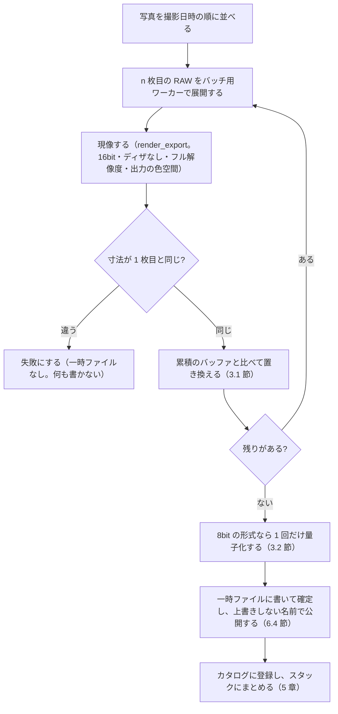

# 比較明・比較暗合成（DEV-34）の設計

2026-10-20 作成・実装（[実装の進め方と進捗](implementation_status.md) の進捗の No.53）。v1 に入れること・方式 A・既定（Adobe RGB・TIFF 16bit・元の写真とスタックにまとめる・上限 999 枚）は **利用者の決定**、ほかは **AI の仮決定（人の確認待ち）** です（決定事項ログ No.175〜178、人の判断の表 No.183〜186）。**Windows の手元でだけ確かめました。macOS・実機の ARW・Photoshop との比較・時間とメモリの計測はしていません。**

## 1. 目的と範囲

花火・星の軌跡・車の光跡などを、三脚で固定して撮った複数の写真から 1 枚にまとめます。Lightroom Classic から Photoshop へ「レイヤーとして開く」で渡し、描画モードを「比較（明）」にして合成するのと同じ結果を、このアプリの中だけで作ることが目的です。

| 範囲に含める | 範囲に含めない（later） |
|---|---|
| 比較明・比較暗（チャンネルごと）と、カラー比較明・カラー比較暗（輝度で比べる） | 位置合わせ（手持ちの撮影）・ゴースト除去 |
| 各写真の現像の設定をかけた後の画像での合成（Lightroom → Photoshop と同じ） | RAW の段階（シーンリニア）での合成と、合成した結果の再現像（2.2 節の方式 B） |
| 結果を 16bit の TIFF などで書き出し、カタログに登録してスタックにまとめる | 写真ごとのマスク（一部の写真の一部だけを使う）・合成の中のレイヤーの操作 |
| 画面（ライブラリの右クリックのメニュー）・コア API・CLI | 合成の結果のプレビュー（合成する前の見本）、合成の元の記録と再合成（7 章） |

HDR 合成・パノラマ合成（DEV-33。later）とは分けます。比較明・比較暗は位置合わせが要らず、画素ごとの比較だけで済むためです。

## 2. 方式

### 2.1 Lightroom → Photoshop の流れとの対応

| Lightroom → Photoshop | このアプリ |
|---|---|
| 各写真に現像の設定をかけた画像を作る（外部編集の既定は 16bit・ProPhoto RGB。**利用者の環境の設定で確認が要る**） | 各写真を、書き出しと同じ経路（`Inner::render_export`）でフル解像度・16bit・ディザなしで現像する |
| レイヤーに重ね、描画モードを「比較（明）」にする | 画素ごと・チャンネルごとに最大値をとる（3 章） |
| 合成の結果を TIFF・PSD で保存し、カタログに戻す | 結果を書き出しと同じ安全な手順でファイルにし（6.4 節）、カタログに登録してスタックにまとめる |

### 2.2 方式の比較

| | **方式 A：現像した後の画像で合成する（採用）** | 方式 B：RAW の段階で合成する |
|---|---|---|
| Lightroom → Photoshop との近さ | 同じ（現像した後の画像を重ねる） | 違う |
| 合成の後の現像 | 結果は RAW 以外の入力（16bit の TIFF）として、ふつうの写真と同じく現像できる（2.6 節の「RAW 以外の入力」） | 合成した結果に、RAW と同じ現像をかけ直せる |
| 作る量 | 少ない。書き出しの経路・安全なファイルの書き込み・取り込みの登録を使い回す | 多い。「合成した仮想の RAW」をカタログ・パイプライン・キャッシュのキー・処理バージョンで扱う仕組みが要る |
| 結果の再現性 | 元の写真の現像の設定を変えたら、合成し直す | 合成の元が変わったときの扱いが難しい |

方式 B は、需要が分かってから later で検討します。

## 3. 合成の計算

### 3.1 比べ方（モード）

入力は、出力の色空間（`OutputColorSpace`。sRGB・Display P3・Adobe RGB）で符号化した 16bit の値です（境界 B4b。[04 の 2.6 節](04_architecture.md)）。`n` 枚目の画素を `c_n = (R, G, B)` とします。

| モード | 計算 | Photoshop の描画モード | 用途 |
|---|---|---|---|
| **比較明（既定）** | `out = (max_n R_n, max_n G_n, max_n B_n)` | 比較（明）（Lighten） | 花火・星の軌跡・光跡。色の違う光が重なると、色が混ざって明るくなる |
| 比較暗 | `out = (min_n R_n, min_n G_n, min_n B_n)` | 比較（暗）（Darken） | 人や車の写り込みを消す（動くものが明るいとき）など |
| カラー比較明 | 輝度 `Y(c_n)` が最大の写真の `c_n` をそのまま採る | カラー比較（明）（Lighter Color） | 重なったところで色を混ぜたくないとき |
| カラー比較暗 | 輝度 `Y(c_n)` が最小の写真の `c_n` をそのまま採る | カラー比較（暗）（Darker Color） | 同上（暗い側） |

- **チャンネルごとの最大・最小は、伝達関数によらない**: 伝達関数（IEC 61966-2-1・ガンマ 563/256）は単調に増えるので、符号化した値で比べても、その色空間のリニアの値で比べても、選ばれる値は同じです。そのため、符号化した 16bit の値のまま比べます（デコードしない）。
- **色空間によって結果は変わる**: 原色が違う色空間では、チャンネルの取り方が違うため、重なったところの色がわずかに変わります。Photoshop は、ドキュメントの色空間（Lightroom から渡すときの既定は ProPhoto RGB）で比べます。このアプリは ProPhoto RGB で書き出せないので、**Photoshop の結果と完全には一致しません**。差が目で見て分かるかは、同じ写真で比べて確かめます（8 章）。
- **輝度の式**（カラー比較明・暗）: 出力の色空間の 16bit の値をリニアに戻し、その色空間の輝度の係数（RGB → XYZ の行列の Y の行）で `Y` を求めます。Photoshop の「カラー比較（明）」の比べ方は **確認していません**。Adobe の説明では「すべてのチャンネルの値の合計で比べる」と AI は記憶していますが、実際の式は違うという話もあり、どちらも未確認です。Photoshop との比較（8.2 節）で差が大きければ、式を見直します。
- **同じ値のとき**: カラー比較明・暗で `Y` が同じ写真が複数あれば、**指定した順で先の写真** を採ります（結果を写真の順に依存させないため、順は撮影日時の順に固定する。4.1 節）。比較明・比較暗は、同じ値ならどれを採っても同じです。
- 比較明・比較暗は、写真の順によりません（最大・最小は順を入れ替えても同じ）。

### 3.2 ディザと量子化（重要）

**現像は 16bit・ディザなし** で行い、合成の後で 1 回だけ量子化します。

- 8bit のディザ（`Dither::DEFAULT_8BIT`。三角分布）をかけた画像を比較明で重ねると、各画素で「プラス側に振れたノイズ」ばかりが選ばれ、**枚数が多いほど暗部が持ち上がって明るく偏ります**（比較暗なら暗く偏る）。
- そのため、現像の設定は形式によらず `ExportFormat::Tiff16` で受け取り（`ExportOptions::dither_16bit` は既定の `Dither::None`）、合成した 16bit の値を、書き出す形式が 8bit（JPEG・PNG 8bit）のときだけ、書き出しの仕上げと同じ `requantize_u16_to_u8`（17b と同じ三角分布のディザ）で 8bit にします。

### 3.3 寸法と向き

- 合成するには、すべての写真の **現像した後の寸法（幅・高さ）が同じ** であることが要ります。違えば合成を始めずに（または、途中で分かった時点で）失敗にし、寸法の違う写真を知らせます。縦横の向き・切り抜き・角度・レンズ補正の歪曲の違いで寸法が変わります。
- 寸法が同じでも、**切り抜き・角度・変形・レンズ補正（幾何）の設定が写真によって違う** と、画素の位置がずれて合成がにじみます。ダイアログで警告します（止めはしない）。比べるのは現像の設定の幾何の項目（`DevelopSettings` の切り抜き・角度・レンズ補正の歪曲）だけです。
- 合成では縮小しません（書き出しの寸法の設定は使わず、常にフル解像度）。縮小した画像が要るときは、合成の結果を書き出します。

### 3.4 現像の設定の違い

各写真は、**その写真の現像の設定** で現像します（Lightroom → Photoshop と同じ）。合成の前に、設定のコピー＆ペースト（DEV-30）や現像プリセット（DEV-29）で設定をそろえるのがふつうです。

- ホワイトバランス・露光量など、幾何以外の設定が写真によって違えば、ダイアログで「現像の設定が違う写真が n 枚あります」と知らせます（止めはしない。わざと変えることもあるため）。比べるのは `DevelopSettings` のうち幾何の項目と外部データ（`render_deps`）を除いた値です（1 枚目と比べる。今の設定のハッシュ（`genzo-model` の `develop/hash.rs`）は全体のハッシュなので、そのままは使えない）。

## 4. 処理の流れ

### 4.1 入力

- 選んだ写真（variant）2〜999 枚（上限は仮置き）。動画は除きます（除いた数を知らせる。動画だけなら何もしない）。同じ variant を 2 回は使いません。仮想コピーは別の写真として扱います（同じ写真の別の現像として重ねられる）。
- 順は撮影日時の順（分からないものは最後、同じなら variant の ID の順）です。
- 見つからない写真（FILE-04）が含まれていれば、合成を始めずに失敗にします。

### 4.2 ジョブ

新しいジョブの種類 `JobKind::Composite`（書き出しと同じ **P3**。6.1 節）で、写真を **1 枚ずつ順に** 処理します（GPU のキューは 1 つで、書き出しと同じく 1 枚ずつ現像する）。



- **累積のバッファ**: 1 枚目の現像の結果（16bit の RGB）をそのまま累積のバッファにし、2 枚目からは各画素を比べて置き換えます。カラー比較明・暗では、累積のバッファの各画素の輝度を別のバッファ（f32、1 画素 4 バイト）に持ち、毎回の計算をなくします。
- **途中の失敗**: どれか 1 枚でも現像に失敗したら、**合成の全体を失敗** にします（部分的な結果は書きません）。花火の 1 枚が黙って抜けた結果を残さないためです。失敗した写真と理由をジョブの結果に入れます。
- **取り消し**: 写真ごと（と、現像のタイルごと。今の書き出しと同じ）に取り消しを確かめます。取り消したら何も書きません。書いている途中なら、一時ファイルを消します（今の `export_image` の手順）。
- **進み具合**: 「n / 全体の枚数」です（最後の書き込みと登録は、全体の枚数に含めない）。

### 4.3 メモリ（SCL-05）

α7 IV（7008 × 4672 = 32,741,376 画素）のとき、16bit の RGB の画像 1 枚は 196,448,256 バイト（約 187 MiB）です。

| 持つもの | 大きさ（α7 IV） |
|---|---|
| 累積のバッファ（16bit の RGB） | 約 187 MiB |
| 現像の結果（`render_export` が返す 16bit の RGB。1 枚ずつ） | 約 187 MiB |
| カラー比較明・暗の輝度のバッファ（f32） | 約 125 MiB（このモードのときだけ） |
| 現像の途中のバッファ（タイルなど） | 今の書き出しと同じ |

- 今の書き出し（1 枚）より増えるのは、累積のバッファ（と輝度のバッファ）の分だけで、**写真の枚数によって増えません**。一括処理の 8GB 以下（SCL-05）に収まる見込みです（計算の上の見込み。実機で計測していない）。
- 比べて置き換える処理は、帯（64 行）ごとに CPU で行います（GPU 版は作らない。画素ごとの比較は軽い）。

### 4.4 時間（参考の見込み）

ほぼ「1 枚の書き出しの時間 × 枚数」です。書き出しの目標（PERF-10）は α7 IV のフル解像度の JPEG で 1 枚 3 秒以内なので、目標を満たしても **30 枚で約 90 秒、300 枚（星の軌跡）で約 15 分** かかる見込みです（**計測していない**。目標から計算した値）。合成の計算そのものは、現像に比べて小さいと見込みます。

## 5. 出力とカタログ

### 5.1 ファイル

| 項目 | 既定（仮置き） | 選べるもの |
|---|---|---|
| 形式 | **TIFF 16bit** | TIFF 16bit・PNG 16bit・PNG 8bit・JPEG（品質） |
| 色空間 | **Adobe RGB (1998)** | sRGB・Display P3・Adobe RGB |
| 保存先 | **合成の元の 1 枚目（撮影日時が最も早い写真）と同じフォルダ** | 任意のフォルダ |
| 名前 | `<1 枚目の元のファイル名>-<モード>-<枚数>.<拡張子>`（例: `DSC01234-lighten-24.tif`。モードは `lighten`・`darken`・`lighter-color`・`darker-color`） | 書き出しのファイル名の規則（EXP-02）は使わない |
| 同じ名前 | **連番を付ける**（上書きしない） | 選べない |

- 既定の色空間を Adobe RGB にするのは、このアプリで書き出せる色空間のうち、Photoshop の既定の ProPhoto RGB に最も近い（広い）ためです。ただし Display P3 と Adobe RGB はどちらかが一方を含むわけではありません（赤は Display P3 が、緑は Adobe RGB が広い）。花火の色で差が出るかは確かめていません。
- 出力シャープ・透かし（EXP-03）は **かけません**。合成の結果は「中間のファイル」で、仕上げはそれを書き出すときにかけます。解像度（ppi）は既定の 72 です。
- 安全性は書き出しと同じです（[04 の 6.4 節](04_architecture.md)の「書き出しの安全性」）。カタログに登録したファイル・合成の入力のファイルは、ファイルの同一性でも照合して **上書きしません**。同じフォルダの一時ファイルに書いて確定してから、上書きしない名前の変更で公開します。

### 5.2 メタデータ

- Exif: **1 枚目の写真** の撮影情報（カメラ・レンズ・ISO・絞り・焦点距離・GPS（設定の `remove_gps` に従う））と、補正した撮影日時を書きます。シャッター速度は 1 枚目の値で、合成した全体の露光の時間ではありません（Exif の範囲の外。Lightroom → Photoshop で保存した TIFF も、ふつうは基準のレイヤーの値になると AI は理解している。**要確認**）。
- XMP: 説明のメタデータ（キャプション・作成者・著作権表示など）は、1 枚目の asset の値を書きます。キーワードは書きません（合成の結果に付けたいキーワードは、登録の後で付ける）。
- 合成の元（写真の一覧・モード）は、ファイルにもカタログにも **記録しません**（7 章の later）。ジョブの結果とログにだけ残します。

### 5.3 カタログへの登録

- 書いたファイルを、取り込み（IMP-01）と同じ手順でカタログに登録します。今の取り込みのコア API はフォルダ単位（`Core::import_folder_with`）なので、**指定したファイルだけを登録する内部の関数** を足します（`import.rs` の `probe_request` → `register_requests` → `after_import` を、走査（`scan`）なしで呼ぶ。メタデータの読み取りはバッチ用ワーカー。SEC-05）。
- 登録した写真は、**合成の元の写真とスタックにまとめ、一番上にします**（既定。ダイアログで外せる）。Lightroom の外部編集の「元の写真とスタック」と同じ考え方です。
  - 合成の元の写真が別々のスタックに入っていれば、今のスタックの規則（3.10 節の「まとめる」）どおり、それらのスタックは 1 つにまとまります。ダイアログで、まとまるスタックの数を知らせます。
  - 作ったスタックは折りたたみます（今の「まとめる」と同じ）。
- 登録に失敗したとき（ファイルは書けた）: ファイルは消さず、ジョブの結果で「書けたが登録できなかった」と知らせ、ファイルの場所を出します（利用者が取り込み直せる）。

## 6. インターフェース

### 6.1 コア API（`genzo-api`。新しいモジュール `composite.rs`）

```rust
/// 合成の比べ方（3.1 節）。
pub enum CompositeMode { Lighten, Darken, LighterColor, DarkerColor }

/// 合成の設定。
pub struct CompositeSettings {
    pub mode: CompositeMode,
    /// 形式（`ExportFormat`）。既定は TIFF 16bit。
    pub format: ExportFormat,
    /// 色空間。既定は Adobe RGB。
    pub color_space: OutputColorSpace,
    /// GPS を書かない（EXP-04 と同じ）。
    pub remove_gps: bool,
    /// 合成の元の写真とスタックにまとめる（既定は true）。
    pub stack_with_sources: bool,
}

impl Core {
    /// 合成する前の確認（写真の数・除いた動画・見つからない写真・寸法の見込み・幾何と現像の設定の違い・
    /// まとまるスタックの数・メモリの見込み）。ジョブにしない（カタログを読むだけ）。
    pub fn composite_check(&self, variant_ids: &[VariantId], settings: &CompositeSettings)
        -> Result<CompositeCheck, ApiError>;

    /// 合成する（P3 のジョブ。ジョブの ID を返す）。結果（`CompositeReport`）は `Core::wait_job`・`Core::job` で取る。
    /// 保存先が `None` なら 1 枚目の写真と同じフォルダ。
    pub fn composite(&self, variant_ids: &[VariantId], settings: &CompositeSettings, dest_dir: Option<&Path>)
        -> Result<u64, ApiError>;
}
```

- `CompositeReport`: 書いたファイルのパス・登録した variant の ID（登録に失敗したら `None` と理由）・使った写真の数・除いた動画の数・現像の警告（写真ごと）・現像に使ったバックエンド（GPU・CPU）・取り消したか。
- コマンド（`Command::CompositeCheck`・`Command::Composite`）とイベントは、書き出しと同じ形にします。
- 合成の計算（3.1 節）は、画素の配列だけを受け取る純粋な関数として `genzo-pipeline` に置きます（`composite.rs`。`fn blend_into(acc: &mut [u16], luma: Option<&mut [f32]>, src: &[u16], mode, space)`）。テストしやすくし、CLI の単体のモード（カタログなし）でも使えるようにするためです。

### 6.2 画面

- ライブラリのグリッドの右クリックのメニューの最後に「比較明合成…」「比較暗合成…」を足します（2 枚以上の写真を選んでいるときだけ使える。メニューに入れ子がないので、2 つの項目にした。`ui/src/library/stackLogic.ts` の `photoMenuEntries`）。カラー比較明・暗は、ダイアログの「詳しい設定」で選びます。
- ダイアログ（`ui/src/dialogs/CompositeDialog.tsx`）:
  - モード（比較明・比較暗・カラー比較明・カラー比較暗。「比較明」と「比較暗」を上に置き、カラーの 2 つは「詳しい設定」の中）。
  - 形式・色空間・保存先・GPS を書かない・元の写真とスタックにまとめる。
  - `composite_check` の結果: 合成する枚数、除いた動画、保存するファイルの名前、メモリの見込み、警告（元の写真の寸法・向きが違う写真（現像した後の寸法が違えば合成できない）・幾何の設定が違う写真・現像の設定が違う写真・まとまるスタック）、合成できない理由。時間の目安は出さない（計測していないため）。
  - 「合成」で始め、ジョブの進み具合は書き出しと同じ場所（ジョブの一覧）に出します。終わったら、合成の結果を選んで表示します。
- ショートカットは割り当てません。

### 6.3 CLI（`genzo-cli`。検証用）

書き出し（`genzo export`）の書式に合わせます（カタログは共通の `--catalog`、形式・色空間は `ExportOpts` と同じ値）。

```text
genzo --catalog <カタログ> composite --mode lighten|darken|lighter-color|darker-color \
  [--format tiff|png16|png8|jpeg] [--quality 90] [--color-space srgb|p3|adobergb] \
  [--out <フォルダ>] [--no-stack] [--remove-gps] <variant の ID>...
```

`--check` で、合成せずに確認の結果（`composite_check`）だけを表示します。設計の段階で考えたカタログなしの `composite-files`（同じ寸法の画像ファイルの合成）は **作っていません**（必要になったら足す）。

## 7. later（今回は作らない）

- **合成の元の記録と再合成**: カタログに「合成の結果 ↔ 元の variant・モード・設定」の表を足し（スキーマの版 13）、元の写真の現像の設定を変えた後に「合成し直す」を出す。需要が分かってから。
- **合成の見本**: L1 のプレビュー（Display P3 の 8bit JPEG。B5）を比較明で重ね、ダイアログに小さな見本を出す（フル解像度の結果とは色・ディザが違うので、見本であることを示す）。
- **写真ごとのマスク・写真の一部だけを使う**、**位置合わせ**（手持ち）、**RAW の段階での合成**（2.2 節の方式 B）、**ProPhoto RGB での比較**（作業色空間を出力として扱う経路が要る）。
- 平均の合成（ノイズ低減・長秒の擬似）。同じ仕組み（累積のバッファ）で作れるが、累積を 32bit にする必要がある。

## 8. テストと確認

### 8.1 自動テスト（この環境で確かめられる）

- `genzo-pipeline` の合成の関数: 比較明・比較暗がチャンネルごとの最大・最小になる、順を入れ替えても同じ、同じ画像を重ねても変わらない、カラー比較明・暗は輝度が最大・最小の画素の RGB をそのまま採る（チャンネルを混ぜない）、同じ輝度のとき先の写真を採る。
- ディザ: 16bit・ディザなしで現像していることを確かめる（同じ写真の仮想コピー 2 枚を比較明で合成し、TIFF 16bit にした結果が、1 枚を同じ設定の TIFF 16bit で書き出した結果と画素の値でビット単位で同じ）。8bit の形式では、量子化が 1 回だけであることを確かめる（同じ組で、PNG 8bit の合成の結果が、TIFF 16bit の合成の結果に `requantize_u16_to_u8` を 1 回かけたものと同じ）。
- 寸法の違う写真で失敗し、何も書かない。取り消しで何も書かない（一時ファイルも残らない）。1 枚の現像の失敗で全体が失敗する。
- 上書きしない: 保存先に同じ名前があれば連番、合成の入力・カタログのファイルを指す名前にはならない。
- 登録とスタック: 結果が登録され、元の写真とスタックになり一番上になる。`stack_with_sources = false` ならスタックにしない。登録の失敗でファイルが残り、理由が返る。
- メモリ: 枚数を増やしても、ピークのメモリが増えない（合成のデータで、10 枚と 50 枚を比べる）。

### 8.2 人の確認（実機・実写）

- **Photoshop との比較**: 同じ花火の ARW（10 枚程度）を、Lightroom Classic →「Photoshop でレイヤーとして開く」→ すべて「比較（明）」→ 16bit TIFF と、このアプリの合成（同じ現像の設定にできないため、Lightroom で現像した TIFF を両方の入力にする比べ方も行う）で比べる。重なった花火の色の違い（ProPhoto RGB と Adobe RGB の差）が目で見て分かるか。
- 星の軌跡（100〜300 枚）での時間とメモリ（Windows の実機と M1 Mac。PERF-10・SCL-05）。
- 暗部の持ち上がりがないこと（3.2 節。空の暗い部分を、1 枚の書き出しと比べる）。

## 9. 決定事項と、人に確認したいこと

| 決定事項ログ | 人の判断の表 | 内容 |
|---|---|---|
| No.175 | No.183 | 機能 DEV-34 を v1 に足す。方式 A（現像した後の画像で合成する）（**利用者の決定**）。モードは 4 つで既定は比較明（チャンネルごと） |
| No.176 | No.184 | 16bit・ディザなしで現像して出力の色空間の値で比べ、8bit の形式は合成の後で 1 回だけ量子化する。寸法が違えば失敗、幾何・現像の設定の違いは警告だけ。1 枚の失敗で全体を失敗にする。上限 999 枚（**利用者の決定**） |
| No.177 | No.185 | 出力の既定: TIFF 16bit・Adobe RGB（**利用者の決定**）・1 枚目と同じフォルダ・`<名前>-<モード>-<枚数>`・連番。仕上げ（出力シャープ・透かし）なし。Exif と説明のメタデータは 1 枚目、キーワードは書かない |
| No.178 | No.186 | 結果をカタログに登録し、元の写真とスタックにまとめて一番上にする（既定。外せる。**利用者の決定**）。合成の元は記録しない（再合成は later） |

**残っている確認**（8.2 節）

1. Photoshop の「比較（明）」の結果との比較（色空間の違い。カラー比較明の式）。
2. 実機（Windows・M1 Mac）での時間とメモリ（PERF-10・SCL-05）。
3. 暗部の持ち上がりがないこと（実写の夜空）。
